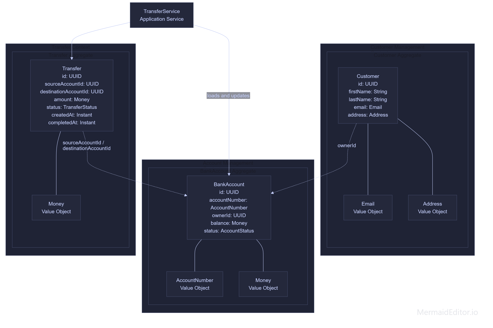

# Domain Driven Design – System bankowy

## 1. Opis zadania

Celem‍‍‍ projektu jest zaprojektowanie fragmentu systemu bankowego w oparciu o zasady Domain-Driven Design (DDD). Zakres prac obejmuje zarządzanie klientami i ich rachunkami, obsługę przelewów pomiędzy kontami oraz mechanizm blokowania rachunków. Do tego dochodzi możliwość przeglądania historii przelewów. Model opiera się na podziale domeny na Bounded Contexts i identyfikacji agregatów, encji oraz Value ‍‍‍Objects.

## 2. Bounded Contexts

W systemie wyróżniono trzy konteksty:

- **Customer Management** – zarządzanie danymi klientów, ich danymi kontaktowymi i adresami.
- **Account Management** – zarządzanie rachunkami bankowymi, saldem oraz blokowaniem i odblokowywaniem kont.
- **Transfers** – obsługa przelewów, kontrola warunków ich realizacji oraz historia operacji.

## 3. Model domenowy

Model obejmuje trzy agregaty: Customer, BankAccount oraz Transfer. Każdy z nich posiada własny Aggregate Root.

## 4. Przyjęte założenia

### Encje i agregaty

| Element | Atrybuty | Odpowiedzialność |
|---|---|---|
| **Customer** | id, firstName, lastName, email, address | Przechowywanie danych klienta. |
| **BankAccount** | id, accountNumber, ownerId, balance, status | Zarządzanie rachunkiem, saldem i jego statusem. |
| **Transfer** | id, sourceAccountId, destinationAccountId, amount, status, createdAt, completedAt | Reprezentowanie przelewu i jego statusu. |

Wszystkie trzy obiekty są Aggregate Roots. Customer, BankAccount i Transfer posiadają własne identyfikatory UUID.

### Value Objects

| Element | Atrybuty | Ograniczenia |
|---|---|---|
| **Money** | amount: BigDecimal | Wartość nieujemna, maksymalnie 2 miejsca po przecinku. |
| **AccountNumber** | value: String | Dokładnie 26 cyfr. |
| **Email** | value: String | Poprawny format adresu e-mail. |
| **Address** | street, city, postalCode, country | Wszystkie pola wymagane. |

Value Objects są niemutowalne. System obsługuje wyłącznie walutę PLN.

### Reguły biznesowe

- Jeden klient może posiadać wiele kont, ale każde konto ma tylko jednego właściciela.
- Konto może mieć status `ACTIVE` lub `BLOCKED`.
- Zablokowane konto nie może wysyłać ani otrzymywać przelewów.
- Saldo konta nie może być ujemne.
- Kwota przelewu musi być większa od zera.
- Konto nadawcy i odbiorcy muszą być różne.
- Przelew może mieć status `PENDING`, `COMPLETED` lub `REJECTED`.
- Historia obejmuje zarówno przelewy zrealizowane, jak i odrzucone.

### Operacje pomiędzy agregatami

Realizację przelewu koordynuje `TransferService` (Application Service). Pobiera on odpowiednie konta, weryfikuje ich status i dostępne środki, a następnie koordynuje obciążenie rachunku nadawcy oraz uznanie rachunku odbiorcy. Operacje te powinny być atomowe, aby zapewnić spójność sald. Historia przelewów jest pobierana na podstawie identyfikatorów kont zapisanych w agregacie Transfer.