TBO - zadanie 1

# Opis zadania

Celem zadania było zamodelowanie fragmentu bezpiecznej aplikacji bankowej. Należało wykorzystać zasady Domain Driven Design.
Utworzony model jest tylko uproszczonym fragmentem.

# Konteksty

*Przelewy* - przyjmowanie zleceń przelewów, kontrola statusu przelewów

*Konto klienta* - zarządzanie kontem i rachunkami klienta, przechowywanie i obsługa danych użytkownika

*Uwierzytelnianie* - weryfikacja tożsamości użytkownika, obsługa logowania, potwierdzanie operacji

# Granice odpowiedzialności

* kontekst Uwierzytelnianie potwierdza tożsamość klienta, nie wykonuje żądań i nie stwierdza czy klient może wykonać przelew
* tylko kontekst Konto klienta trzyma informacje o danych klienta jego rachunkach i saldach
* kontekst Przelewy zajmuje się zarządzaniem cyklem życia jednego zlecenia i nie trzyma informacji np. o saldzie

# Diagram modelu

# Agregaty i encje

## Kontekst Klient

### agregat Klient

| atrybut | typ | opis |
| :--- | :--- | :--- |
| `klientId` | UUID | unikalny identyfikator klienta |
| `imię` | tekst | imię klienta |
| `nazwisko` | tekst | nazwisko klienta |
| `adres` | `Adres` | obiekt opisujący adres zamieszkania |
| `status` | enum | np. `AKTYWNY`, `ZABLOKOWANY`, `ZAMKNIĘTY` |

### agregat KontoBankowe

| atrybut | typ | znaczenie |
| :--- | :--- | :--- |
| `kontoId` | UUID | unikalny identyfikator rachunku |
| `klientId` | UUID | identyfikator właściciela, referencja |
| `numerRachunku` | `NumerRachunku` | numer rachunku w formacie IBAN |
| `saldo` | `Kwota` | saldo księgowe rachunku |
| `status` | enum | np. `AKTYWNE`, `ZABLOKOWANE`, `ZAMKNIĘTE` |
| `wersja` | liczba całkowita | wersja agregatu |

## Kontekst Przelewy

### agregat Przelew

| atrybut | typ | znaczenie |
| :--- | :--- | :--- |
| `przelewId` | UUID | unikalny identyfikator zlecenia przelewu |
| `kontoŹródłoweId` | UUID | identyfikator rachunku, z którego mają zostać pobrane środki |
| `kontoDoceloweId` | UUID | identyfikator rachunku odbiorcy |
| `kwota` | `KwotaPrzelewu` | kwota i waluta przelewu |
| `zleconyPrzez` | UUID | identyfikator uwierzytelnionego użytkownika |
| `status` | enum | stan procesu przelewu |
| `utworzonoAt` | data/czas | data utworzenia w UTC |
| `idempotencyKey` | tekst/UUID | klucz zapobiegający wielokrotnemu wykonaniu tego samego żądania |

## Encja użytkownika

| atrybut | typ | znaczenie |
| :--- | :--- | :--- |
| `userId` | UUID | identyfikator użytkownika systemu |
| `klientId` | UUID | powiązanie tożsamości systemowej z klientem banku |
| `login` | tekst (e-mail) | znormalizowany, unikalny login |
| `hashHasła` | tekst | wynik bezpiecznego haszowania hasła; nigdy hasło jawne |
| `status` | enum | np. `AKTYWNY`, `ZABLOKOWANY` |
| `mfaEnabled` | boolean | informacja, czy włączono uwierzytelnianie wieloskładnikowe |

## Obiekty wartości

| obiekt wartości | atrybuty i format | rguły walidacji |
| :--- | :--- | :--- |
| `Adres` | `ulica`, `numerBudynku`, opcjonalnie `numerLokalu`, `miasto`, `kodPocztowy`, `kraj` | pola tekstowe po usunięciu zbędnych spacji nie mogą być puste, kod kraju zgodny z normą ISO, kod pocztowy jest walidowany według kraju zamiast regexa |
| `NumerRachunku` | IBAN | dla przyjętego zakresu polski IBAN: prefiks `PL` i 26 cyfr (28 znaków),tylko wielkimi literami i bez spacji a przy zapisie sprawdzana suma kontrolna IBAN i usuwanie białych znaków |
| `Kwota` | liczba całkowita w groszach oraz kod waluty `PLN` | nieujemna wartość całkowitoliczbowa |
| `KwotaPrzelewu` | liczba całkowita w groszach oraz kod waluty `PLN` | dodatnia liczba całkowita i kod waluty |    

# Przykładowy przebieg przelewu

1. Użytkownik loguje się przez Uwierzytelnianie. Jeśli dane są poprawne, dostaje token z `userId` i uprawnieniami. W razie potrzeby użytkownik może jeszcze przejść MFA.
2. Aplikacja wysyła do Przelewów prośbę o utworzenie przelewu zawierającą rachunek źródłowy, rachunek docelowy, kwotę i klucz idempotencji.
3. Przelewy sprawdzają dane i tworzą agregat `Przelew`. Natępnie pytają Konto klienta, czy można zarezerwować środki.
4. `KontoBankowe` sprawdza właściciela, status rachunku i dostępne saldo. Może zarezerwować środki pod dany `przelewId` lub odrzucić operację.
5. Jeśli rezerwacja się udałą to Przelewy zlecają zatwierdzenie obciążenia rachunku źródłowego, a potem rachunek docelowy.
6. Gdy oba potwierdzenia przyjdą to przelew dostanie status `ZREALIZOWANY`. Jeśli błąd pojawi się przed zatwierdzeniem obciążenia to rezerwacja będzie zwolniona.
Jeśli obciążenie już zatwierdzono ale uznanie rachunku docelowego się nie udało system próbuje jeszcze raz.
Jeśli nadal się nie da wykonuje kompensację `ZwróćŚrodki` na rachunek źródłowy.
Status `NIEUDANY` ustawia dopiero po potwierdzeniu, że kompensacja się zakończyła.