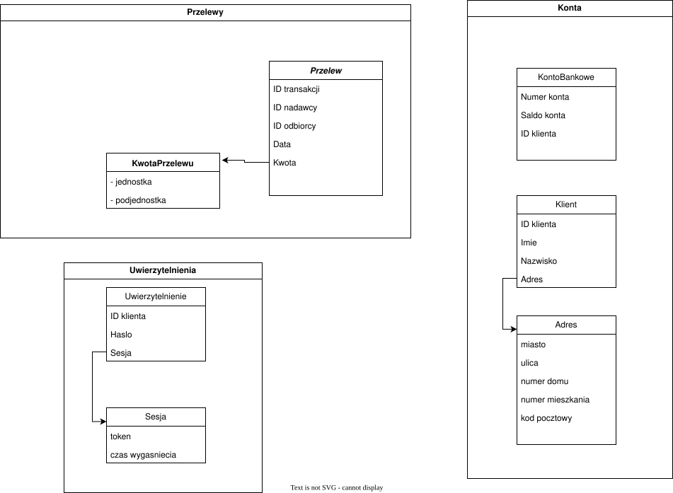

### Opis zadania

Celem zadania jest zamodelowanie bezpiecznej aplikacji bankowej (fragmentu) wykorzystując zasady Domain Driven Design. Trudność zadania leży w integracji między różnymi kontekstami bankowości. Najprostszym rozwiązaniem jest wykorzystanie pewnej zmiennej: ID klienta, jako referencji między kontekstami. Wymaga to jednak zasobów celem sprawdzenia spójności danych np. czy po usunięciu Klienta, wciąż są obecne dane nt. jego przelewów.

### Model

- Autoryzacje. Kontekst uwierzytelniania użytkownika i jego transakcji. Sprawdza dostęp do danych zasobów, informacji. Tworzenie i zarządzanie sesjami.
- Przelewy. Kontekst przelewania pieniędzy. Obejmuje historię przelewów i sprawdzenie możliwości przelewu (np. limit na koncie).
- Konta bankowe. Kontekst tworzenia i przydzielania zasobów użytkownikom. Umożliwia wprowadzanie informacji o użytkownikach.

Na schemacie pominięte zostały integracje między kontekstami, które są opisane poniżej.

### Agregaty, encje, obiekty wartości

| Kontekst        | Agregat/Encje         | Pola/Obiekty Wartości              | Opis/Założenia                                                                 | Integracje                                                                                      |
|-----------------|-----------------------|------------------------------------|-------------------------------------------------------------------------------|-------------------------------------------------------------------------------------------------|
| Przelewy         | Agregat: `Przelew`    | Encja: `Przelew`                   | - `ID transakcji`: unsigned int                                              | - Przelew może być dodany do repozytorium, gdy klient posiada ważny token sesji (`Sesja`).     |
|                 |                       |                                    | - `ID nadawcy`: unsigned int                                                 | - `KwotaPrzelewu` nie może przekroczyć `saldo konta` (`KontoBankowe`).                           |
|                 |                       |                                    | - `ID odbiorcy`: unsigned int                                                |                                                                                                 |
|                 |                       |                                    | - `Data`: Date (lub timestamp)                                               |                                                                                                 |
|                 |                       | Obiekt wartości: `KwotaPrzelewu`   | - `(jednostka, podjednostka)`; sprawdzana jest wartość większa od zera       |                                                                                                 |
|                 |                       |                                    | - Walidacja, czy `ID nadawcy` posiada wystarczające środki na koncie         |                                                                                                 |
| Konta Bankowe    | Agregat: `KontoBankowe`| Encja: `KontoBankowe`              | - `Numer konta`: unsigned int lub numer IBAN                                 | - Historia przelewów uzyskiwana jest przez repozytorium encji `Przelew` z ID nadawcy/odbiorcy.  |
|                 |                       |                                    | - `Saldo konta`: Obiekt wartości (`jednostka, podjednostka`)                 |                                                                                                 |
|                 |                       |                                    | - `ID klienta`: unsigned int                                                |                                                                                                 |
|                 |                       | Encja: `Klient`                    | - `ID klienta`: unsigned int                                  |                                                                                                 |
|                 |                       |                                    | - `Imię`, `Nazwisko`: String                                                |                                                                                                 |
|                 |                       | Obiekt wartości: `Adres`           | - `(miasto, ulica, numer domu, numer mieszkania, kod pocztowy)`             |                                                                                                 |
| Autoryzacje     | Agregat: `Uwierzytelnienie` | Encja: `Uwierzytelnienie`        | - `ID klienta`: unsigned int                                                | - Uwierzytelnienie po `hashu hasła` z przypisaniem `Sesji`.                                     |
|                 |                       |                                    | - `Hash hasła`: hash                                                         |                                                                                                 |
|                 |                       | Obiekt wartości: `Sesja`           | - `Token`: unsigned int, trudny do przechwycenia                              |                                                                                                 |
|                 |                       |                                    | - `Czas_wygasniecia_tokenu`: timestamp                                       |                                                                                                 |

### Integracje:

| Operacja                          | Opis                                                                                              |
|-----------------------------------|---------------------------------------------------------------------------------------------------|
| **Zlecanie przelewów**            | Dodawanie obiektów encji `Przelew` do repozytorium przelewów jest możliwe tylko po udowodnieniu posiadania ważnego ID sesji (`Sesja`). Operacja dostępna jedynie dla uwierzytelnionych użytkowników. |
| **Sprawdzenie środków**           | Przed zleceniem przelewu sprawdzane jest, czy `KwotaPrzelewu` nie jest większa niż `saldo konta` (`KontoBankowe`). Przelew realizowany jest wyłącznie w przypadku dostępności środków na koncie nadawcy. |
| **Historia przelewów**            | Przeszukiwanie bazy danych agregatu `Przelew` po `ID nadawcy` lub `ID odbiorcy` w celu uzyskania historii przelewów. Alternatywnie, encja `KontoBankowe` może przechowywać listę ID transakcji, aby uprościć dostęp do historii. | 

### Opis alternatyw

- **Historia przelewów**: Zamiast przeszukiwania bazy danych agregatu `Przelew`, można przechowywać listę ID transakcji bezpośrednio w encji `KontoBankowe`. Wyszukiwanie po kluczu (zamiast po polach: ID nadawcy, ID odbiorcy) w bazie danych powinno być mniej zasobożerne. Jednak prowadzi do zwiększenia rozmiaru obiektu `KontoBankowe`, co może wpływać na jego zarządzanie.
- Użycie PESELU jako identyfikatora zamiast sztucznego UID.