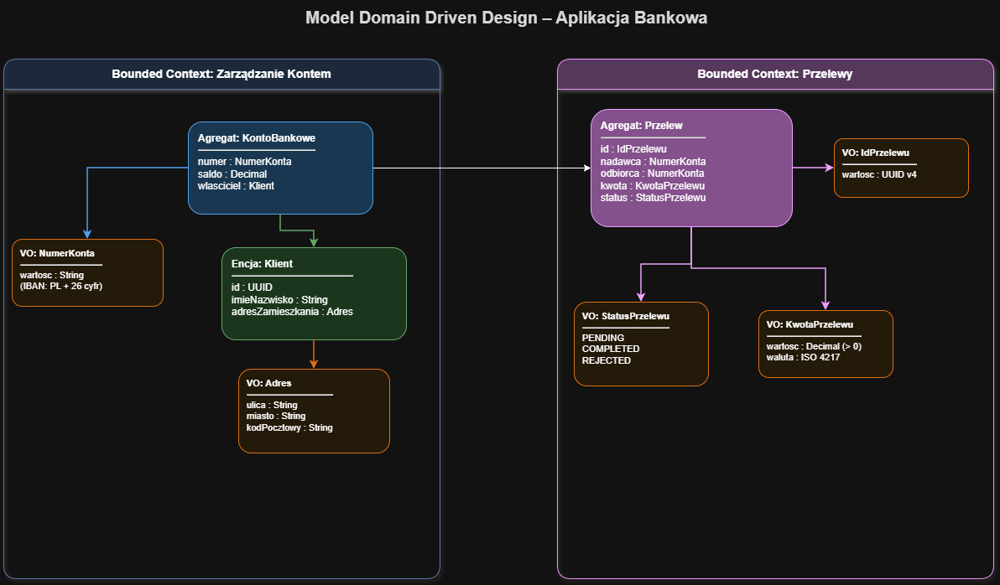

# Model Domain Driven Design - Aplikacja Bankowa

## Opis zadania
Zaprojektowany model przedstawia fragment aplikacji bankowej, wymodelowany zgodnie z zasadami Domain Driven Design. System został podzielony na odseparowane Bounded Contexts (Zarządzanie Kontem oraz Przelewy) i operuje na wybranej grupie encji oraz agregatów. Nacisk w modelu położono na ścisłą walidację obiektów wartości (Value Objects), takich jak kwoty czy numery rachunków, co zapobiega wprowadzeniu systemu w nieprawidłowy stan i zabezpiecza przed tworzeniem niepoprawnych transakcji.

## Bounded Contexts
1. Zarządzanie Kontem: Odpowiada za utrzymanie integralności danych o właścicielu oraz stanu jego salda.
2. Przelewy: Obejmuje logikę weryfikacji i przesyłania środków między rachunkami.

## Model Graficzny
Poniższy schemat przedstawia relacje między agregatami, encjami oraz obiektami wartości w zdefiniowanych kontekstach.

## Zdefiniowane założenia, atrybuty i formaty danych

Poniżej przedstawiono założenia oraz reguły walidacji dla poszczególnych obiektów domenowych, mające na celu zapewnienie bezpieczeństwa i spójności systemu.

### Agregat: KontoBankowe
| Atrybut    | Typ | Założenia i walidacja |
|:-----------| :--- | :--- |
| numer      | NumerKonta | Identyfikator konta, ścisła walidacja pod kątem poprawności formatu (brak znaków specjalnych). |
| saldo      | Decimal | Gwarantuje, że zlecenie przelewu następuje wyłącznie przy saldzie wystarczającym do pokrycia kwoty operacji. Odrzuca transakcje skutkujące niedozwolonym debetem (saldo nie może spaść poniżej zera). |
| wlasciciel | Klient | Powiązanie z uwierzytelnionym w systemie właścicielem rachunku. |

### Agregat: Przelew
| Atrybut  | Typ | Założenia i walidacja                                                                                                                                                  |
|:---------| :--- |:-----------------------------------------------------------------------------------------------------------------------------------------------------------------------|
| id       | IdPrzelewu | Unikalny identyfikator operacji (UUID) chroniący przed enumeracją.                                                                                                     |
| nadawca  | NumerKonta | Rachunek obciążany (wymagana zgodność z identyfikatorem klienta zlecającego).                                                                                          |
| odbiorca | NumerKonta | Rachunek uznawany.                                                                                                                                                     |
| kwota    | KwotaPrzelewu | Weryfikacja wartości dodatniej i dozwolonej waluty.                                                                                                                    |
| status   | StatusPrzelewu | Definiuje dozwolone statusy procesu: **PENDING, COMPLETED, REJECTED**. Uniemożliwia modyfikację parametrów przelewu z poziomu użytkownika w trakcie jego procesowania. |

### Encja: Klient
| Atrybut           | Typ | Założenia i walidacja                                                                            |
|:------------------| :--- |:-------------------------------------------------------------------------------------------------|
| id                | UUID | Identyfikator w postaci 36-znakowego formatu UUID (v4) zapobiegający wyliczaniu identyfikatorów. |
| imieNazwisko      | String | Odrzuca znaki specjalne (np. tagi HTML czy skrypty JS) zapobiegając różnym podatnościom.         |
| adresZamieszkania | Adres | Ścisłe powiązanie z obiektem wartości określającym bezpieczny format danych adresowych.          |

### Obiekt Wartości: NumerKonta
| Atrybut | Typ | Założenia i walidacja                                                                                                                                                    |
|:--------| :--- |:-------------------------------------------------------------------------------------------------------------------------------------------------------------------------|
| wartosc | String | Wymuszony, bezpieczny format IBAN (np. polski rachunek: prefix PL + 26 cyfr). Akceptuje tylko znaki alfanumeryczne, odrzuca wszelkie spacje, myślniki i znaki specjalne. |

### Obiekt Wartości: KwotaPrzelewu
| Atrybut | Typ | Założenia i walidacja                                                                                                                                    |
|:--------| :--- |:---------------------------------------------------------------------------------------------------------------------------------------------------------|
| wartosc | Decimal | Wartość operacji matematycznej musi być ściśle większa od zera (zapobieganie atakom wykorzystującym ujemne kwoty). Maksymalnie dwa miejsca po przecinku. |
| waluta  | String | Waluta w 3-literowym formacie ISO 4217 (np. **PLN, EUR, USD**).                                                                                         |

### Obiekt Wartości: Adres
| Atrybut     | Typ | Założenia i walidacja |
|:------------| :--- | :--- |
| ulica       | String | Restrykcyjny limit długości znaków (np. max 100) przeciwdziałający atakom typu Buffer Overflow. |
| miasto      | String | Limit długości znaków oraz walidacja pod kątem użycia liter, spacji i myślników (np. „Bielsko-Biała”). |
| kodPocztowy | String | Kod pocztowy ustandaryzowany z wyrażeniem regularnym wymuszonym dla danego kraju. |

### Obiekt Wartości: IdPrzelewu
| Atrybut | Typ | Założenia i walidacja |
|:--------| :--- | :--- |
| wartosc | UUID | Identyfikator w formacie UUID v4 (36 znaków). Zapewnia unikalność operacji i chroni przed enumeracją identyfikatorów. |

### Obiekt Wartości: StatusPrzelewu
| Atrybut | Typ | Założenia i walidacja                                                                                                                                                                                                         |
|:--------| :--- |:------------------------------------------------------------------------------------------------------------------------------------------------------------------------------------------------------------------------------|
| wartosc | Enum | Dozwolone wartości: **PENDING, COMPLETED, REJECTED**. Status może być zmieniany wyłącznie przez system (nie przez użytkownika). Po przejściu do **COMPLETED** lub **REJECTED** parametry przelewu stają się niemodyfikowalne. |

## Operacje między kontekstami
- Kontekst **Przelewy** odpytuje kontekst **Zarządzanie Kontem** o aktualne saldo oraz właściciela rachunku nadawcy przed utworzeniem przelewu.
- Po pomyślnym wykonaniu przelewu kontekst **Przelewy** informuje kontekst **Zarządzanie Kontem** o konieczności aktualizacji sald (obciążenie rachunku nadawcy i uznanie rachunku odbiorcy).
- W przypadku braku wystarczających środków lub niezgodności właściciela rachunku przelew otrzymuje status **REJECTED** i nie powoduje zmiany sald.
