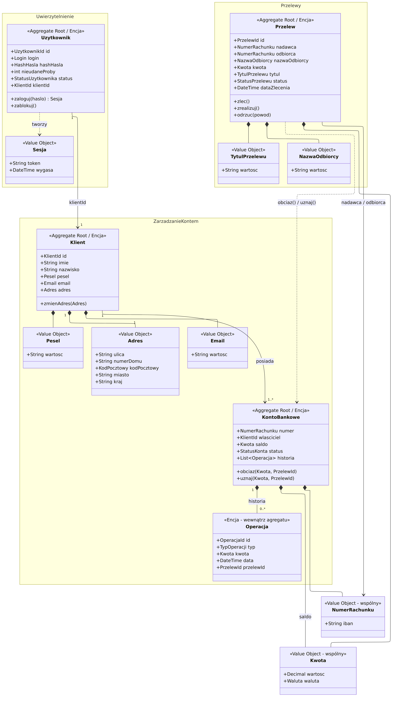

# Zadanie 1 – Domain Driven Design: Przelewy w aplikacji bankowej

## Opis zadania

Celem zadania jest zamodelowanie fragmentu bezpiecznej aplikacji bankowej zgodnie z zasadami Domain Driven Design.
Wybranym fragmentem jest **realizacja przelewu** – od uwierzytelnienia użytkownika, przez obciążenie rachunku nadawcy, aż po uznanie rachunku odbiorcy.
System podzielono na trzy konteksty ograniczone (Uwierzytelnienie, Zarządzanie Kontem, Przelewy), w których zdefiniowano agregaty, encje oraz obiekty wartości.
Dla każdego elementu określono dopuszczalne formaty danych – walidacja odbywa się w momencie tworzenia obiektu (zgodnie z zasadą *Secure by Design*), dzięki czemu niepoprawne lub złośliwe dane (np. skrypty XSS, ujemne kwoty) nie mogą trafić do systemu.

## Model

### Konteksty ograniczone (Bounded Contexts)

| Kontekst | Odpowiedzialność | Agregaty |
|---|---|---|
| **Uwierzytelnienie** | logowanie użytkownika, zarządzanie sesją, blokada konta po nieudanych próbach | `Uzytkownik` |
| **Zarządzanie Kontem** | dane osobowe klienta, rachunki bankowe, saldo | `Klient`, `KontoBankowe` |
| **Przelewy** | zlecanie, walidacja i realizacja przelewów | `Przelew` |

### Agregaty

| Agregat | Korzeń (encja) | Inne encje w agregacie | Obiekty wartości w agregacie |
|---|---|---|---|
| **Uzytkownik** | Uzytkownik | – | Sesja |
| **Klient** | Klient | – | Adres, Pesel, Email |
| **KontoBankowe** | KontoBankowe | Operacja (historia operacji na koncie) | NumerRachunku, Kwota (saldo) |
| **Przelew** | Przelew | – | NumerRachunku (nadawca, odbiorca), Kwota, TytulPrzelewu, NazwaOdbiorcy |

> Z zewnątrz agregatu wolno odwoływać się **wyłącznie do jego korzenia**. Przykład: encja `Operacja` należy do agregatu `KontoBankowe`, ale nie jest jego korzeniem – nie można jej utworzyć ani zmienić bezpośrednio. Powstaje tylko wewnątrz metod `konto.obciaz()` / `konto.uznaj()`, dzięki czemu saldo zawsze zgadza się z historią operacji.

> Agregaty odwołują się do siebie **wyłącznie przez identyfikator** (np. `KontoBankowe` przechowuje `KlientId`, a nie cały obiekt `Klient`). Dzięki temu każdy agregat jest modyfikowany niezależnie i samodzielnie pilnuje swoich reguł. Klient i KontoBankowe są osobnymi agregatami, ponieważ konto ma własne reguły (saldo, status) niezależne od danych osobowych klienta, a operacja na koncie nie powinna blokować całego klienta.

### Encje

| Encja | Identyfikator | Kontekst |
|---|---|---|
| Uzytkownik | UzytkownikId (UUID) | Uwierzytelnienie |
| Klient | KlientId (UUID) | Zarządzanie Kontem |
| KontoBankowe | NumerRachunku (IBAN) | Zarządzanie Kontem |
| Operacja | OperacjaId (UUID) | Zarządzanie Kontem (wewnątrz agregatu KontoBankowe) |
| Przelew | PrzelewId (UUID) | Przelewy |

### Obiekty wartości

| Obiekt wartości | Kontekst |
|---|---|
| Sesja | Uwierzytelnienie |
| Adres, Pesel, Email | Zarządzanie Kontem |
| TytulPrzelewu, NazwaOdbiorcy | Przelewy |
| NumerRachunku, Kwota (z Walutą) | współdzielone: Zarządzanie Kontem, Przelewy |

## Przyjęte założenia

### Ogólne
- Wszystkie obiekty wartości są **niezmienne** (immutable) i **walidowane w konstruktorze** – niepoprawnego obiektu nie da się utworzyć.
- Wszystkie pola tekstowe są przycinane (`trim`) i nie mogą zawierać znaków `< > " ' ;` ani znaków sterujących – chroni to przed XSS i wstrzyknięciami.
- Identyfikatory encji (`UzytkownikId`, `KlientId`, `PrzelewId`, `OperacjaId`) to **UUID v4** generowane przez system (nie przez użytkownika) – zapobiega to zgadywaniu identyfikatorów (IDOR).
- Daty zapisywane są w formacie **ISO 8601, UTC** (np. `2026-11-09T10:15:00Z`).

### Kontekst: Uwierzytelnienie

| Encja / VO | Atrybut | Format / ograniczenie |
|---|---|---|
| Uzytkownik | id | UUID v4 |
| | login | 6–20 znaków, `^[a-zA-Z0-9_]+$`, unikalny |
| | hashHasla | wyłącznie hash (Argon2id / bcrypt); hasło nigdy nie jest przechowywane jawnie |
| | hasło (przy ustawianiu) | min. 12 znaków, co najmniej 1 wielka litera, 1 mała, 1 cyfra, 1 znak specjalny |
| | nieudaneProby | liczba całkowita 0–3; po 3 nieudanych próbach status → `ZABLOKOWANY` |
| | status | `AKTYWNY` / `ZABLOKOWANY` |
| | klientId | UUID istniejącego Klienta |
| Sesja (VO) | token | losowy, min. 128 bitów entropii |
| | wygasa | max. 15 minut od ostatniej aktywności |

### Kontekst: Zarządzanie Kontem

| Encja / VO | Atrybut | Format / ograniczenie |
|---|---|---|
| Klient | id | UUID v4 |
| | imie, nazwisko | 1–50 znaków, `^[A-Za-zĄĆĘŁŃÓŚŹŻąćęłńóśźż \-]+$` |
| Pesel (VO) | wartosc | dokładnie 11 cyfr, poprawna suma kontrolna, poprawna data urodzenia |
| Email (VO) | wartosc | format zgodny z RFC 5322 (uproszczony), max. 254 znaki |
| Adres (VO) | ulica | 1–100 znaków: litery, cyfry, spacja, `. -` |
| | numerDomu | 1–10 znaków, `^[0-9]+[A-Za-z]?(/[0-9]+[A-Za-z]?)?$` (np. `12`, `5A`, `7/14`) |
| | kodPocztowy | `^\d{2}-\d{3}$` (np. `00-950`) |
| | miasto | 1–50 znaków: litery, spacja, `-` |
| | kraj | kod ISO 3166-1 alpha-2 (np. `PL`) |
| KontoBankowe | numer | NumerRachunku (VO) |
| | wlasciciel | KlientId (UUID) |
| | saldo | Kwota ≥ 0 (brak debetu) |
| | status | `AKTYWNE` / `ZABLOKOWANE` |
| | historia | lista Operacji; tylko dopisywanie (operacji nie można edytować ani usuwać) |
| Operacja | id | UUID v4 |
| | typ | `OBCIAZENIE` / `UZNANIE` |
| | kwota | Kwota (VO) > 0, w walucie konta |
| | data | ISO 8601, UTC, nadawana przez system |
| | przelewId | **opcjonalny**; UUID Przelewu, jeśli operacja wynika z przelewu (operacja może mieć też inne źródło, np. wpłatę gotówkową lub opłatę – poza zakresem modelu) |

### Kontekst: Przelewy

| Encja / VO | Atrybut | Format / ograniczenie |
|---|---|---|
| Przelew | id | UUID v4 |
| | nadawca, odbiorca | NumerRachunku (VO); **nadawca ≠ odbiorca** |
| | kwota | Kwota (VO) |
| | status | `ZLECONY` → `ZREALIZOWANY` lub `ODRZUCONY` (zmiana statusu tylko w tym kierunku) |
| | dataZlecenia | ISO 8601, UTC, nadawana przez system |
| TytulPrzelewu (VO) | wartosc | 1–140 znaków, `^[A-Za-z0-9ĄĆĘŁŃÓŚŹŻąćęłńóśźż .,\-/]+$` |
| NazwaOdbiorcy (VO) | wartosc | 1–70 znaków, ten sam zbiór znaków co tytuł |

### Obiekty wartości współdzielone

| VO | Atrybut | Format / ograniczenie |
|---|---|---|
| NumerRachunku | iban | `PL` + 26 cyfr (`^PL\d{26}$`), spacje usuwane przed walidacją, poprawna suma kontrolna mod 97 |
| Kwota | wartosc | liczba dziesiętna > 0 (dla przelewu) lub ≥ 0 (dla salda), max. 2 miejsca po przecinku, max. 1 000 000,00 dla pojedynczego przelewu |
| | waluta | kod ISO 4217: `PLN`, `EUR`, `USD` |

## Operacje i integracja między kontekstami

| # | Operacja | Konteksty | Reguły |
|---|---|---|---|
| 1 | Logowanie | Uwierzytelnienie | poprawny login i hasło → utworzenie Sesji; błąd → `nieudaneProby + 1`; po 3 błędach konto zablokowane |
| 2 | Zlecenie przelewu | Uwierzytelnienie → Przelewy | przelew może zlecić tylko użytkownik z ważną sesją i wyłącznie z rachunku należącego do powiązanego z nim Klienta |
| 3 | Utworzenie przelewu | Przelewy | wszystkie VO walidowane przy tworzeniu; błąd walidacji → przelew nie powstaje |
| 4 | Obciążenie rachunku nadawcy | Przelewy → Zarządzanie Kontem | `KontoBankowe.obciaz(kwota, przelewId)`: konto `AKTYWNE`, waluta zgodna z walutą konta, saldo ≥ kwota; zmniejsza saldo i dopisuje Operację `OBCIAZENIE`; inaczej przelew → `ODRZUCONY` |
| 5 | Uznanie rachunku odbiorcy | Przelewy → Zarządzanie Kontem | po zdarzeniu `PrzelewZrealizowany` wywoływane jest `KontoBankowe.uznaj(kwota, przelewId)` na koncie odbiorcy – zwiększa saldo i dopisuje Operację `UZNANIE` |
| 6 | Zmiana salda | Zarządzanie Kontem | saldo zmieniane **wyłącznie** przez metody agregatu `obciaz()` / `uznaj()` – nigdy bezpośrednio; każda zmiana salda ma odpowiadającą Operację w historii |
| 7 | Zmiana adresu klienta | Zarządzanie Kontem | stary obiekt `Adres` jest zastępowany nowym (VO są niezmienne) |
