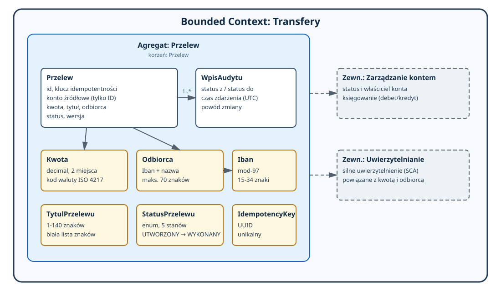

# Model domeny przelewów bankowych

## Krótki opis

Model obejmuje fragment systemu bankowego odpowiedzialny za zlecanie i realizację przelewów. Granicą kontekstu jest cykl życia przelewu: utworzenie, autoryzacja, wykonanie, odrzucenie lub anulowanie oraz audyt zmian. Konta, salda i uwierzytelnianie należą do innych kontekstów i są wskazywane wyłącznie przez identyfikatory. Diagram pokazuje agregat `Przelew`, jego encje, obiekty wartości i integrację z kontekstami zewnętrznymi.

Źródło diagramu (draw.io): [`ddd-transfers-model.drawio`](./ddd-transfers-model.drawio).

## Bounded Context: Transfery

Kontekst udostępnia operacje `Utwórz przelew`, `Autoryzuj`, `Wykonaj`, `Odrzuć` i `Anuluj`. Z kontekstu `Zarządzanie kontem` korzysta przez identyfikator konta (sprawdzenie statusu i właściciela, księgowanie), a z kontekstu `Uwierzytelnianie` przez weryfikację silnego uwierzytelnienia (SCA). Kontekst nie przechowuje sald ani danych logowania.

## Agregaty i encje

| Element | Rodzaj | Odpowiedzialność i najważniejsze reguły |
|---|---|---|
| **Przelew** | agregat, encja korzeniowa | Jedyna granica spójności. Zmiany stanu wyłącznie przez jego metody. Dozwolone przejścia: `UTWORZONY → ZAUTORYZOWANY → WYKONANY`, `UTWORZONY/ZAUTORYZOWANY → ODRZUCONY`, `UTWORZONY → ANULOWANY`. Stany końcowe: `WYKONANY`, `ODRZUCONY`, `ANULOWANY`. |
| **WpisAudytu** | encja wewnątrz agregatu `Przelew` | Niemodyfikowalny zapis każdej zmiany statusu (status z/do, czas UTC, powód). Nigdy nie jest edytowany ani usuwany. |

## Obiekty wartości i założenia

| Obiekt wartości | Format i ograniczenia |
|---|---|
| `Kwota` | `decimal` z dokładnością do 2 miejsc, większa od 0, maks. 1 000 000,00; waluta ISO 4217 zgodna z walutą konta źródłowego; zakaz typów zmiennoprzecinkowych. |
| `Iban` | Wielkie litery, bez spacji, 15–34 znaki, wzorzec `^[A-Z]{2}[0-9]{2}[A-Z0-9]{11,30}$`, poprawna suma kontrolna mod-97; różny od konta źródłowego. |
| `Odbiorca` | `Iban` + nazwa 1–70 znaków; dozwolone litery, cyfry, spacje i `.,-'/`; znaki `< > " & ;` są odrzucane. |
| `TytulPrzelewu` | 1–140 znaków, ta sama biała lista znaków co nazwa odbiorcy; walidacja przy tworzeniu obiektu w backendzie (ochrona przed XSS). |
| `StatusPrzelewu` | Wyliczenie: `UTWORZONY`, `ZAUTORYZOWANY`, `WYKONANY`, `ODRZUCONY`, `ANULOWANY`. |
| `IdempotencyKey` | UUID, wymagany, unikalny dla klienta; powtórzony klucz zwraca istniejący przelew zamiast tworzyć duplikat. |

Przyjęto, że identyfikator przelewu (UUID v4) i czasy (UTC) generuje wyłącznie serwer, a właściciel konta źródłowego wynika z sesji, nie z danych żądania. Kwoty i odbiorcy nie można zmienić po utworzeniu, zamiast tego tworzy się nowy przelew. Przelew powyżej progu (np. 1 000,00) wymaga poprawnego SCA powiązanego z kwotą i odbiorcą przed `Autoryzuj`. Wykonanie wymaga statusu `ZAUTORYZOWANY`, wystarczających środków i niewyczerpanego limitu dziennego (sprawdzanych w kontekście `Zarządzanie kontem`). Zdarzenia `PrzelewWykonany` i `PrzelewOdrzucony` mogą być publikowane do innych kontekstów, ale niosą wyłącznie identyfikatory, bez numerów kont i danych osobowych.