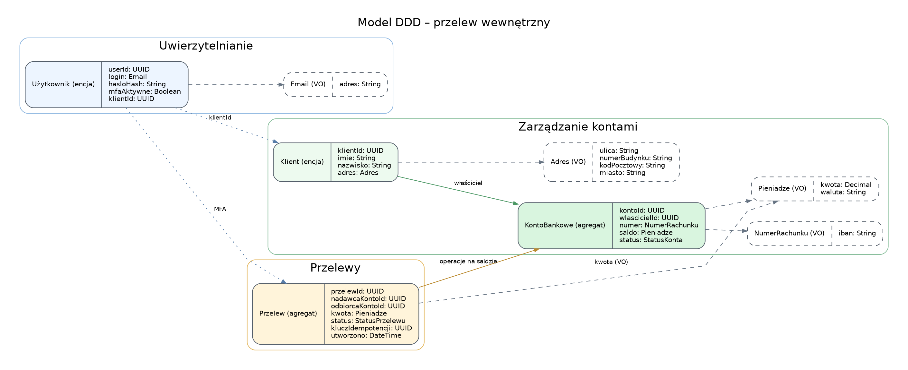

# Model DDD – przelewy w aplikacji bankowej

## Opis zadania

Celem zadania jest przygotowanie uproszczonego modelu aplikacji bankowej z wykorzystaniem Domain Driven Design. Wybrany fragment systemu dotyczy przelewów między rachunkami w tym samym banku. Model został podzielony na trzy Bounded Contexts: uwierzytelnianie, zarządzanie kontami i przelewy. Uwzględniono najważniejsze encje, obiekty wartości oraz podstawowe ograniczenia związane z realizacją przelewu.

## Diagram

Na diagramie pokazano 4 encje i 4 obiekty wartości (VO). KontoBankowe i Przelew są korzeniami osobnych agregatów. Strzałki pomiędzy kontekstami oznaczają współpracę, a nie bezpośrednią możliwość zmiany danych innego kontekstu.

## 1. Bounded Contexts

| Kontekst | Odpowiedzialność |
|---|---|
| Uwierzytelnianie | Logowanie użytkownika i potwierdzanie operacji za pomocą MFA. |
| Zarządzanie kontami | Przechowywanie danych klientów i rachunków oraz kontrolowanie ich salda. |
| Przelewy | Tworzenie zleceń, sprawdzanie ich statusu i zlecanie przesunięcia środków między rachunkami. |

## 2. Encje, agregaty i Value Objects

| Element | Rodzaj | Najważniejsze atrybuty |
|---|---|---|
| Użytkownik | Encja | userId (UUID), login (Email), hasloHash (String), mfaAktywne (Boolean), klientId (UUID) |
| Klient | Encja | klientId (UUID), imie (String), nazwisko (String), adres (Adres) |
| KontoBankowe | Encja, korzeń agregatu | kontoId (UUID), wlascicielId (UUID), numer (NumerRachunku), saldo (Pieniadze), status (StatusKonta) |
| Przelew | Encja, korzeń agregatu | przelewId (UUID), nadawcaKontoId (UUID), odbiorcaKontoId (UUID), kwota (Pieniadze), status (StatusPrzelewu), kluczIdempotencji (UUID), utworzono (DateTime) |
| Email | VO | adres (String) |
| Adres | VO | ulica (String), numerBudynku (String), kodPocztowy (String), miasto (String) |
| NumerRachunku | VO | iban (String) |
| Pieniadze | VO | kwota (Decimal), waluta (String) |

W agregacie KontoBankowe kontrolowana jest zmiana salda, np. przez operacje obciaz() i uznaj(). Agregat Przelew odpowiada za status zlecenia, np. UTWORZONY, AUTORYZOWANY, ZREALIZOWANY lub ODRZUCONY.

## 3. Przyjęte założenia

| Obszar | Założenie |
|---|---|
| Zakres | Przelewy tylko w PLN, między dwoma różnymi rachunkami tego samego banku. |
| Dane klienta | Imię i nazwisko nie mogą być puste. Kod pocztowy ma format 00-000, a e-mail musi mieć poprawną składnię. |
| Numer rachunku | Polski IBAN: PL i 26 cyfr, z poprawną sumą kontrolną. |
| Kwota i saldo | Kwota przelewu musi być większa od zera i mieć maksymalnie dwa miejsca po przecinku. Do kwot używany jest typ Decimal. Saldo nie może stać się ujemne. |
| Dostęp | Przelew może zlecić tylko zalogowany użytkownik z własnego, aktywnego rachunku. Operacja wymaga potwierdzenia MFA. |
| Realizacja | Oba rachunki muszą być aktywne. Pobranie i dodanie pieniędzy odbywa się w jednej transakcji, żeby nie doszło do częściowego wykonania przelewu. |
| Ponowienie żądania | Klucz idempotencji zapobiega dwukrotnemu wykonaniu tego samego zlecenia. |

### Przykładowy przebieg przelewu

1. Użytkownik loguje się w kontekście Uwierzytelnianie.
2. W kontekście Przelewy tworzone jest zlecenie z kwotą i identyfikatorami rachunków.
3. Użytkownik zatwierdza operację przez MFA.
4. Kontekst Zarządzanie kontami sprawdza stan obu rachunków i dostępne środki, a następnie aktualizuje salda.
5. Przelew otrzymuje status ZREALIZOWANY. W przypadku błędu operacja jest wycofywana, a przelew zostaje odrzucony.

Przyjęto, że konteksty komunikują się przez udostępnione operacje i identyfikatory obiektów. Pominięto przelewy zagraniczne, przewalutowania, opłaty oraz inne funkcje bankowości niezwiązane z wybranym fragmentem.
