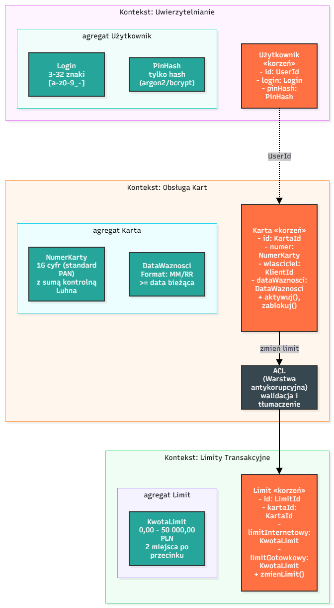

# Zadanie 1 - Domain Driven Design: Zarządzanie Kartami Płatniczymi

Niniejszy projekt przedstawia fragment bezpiecznego systemu bankowego odpowiedzialny za Domain-Driven Design modułu zarządzania kartami płatniczymi. Model skupia się na trzech powiązanych kontekstach ograniczonych: uwierzytelnianiu użytkownika, obsłudze kart oraz zarządzaniu limitami transakcyjnymi. Głównym celem jest wyznaczenie wyraźnych granic agregatów oraz zdefiniowanie obiektów wartości dbających o integralność danych finansowych i bezpieczeństwo operacji kartowych.

## Model domeny

## Przyjęte założenia i ograniczenia modelu

| Element modelu | Typ | Opis / Format danych / Ograniczenia | Operacje / Integracja |
| :--- | :--- | :--- | :--- |
| **Użytkownik** | Encja (Korzeń agregatu) | Reprezentuje tożsamość systemową klienta posiadającego karty. | Służy do uwierzytelniania w sesji bankowej. |
| **Login** | Obiekt Wartości | Ciąg znaków o długości 3-32 znaków, dozwolone małe litery, cyfry, podkreślenie i myślnik. | Walidacja unikalności w kontekście uwierzytelniania. |
| **PinHash** | Obiekt Wartości | Bezpieczny skrót kryptograficzny kodu PIN (np. Argon2). | Weryfikacja autoryzacji transakcji stacjonarnych. |
| **Karta** | Encja (Korzeń agregatu) | Główny obiekt biznesowy reprezentujący kartę płatniczą (debetową lub kredytową). | Umożliwia aktywację, zmianę statusu (zablokowana/aktywna) oraz inicjację transakcji. |
| **NumerKarty** | Obiekt Wartości | 16-cyfrowy numer karty w standardzie PAN, walidowany algorytmem Luhna. | Zapewnia poprawność formatu numeru rachunku karty. |
| **DataWażności** | Obiekt Wartości | Format `MM/RR`. Wartość musi wskazywać na datę późniejszą niż bieżący miesiąc. | Blokuje możliwość użycia przeterminowanych kart. |
| **Limit** | Encja (Korzeń agregatu) | Określa maksymalne dozwolone kwoty wydatków dla danej karty w podziale na kanały (internetowy, gotówkowy). | Pozwala na modyfikację dziennych/miesięcznych limitów bezpieczeństwa. |
| **KwotaLimit** | Obiekt Wartości | Wartość numeryczna z przedziału `0,00 – 50 000,00 PLN` z dokładnością do 2 miejsc po przecinku. | Kontroluje poprawność wprowadzanych progów finansowych. |
| **ACL (Anticorruption Layer)** | Warstwa integracyjna | Tłumaczy komunikaty pomiędzy kontekstem *Obsługi Kart* a *Limitów Transakcyjnych*. | Bezpieczne przekazywanie żądań zmiany limitów bez zrastania się modeli domenowych. |