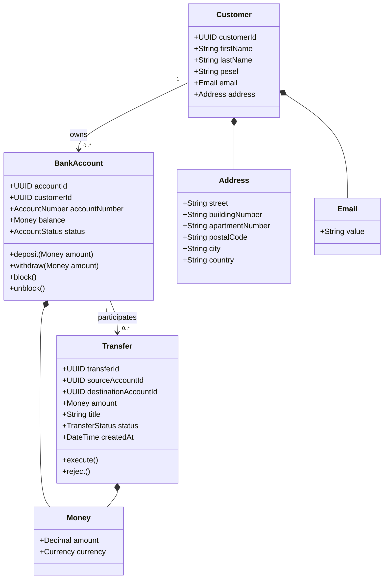

# Zadanie 1 – Domain Driven Design

## 1. Opis zadania

Celem zadania jest zaprojektowanie fragmentu bezpiecznej aplikacji bankowej z wykorzystaniem zasad Domain Driven Design (DDD). System umożliwia zarządzanie klientami i ich rachunkami bankowymi oraz wykonywanie przelewów pomiędzy rachunkami. Projekt został podzielony na Bounded Contexts, aby oddzielić odpowiedzialności poszczególnych części systemu. Model uwzględnia agregaty, encje i obiekty wartości (Value Objects), a także podstawowe reguły biznesowe i założenia dotyczące bezpieczeństwa.

## 2. Bounded Contexts

W systemie wyróżniono trzy główne konteksty:

### 2.1. Customer Management (Zarządzanie klientami)

Odpowiada za przechowywanie i zarządzanie danymi klientów banku.

Główne odpowiedzialności:
- Rejestracja nowych klientów.
- Przechowywanie danych osobowych.
- Zarządzanie adresem klienta.
- Udostępnianie identyfikatora klienta innym kontekstom.

### 2.2. Account Management (Zarządzanie rachunkami)

Odpowiada za obsługę rachunków bankowych klientów.

Główne odpowiedzialności:
- Tworzenie rachunków bankowych.
- Sprawdzanie salda rachunku.
- Blokowanie i odblokowywanie rachunków.
- Aktualizowanie salda w wyniku operacji bankowych.
- Kontrolowanie, czy rachunek może realizować transakcje.

### 2.3. Transfers (Przelewy)

Odpowiada za realizację przelewów pomiędzy rachunkami bankowymi.

Główne odpowiedzialności:
- Przyjmowanie zleceń przelewów.
- Weryfikacja poprawności danych przelewu.
- Sprawdzanie dostępności środków.
- Realizacja lub odrzucanie przelewów.
- Przechowywanie historii operacji i statusów przelewów.

## 3. Model domenowy

Poniższy diagram przedstawia zależności pomiędzy kontekstami, agregatami, encjami oraz obiektami wartości.

### 3.1. Encje (Entities)

**Customer (Klient)**

Reprezentuje osobę korzystającą z usług banku.

Atrybuty:
- `customerId` – unikalny identyfikator klienta (UUID).
- `firstName` – imię klienta.
- `lastName` – nazwisko klienta.
- `pesel` – numer PESEL.
- `email` – adres e-mail (Value Object).
- `address` – adres zamieszkania (Value Object).

**BankAccount (KontoBankowe)** – agregat

Reprezentuje rachunek bankowy klienta. Jest korzeniem agregatu odpowiedzialnym za kontrolowanie operacji na rachunku.

Atrybuty:
- `accountId` – unikalny identyfikator rachunku (UUID).
- `customerId` – identyfikator właściciela rachunku.
- `accountNumber` – numer rachunku bankowego (NRB).
- `balance` – aktualne saldo (Money).
- `status` – status rachunku (ACTIVE, BLOCKED, CLOSED).

Operacje:
- `deposit(amount)` – wpłata środków.
- `withdraw(amount)` – wypłata środków.
- `block()` – zablokowanie rachunku.
- `unblock()` – odblokowanie rachunku.

**Transfer (Przelew)** – agregat

Reprezentuje zlecenie przelewu pomiędzy dwoma rachunkami bankowymi.

Atrybuty:
- `transferId` – unikalny identyfikator przelewu (UUID).
- `sourceAccountId` – identyfikator rachunku nadawcy.
- `destinationAccountId` – identyfikator rachunku odbiorcy.
- `amount` – kwota przelewu (Money).
- `title` – tytuł przelewu.
- `status` – status przelewu (PENDING, COMPLETED, REJECTED).
- `createdAt` – data i godzina utworzenia przelewu.

Operacje:
- `execute()` – realizacja przelewu.
- `reject()` – odrzucenie przelewu.

## 4. Obiekty wartości (Value Objects)

Obiekty wartości nie posiadają własnej tożsamości. Są identyfikowane na podstawie przechowywanych wartości i powinny być niezmienne (immutable).

### 4.1. Address (Adres)

Przechowuje dane adresowe klienta.

Atrybuty:
- `street` – nazwa ulicy.
- `buildingNumber` – numer budynku.
- `apartmentNumber` – numer mieszkania (opcjonalny).
- `postalCode` – kod pocztowy.
- `city` – miejscowość.
- `country` – kraj.

### 4.2. Money (Kwota)

Reprezentuje wartość pieniężną.

Atrybuty:
- `amount` – kwota wyrażona jako liczba dziesiętna.
- `currency` – waluta (np. PLN, EUR, USD).

### 4.3. Email (AdresEmail)

Przechowuje adres poczty elektronicznej klienta.

Atrybut:
- `value` – poprawny adres e-mail.

### 4.4. AccountNumber (NumerRachunku)

Reprezentuje numer rachunku bankowego.

Atrybut:
- `value` – numer rachunku w formacie NRB (26 cyfr).

## 5. Przyjęte założenia i ograniczenia

| Element | Atrybut / operacja | Założenia i ograniczenia |
|---|---|---|
| Customer | customerId | UUID, unikalny identyfikator klienta. |
| Customer | firstName | Wymagane, od 2 do 50 znaków. |
| Customer | lastName | Wymagane, od 2 do 100 znaków. |
| Customer | pesel | Dokładnie 11 cyfr, poprawna suma kontrolna. |
| Customer | email | Poprawny format adresu e-mail, unikalny w systemie. |
| Address | street | Wymagana nazwa ulicy. |
| Address | buildingNumber | Wymagany numer budynku. |
| Address | apartmentNumber | Opcjonalny numer mieszkania. |
| Address | postalCode | Format XX-XXX. |
| Address | city | Wymagana miejscowość. |
| Address | country | Kod kraju ISO 3166-1 alpha-2. |
| BankAccount | accountId | UUID, unikalny identyfikator rachunku. |
| BankAccount | accountNumber | 26 cyfr, poprawny numer NRB z sumą kontrolną. |
| BankAccount | customerId | Musi wskazywać istniejącego klienta. |
| BankAccount | balance | Kwota nie może być ujemna dla przyjętego modelu rachunku. |
| BankAccount | status | ACTIVE, BLOCKED lub CLOSED. |
| BankAccount | withdraw() | Możliwe tylko przy aktywnym rachunku i wystarczających środkach. |
| BankAccount | deposit() | Możliwe tylko przy aktywnym rachunku i poprawnej kwocie. |
| Money | amount | Liczba dziesiętna, maksymalnie 2 miejsca po przecinku dla obsługiwanych walut. |
| Money | currency | Kod waluty ISO 4217, np. PLN, EUR, USD. |
| Transfer | transferId | UUID, unikalny identyfikator przelewu. |
| Transfer | sourceAccountId | Identyfikator rachunku nadawcy. |
| Transfer | destinationAccountId | Identyfikator rachunku odbiorcy. |
| Transfer | amount | Kwota większa od zera. |
| Transfer | title | Od 1 do 140 znaków. |
| Transfer | status | PENDING, COMPLETED lub REJECTED. |
| Transfer | createdAt | Data i czas w formacie ISO 8601. |

## 6. Reguły biznesowe

W systemie przyjęto następujące reguły biznesowe:

1. Każdy klient posiada unikalny identyfikator.
2. Klient może posiadać wiele rachunków bankowych.
3. Każdy rachunek bankowy należy do jednego klienta.
4. Rachunek musi mieć unikalny i poprawny numer NRB.
5. Przelew musi posiadać rachunek źródłowy i docelowy.
6. Nie można wykonać przelewu na ten sam rachunek.
7. Kwota przelewu musi być większa od zera.
8. Waluta rachunku źródłowego i docelowego musi być taka sama. Wymiana walut nie jest obsługiwana w tym modelu.
9. Przelew może zostać wykonany tylko wtedy, gdy rachunek nadawcy i odbiorcy są aktywne.
10. Nadawca musi posiadać wystarczające środki na rachunku.
11. Przelew o statusie COMPLETED nie może zostać wykonany ponownie.
12. Każda operacja finansowa musi zostać zarejestrowana w historii operacji.

## 7. Integracja pomiędzy Bounded Contexts

Poszczególne konteksty komunikują się ze sobą za pomocą identyfikatorów oraz zdarzeń domenowych.

**Customer Management > Account Management**

- Po utworzeniu klienta udostępniane jest zdarzenie `CustomerCreated`.
- Account Management może na podstawie `customerId` utworzyć rachunek klienta.
- Dane klienta nie są bezpośrednio modyfikowane przez Account Management.

**Account Management > Transfers**

- Transfers pobiera informacje o rachunkach na podstawie `accountId`.
- Przed wykonaniem przelewu sprawdzany jest status rachunku oraz dostępność środków.
- Operacje obciążenia i uznania rachunków są realizowane przez Account Management.

**Transfers > Account Management**

- Po poprawnej walidacji przelewu wysyłane jest żądanie realizacji operacji finansowej.
- Account Management odpowiada za zmianę salda rachunków.
- Po poprawnej realizacji operacji przelew otrzymuje status COMPLETED.
- W przypadku błędu przelew otrzymuje status REJECTED.

Komunikacja między kontekstami może odbywać się synchronicznie za pomocą API lub asynchronicznie z wykorzystaniem komunikatów i zdarzeń domenowych.

## 8. Bezpieczeństwo i spójność danych

Ze względu na bankowy charakter aplikacji przyjęto następujące założenia dotyczące bezpieczeństwa:

- Wszystkie operacje wymagają odpowiedniego uwierzytelnienia i autoryzacji użytkownika.
- Dane osobowe klientów powinny być odpowiednio chronione i szyfrowane.
- Komunikacja pomiędzy kontekstami powinna odbywać się za pomocą bezpiecznego połączenia HTTPS/TLS.
- Operacje finansowe muszą być wykonywane w sposób atomowy.
- Należy zapobiegać wielokrotnemu wykonaniu tego samego przelewu, np. poprzez zastosowanie kluczy idempotencji.
- Wszystkie operacje finansowe powinny być rejestrowane w audytowalnym dzienniku.
- Dostęp do rachunku powinien być ograniczony do uprawnionych użytkowników.
- Przy równoczesnych operacjach należy zapewnić kontrolę współbieżności, aby uniknąć nieprawidłowego salda.

## 9. Podsumowanie

Zaprojektowany model przedstawia uproszczony fragment systemu bankowego zgodny z zasadami Domain Driven Design. Podział na trzy Bounded Contexts pozwala oddzielić zarządzanie klientami, rachunkami bankowymi oraz przelewami. Zastosowanie agregatów BankAccount i Transfer umożliwia kontrolowanie reguł biznesowych oraz zachowanie spójności danych. Obiekty wartości, takie jak Money, Address, Email i AccountNumber, pozwalają jednoznacznie definiować i walidować dane wykorzystywane w systemie.

Model jest celowo uproszczony i nie obejmuje wszystkich funkcjonalności rzeczywistego systemu bankowego.
