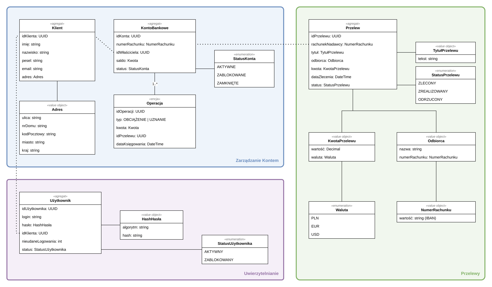

# Zadanie 1: zarządzanie kartami płatniczymi

Model obejmuje obsługę karty do rachunku osobistego w bankowości internetowej. Klient może zmienić limity karty, czasowo ją zablokować i zastrzec po utracie. Wydzielono konteksty Klienci, Rachunki i Karty, z osobnymi modelami i odpowiedzialnościami. Zakres nie obejmuje rozliczania płatności, kredytów ani przechowywania pełnego numeru karty, kodu CVV i PIN.

## Diagram

## Przyjęte założenia

| Element | Atrybuty i reguły |
| --- | --- |
| **Klienci**, Bounded Context | Odpowiada za dane właściciela i jego status. Agregat `Klient`: `klientId`, imię, nazwisko, status. Identyfikator UUID nadaje serwer. Imię i nazwisko: od 1 do 100 znaków Unicode, bez HTML i znaków sterujących. Status: `AKTYWNY` lub `ZABLOKOWANY`. |
| **Rachunki**, Bounded Context | Odpowiada za własność i stan rachunku. Agregat `Rachunek`: `rachunekId`, `wlascicielId`, `numerRachunku`, waluta, status. Rachunek ma jednego właściciela i walutę PLN. Status: `AKTYWNY`, `ZABLOKOWANY` lub `ZAMKNIETY`. |
| **Karty**, Bounded Context | Odpowiada za cykl życia i limity karty. Agregat `Karta`: `kartaId`, `klientId`, `rachunekId`, token, ostatnie cyfry, ważność, limity, status i wersja. Odwołuje się do innych agregatów przez identyfikatory, bez przechowywania ich obiektów. |
| **Encje i korzenie agregatów** | Encjami są `Klient`, `Rachunek` i `Karta`. Każda jest korzeniem osobnego agregatu. Karta pilnuje dopuszczalnych zmian przez operacje `zmienLimity`, `zablokuj`, `odblokuj` i `zastrzez`; nie udostępnia dowolnego ustawiania statusu. |
| **NumerRachunku**, Value Object | Polski NRB: dokładnie 26 cyfr i poprawna suma kontrolna. W bazie zapis bez spacji. Poprawny format nie zastępuje sprawdzenia istnienia rachunku. |
| **LimityKarty**, Value Object | Dzienne limity płatności i wypłat z bankomatu, każdy od 0,00 do 20 000,00 PLN. Typ `Decimal`, maksymalnie dwa miejsca po przecinku. Zero wyłącza dany rodzaj operacji. Granica 20 000,00 jest założeniem tego modelu. |
| **WaznoscKarty**, Value Object | Miesiąc od 1 do 12 i czterocyfrowy rok. Karta jest ważna do końca wskazanego miesiąca. Wygasłej karty nie można odblokować. |
| **TokenKarty i OstatnieCyfry**, Value Objects | Token pochodzi z potwierdzonej odpowiedzi zaufanego systemu kartowego. Nie jest dowolną wartością z formularza klienta. Do prezentacji używane są wyłącznie cztery ostatnie cyfry numeru. Token nie zastępuje uprawnienia do wykonania operacji. |
| **Status karty** | `AKTYWNA`, `CZASOWO_ZABLOKOWANA`, `ZASTRZEZONA`, `WYGASLA`. Blokadę czasową można cofnąć po sprawdzeniu warunków. Zastrzeżenie jest nieodwracalne i wymaga wydania nowej karty, jeśli klient chce dalej z niej korzystać. |

Value Objects nie mają własnej tożsamości. Przykładowo dwa obiekty `LimityKarty` o identycznych limitach są równe, natomiast dwie karty z takimi samymi limitami pozostają różnymi encjami.

## Operacje i integracja kontekstów

1. **Wydanie karty:** kontekst Karty sprawdza w Rachunkach, czy rachunek istnieje, jest aktywny i należy do klienta. Kontekst Klienci potwierdza aktywność właściciela. Token i ważność pochodzą z systemu kartowego.
2. **Zmiana limitów:** serwer ustala klienta z uwierzytelnionej sesji i sprawdza własność karty. Wymagane jest dodatkowe potwierdzenie związane z konkretną kartą i nowymi limitami. Wartości są sprawdzane w backendzie przed zmianą agregatu.
3. **Blokada i zastrzeżenie:** klient wykonuje operację tylko dla swojej karty. Powtórne zastrzeżenie zwraca bieżący stan bez ponownego skutku. Nie istnieje przejście z `ZASTRZEZONA` do `AKTYWNA`.
4. **Odblokowanie:** jest dozwolone tylko dla karty czasowo zablokowanej, niewygasłej, przypisanej do aktywnego klienta i aktywnego rachunku.
5. **Integracja:** konteksty wymieniają identyfikatory i zdarzenia, np. `RachunekZamkniety` i `KartaZastrzezona`. Każdy agregat jest zapisywany we własnej transakcji. Po zamknięciu rachunku Karty trwale blokują jego karty; do czasu obsłużenia zdarzenia operacje wymagające aktywnego rachunku dodatkowo sprawdzają jego aktualny stan.
6. **Równoczesne zmiany:** pole `wersja` pozwala wykryć konflikt. Spóźniona zmiana limitu nie może nadpisać zastrzeżenia karty. Dane wejściowe są walidowane po stronie serwera, a tekst w panelu jest wyświetlany z kodowaniem HTML.
