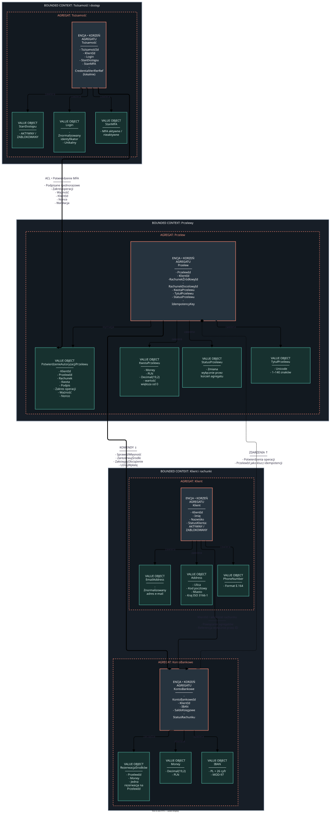

# Zadanie 1 - Domain-Driven Design

## Opis

Celem zadania jest zamodelowanie fragmentu bezpiecznej aplikacji bankowej z wykorzystaniem zasad Domain-Driven Design. Model obejmuje obsługę przelewów wewnętrznych pomiędzy rachunkami prowadzonymi w PLN. Wydzielono trzy konteksty ograniczone: Tożsamość i dostęp, Klient i rachunki oraz Przelewy. Najważniejsze reguły, takie jak autoryzacja operacji, dostępność środków i poprawna kolejność realizacji przelewu, są pilnowane przez model domenowy.

## Diagram modelu

## Przyjęte założenia

| Element | Atrybuty i ograniczenia |
|---|---|
| **Tożsamość i dostęp** - kontekst | Odpowiada za logowanie, MFA i blokowanie dostępu.  Agregat **Tożsamość**: `TożsamośćId`, `KlientId`, `Login`, `StanDostępu`, `StanMFA`. Login jest unikalny, a stan dostępu przyjmuje wartości `AKTYWNY` lub `ZABLOKOWANY`. |
| **Klient i rachunki** - kontekst | Przechowuje dane klienta i rachunków.  Agregat **Klient**: `KlientId`, imię, nazwisko, e-mail, telefon, adres, status.  Agregat **KontoBankowe**: `KontoBankoweId`, `KlientId`, `IBAN`, saldo, status rachunku. Konto przechowuje identyfikator właściciela, a nie referencję do agregatu Klient. |
| **Przelewy** - kontekst | Odpowiada za przyjęcie zlecenia i kontrolę jego realizacji.  Agregat **Przelew**: `PrzelewId`, `KlientId`, identyfikatory rachunku źródłowego i docelowego, kwota, tytuł, status oraz klucz idempotencji. Rachunek źródłowy i docelowy muszą być różne. |
| **Identyfikatory** - Value Objects | Osobne typy UUID: `KlientId`, `TożsamośćId`, `KontoBankoweId`, `PrzelewId`. Identyfikatory są nadawane po stronie serwera i nie zmieniają się w cyklu życia encji. |
| **Dane klienta** - Value Objects | `EmailAddress` - maks. 254 znaki, po normalizacji i sprawdzeniu składni;  `PhoneNumber` - format E.164;  `Address` - ulica, kod pocztowy, miasto i kod kraju ISO 3166-1 alpha-2. Dla Polski kod pocztowy ma format `NN-NNN`. |
| **Dane rachunku** - Value Objects | `IBAN` - polski numer `PL` i 26 cyfr, sprawdzany sumą kontrolną MOD-97;  `Money` - kwota typu `Decimal(19,2)` i waluta PLN. Wartości pieniężne nie są przechowywane jako `float` ani `double`. |
| **Dane przelewu** - Value Objects | `KwotaPrzelewu` - wartość większa od zera;  `TytułPrzelewu` - od 1 do 140 znaków;  `StatusPrzelewu` - kontrolowany przez agregat, bez publicznego settera. |
| **Autoryzacja** | Przelew wymaga potwierdzenia MFA przypisanego do klienta, przelewu, rachunku i kwoty. Potwierdzenie musi być ważne, podpisane i jednorazowe. Dane są sprawdzane przez ACL na granicy kontekstów. |
| **Operacje na rachunku** | Konto musi być aktywne, należeć do inicjatora i mieć wystarczające dostępne środki. Środki są najpierw rezerwowane, następnie rachunek źródłowy jest obciążany, a docelowy uznawany. Operacje są idempotentne względem `PrzelewId`. |
| **Integracja kontekstów** | Konteksty komunikują się przez identyfikatory, komendy i zdarzenia, nie przez bezpośrednie referencje do obcych agregatów. Dane przekraczające granicę kontekstu są tłumaczone i walidowane przez ACL. Każda zmiana agregatu odbywa się w osobnej transakcji. |

