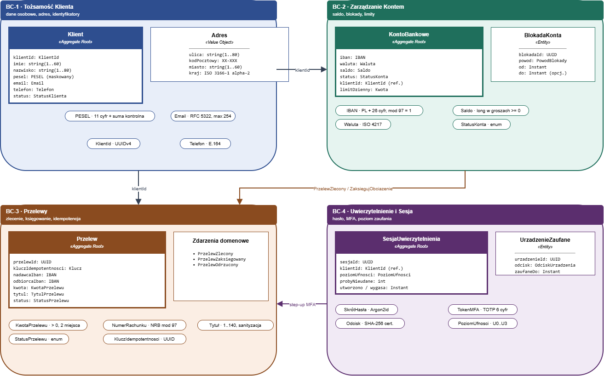

# Zadanie 1 — Domain Driven Design

**Temat:** model fragmentu bezpiecznej aplikacji bankowej w podejściu DDD
**Autor:** Artem Kukushkin
**Zakres:** 4 bounded contexts, 6 encji, 4 agregaty

---

## 1. Opis zadania

Celem zadania było zamodelowanie fragmentu aplikacji bankowej zgodnie z zasadami Domain Driven Design, z naciskiem na bezpieczeństwo. Model obejmuje wyłącznie wąski wycinek systemu — proces od rejestracji klienta, przez otwarcie konta i zlecenie przelewu, po uwierzytelnienie operacji — i nie stanowi kompletnego modelu bankowości. Świadomie pominięto karty, kredyty, przewalutowania oraz rozliczenia międzybankowe, aby skupić się na mechanizmach DDD. Celem było usystematyzowanie wiedzy o DDD, a nie odwzorowanie rzeczywistego systemu bankowego.

---

## 2. Model

---

## 3. Bounded contexts

| Kontekst | Odpowiedzialność | Agregat | Język ubiquitousny |
|---|---|---|---|
| **BC-1 · Tożsamość Klienta** | rejestracja i utrzymanie danych klienta, adres, identyfikatory, status | `Klient` | klient, PESEL, adres, status klienta |
| **BC-2 · Zarządzanie Kontem** | cykl życia konta, saldo, limity, blokady | `KontoBankowe` | konto, IBAN, saldo, blokada, limit dzienny |
| **BC-3 · Przelewy** | zlecenie przelewu, księgowanie, idempotencja, limity transakcyjne | `Przelew` | przelew, nadawca, odbiorca, tytuł, klucz idempotentności |
| **BC-4 · Uwierzytelnienie i Sesja** | hasło, MFA, poziom zaufania sesji, urządzenia zaufane | `SesjaUwierzytelnienia` | sesja, poziom zaufania, token MFA, krok podwyższenia (step-up) |

**Dlaczego cztery, a nie jeden:** „konto" znaczy co innego w BC-2 (saldo i limity) niż w BC-3 (strona nadawcy przelewu). Rozdzielenie pozwala zmieniać politykę bezpieczeństwa przelewów bez dotykania modelu konta i odwrotnie. `Klient` jest osobnym kontekstem, bo bywa używany przez systemy, które o bankowości nie wiedzą nic.

---

## 4. Agregaty, encje i obiekty wartości (6 encji)

| # | Obiekt | Typ | Kontekst | Atrybuty | Format / walidacja | Uwagi bezpieczeństwa |
|---|---|---|---|---|---|---|
| 1 | `Klient` | **Aggregate Root** | BC-1 | `klientId`, `imie`, `nazwisko`, `pesel`, `email`, `telefon`, `status` | `klientId` – UUIDv4; `imie` 1–60, `nazwisko` 1–80 (litery, spacja, myślnik); `email` RFC 5322, ≤254; `telefon` E.164; `status` – enum | PESEL unikalny, walidowany sumą kontrolną; pełna wartość szyfrowana (AES-GCM), w modelu tylko zamaskowana; brak PESEL w logach i zdarzeniach |
| 2 | `KontoBankowe` | **Aggregate Root** | BC-2 | `iban`, `waluta`, `saldo`, `status`, `klientId`, `limitDzienny` | `iban` – PL + 26 cyfr, kontrola mod 97 = 1; `waluta` – ISO 4217; `saldo` – long w groszach ≥ 0; `status` – enum | `klientId` to referencja (nie obiekt); konto zablokowane nie przyjmuje obciążeń; brak debetu w tym fragmencie |
| 3 | `BlokadaKonta` | Entity (w agregacie `KontoBankowe`) | BC-2 | `blokadaId`, `powod`, `od`, `do` | `blokadaId` – UUID; `powod` – enum (SĄD, PODEJRZENIE_OSZUSTWA, WNIOSEK_KLIENTA); `od`/`do` – Instant, `do` opcjonalne | Blokada nie może zostać usunięta bez śladu audytowego; historia blokad tylko do dopisywania |
| 4 | `Przelew` | **Aggregate Root** | BC-3 | `przelewId`, `kluczIdempotentnosci`, `nadawcaIban`, `odbiorcaIban`, `kwota`, `tytul`, `status` | `przelewId`/`klucz` – UUID; IBAN jak wyżej; `kwota` – > 0, ≤ 2 miejsca dziesiętne; `tytuł` – 1–140 znaków po sanityzacji | Idempotencja chroni przed podwójnym księgowaniem przy retry; nadawca ≠ odbiorca; kwota w groszach (integer), nigdy float |
| 5 | `SesjaUwierzytelnienia` | **Aggregate Root** | BC-4 | `sesjaId`, `klientId`, `poziomUfnosci`, `probyNieudane`, `utworzono`, `wygasa` | `sesjaId` – UUID; `poziomUfnosci` – U0…U3; `probyNieudane` – int ≥ 0; znaczniki czasu – Instant | 5 nieudanych prób → blokada 15 min; wygaśnięcie po 15 min bezczynności i 8 h bezwzględnie; sesja nie przechowuje hasła |
| 6 | `UrzadzenieZaufane` | Entity (w agregacie `SesjaUwierzytelnienia`) | BC-4 | `urzadzenieId`, `odcisk`, `zaufaneDo` | `odcisk` – SHA-256 odcisku klucza publicznego (hex/base64), długość stała; `zaufaneDo` – Instant | Odcisk liczony po stronie serwera; brak w odcisku danych osobowych; wygaśnięcie wymusza ponowne MFA |

### Obiekty wartości

| Obiekt | Wartość | Format / reguła |
|---|---|---|
| `KlientId` | UUIDv4 | niezmienny, generowany przy rejestracji |
| `PESEL` | 11 cyfr + suma kontrolna | walidacja wg wag 1,3,7,9,1,3,7,9,1,3; przechowywany zamaskowany (`XXXXXXXXX12`) + HMAC do wyszukiwania |
| `Email`, `Telefon` | adres e-mail, numer E.164 | normalizacja do lowercase / `+48…` przed walidacją |
| `Adres` | `ulica`, `kodPocztowy`, `miasto`, `kraj` | kod `XX-XXX`, kraj – ISO 3166-1 alpha-2 |
| `IBAN` / `NumerRachunku` | numer rachunku | 28 znaków dla PL, kontrola mod 97 = 1; spacje usuwane przy tworzeniu |
| `Waluta` | kod waluty | ISO 4217, lista zamknięta |
| `Saldo` | kwota w groszach | `long ≥ 0`, operacje tylko przez metody VO (bez „gołego" long w API) |
| `KwotaPrzelewu` | kwota przelewu | `long > 0`, ≤ 2 miejsca dziesiętne, waluta obowiązkowa, górny limit z polityki |
| `TytulPrzelewu` | opis przelewu | 1–140 znaków, usuwane znaki kontrolne, dozwolona treść po sanityzacji (ochrona przed HTML/SQL/CRLF injection) |
| `StatusPrzelewu`, `StatusKonta`, `StatusKlienta` | enumy | dozwolone przejścia opisane w sekcji 5 |
| `KluczIdempotentnosci` | UUID | wymagany przy każdym zleceniu; powtórka zwraca ten sam wynik |
| `SkrotHasla` | hash hasła | Argon2id + sól, parametry w konfiguracji; nigdy plaintext, nigdy w logach |
| `TokenMFA` | kod jednorazowy | TOTP 6 cyfr, okno ±1 kroku (30 s), jednorazowy |
| `OdciskUrzadzenia` | odcisk urządzenia | SHA-256, stała długość, porównanie w czasie stałym |
| `PoziomUfnosci` | U0–U3 | U0 – brak, U1 – hasło, U2 – hasło + MFA, U3 – + urządzenie zaufane |

---

## 5. Niezmienniki (invarianty agregatów)

**`KontoBankowe`**
- `saldo ≥ 0` — brak debetu w modelowanym fragmencie;
- IBAN zawsze poprawny (mod 97 = 1), waluta z listy ISO 4217;
- konto w statusie `ZABLOKOWANE` lub `ZAMKNIETE` nie może zostać obciążone;
- aktywna `BlokadaKonta` blokuje wszystkie operacje wychodzące;
- zmiana salda wyłącznie przez metody agregatu (`obciaz()`, `uznaj()`) — nigdy przez setter.

**`Przelew`**
- `0 < kwota ≤ limitDzienny` konta nadawcy;
- waluta przelewu = waluta konta nadawcy (brak przewalutowań);
- `nadawcaIban ≠ odbiorcaIban`;
- tytuł po sanityzacji ma 1–140 znaków;
- `kluczIdempotentnosci` jest unikalny w obrębie konta — powtórne zlecenie z tym samym kluczem nie tworzy drugiego przelewu;
- dozwolone przejścia statusu: `NOWY → ZWALIDOWANY → ZAKSIEGOWANY` lub `… → ODRZUCONY`; powrót do stanu poprzedniego jest zabroniony.

**`Klient`**
- PESEL: 11 cyfr, poprawna suma kontrolna, unikalny w systemie;
- e-mail unikalny i potwierdzony przed aktywacją konta;
- dane osobowe nie trafiają do zdarzeń domenowych w postaci jawnej.

**`SesjaUwierzytelnienia`**
- po 5 nieudanych próbach sesja jest unieważniana, a kolejne logowanie wymaga pełnego MFA;
- sesja wygasa po 15 minutach bezczynności i po 8 godzinach od utworzenia;
- `poziomUfnosci` może rosnąć (step-up), ale nie spada w obrębie sesji bez ponownego uwierzytelnienia.

---

## 6. Operacje i integracja między kontekstami

| # | Skąd → Dokąd | Operacja / kontrakt | Typ | Spójność |
|---|---|---|---|---|
| 1 | BC-1 → BC-2 | `KlientId` przy otwieraniu konta | referencja po ID | natychmiastowa (ID jest niezmienne) |
| 2 | BC-2 → BC-3 | `KontoOtwarte`, `KontoZablokowane` | zdarzenie domenowe | eventualna |
| 3 | BC-3 → BC-2 | `ZaksiegujObciazenie(kontoId, kwota, przelewId)` — sprawdzenie salda i limitu, księgowanie | komenda (port aplikacyjny) | eventualna + saga |
| 4 | BC-2 → BC-3 | `KsiegowanieOdrzucone(przelewId, powod)` | zdarzenie zwrotne | kompensacja: BC-3 ustawia `ODRZUCONY` |
| 5 | BC-3 → BC-4 | `PoziomUwierzytelnieniaQuery(sesjaId)` → U0…U3 | zapytanie (read) | natychmiastowa, tylko do odczytu |
| 6 | BC-3 → BC-4 | żądanie step-up, gdy `kwota > limitBezpieczny` (np. 500 PLN) | komenda do polityki | synchroniczna, przed księgowaniem |
| 7 | BC-2 → system zewnętrzny (Elixir/SWIFT) | mapowanie na model zewnętrzny | Anti-Corruption Layer | eventualna |

**Reguły integracji:**
1. Kontekst nigdy nie odwołuje się do encji innego kontekstu — wyłącznie po identyfikatorze (`klientId`, `IBAN`) lub przez kontrakt.
2. Między BC-2 i BC-3 **nie ma transakcji rozproszonej**: przepływ realizuje saga (`PrzelewZlecony` → `ZaksiegujObciazenie` → `PrzelewZaksiegowany` / `KsiegowanieOdrzucone`).
3. Każda komenda przelewu wymaga `kluczIdempotentnosci` — retry po timeoucie nie tworzy drugiego przelewu.
4. Polityka bezpieczeństwa (kiedy wymagać MFA) należy do BC-3; BC-4 tylko udostępnia poziom zaufania. Rozdzielenie polityki od mechanizmu.

---

## 7. Zdarzenia domenowe

`KlientZarejestrowany` · `KontoOtwarte` · `KontoZablokowane` · `PrzelewZlecony` · `PrzelewZaksiegowany` · `PrzelewOdrzucony` · `ProbaUwierzytelnieniaNieudana` · `SesjaWygasla`

Zdarzenia publikowane są **po commicie** agregatu, zawierają tylko identyfikatory i kwoty — nigdy dane osobowe w postaci jawnej.

---

## 8. Decyzje bezpieczeństwa i ich uzasadnienie

- **Kwoty jako `long` w groszach** — eliminuje błędy zaokrągleń `float` (`0.1 + 0.2 ≠ 0.3`), które w systemie finansowym są błędem, nie kosmetyką.
- **Walidacja w konstruktorach obiektów wartości** — nie da się utworzyć `KwotaPrzelewu(-10)` ani `IBAN("PL00")`; niepoprawne dane nie istnieją w modelu, więc nie ma ich czym „naprawiać" później.
- **Hasło tylko jako `SkrotHasla` (Argon2id + sól)** — BC-4 nie ma pola na hasło jawne; wyciek bazy nie ujawnia haseł.
- **PESEL: maskowanie + HMAC (wyszukiwanie) + AES-GCM (pełna wartość)** — zgodność z RODO i ograniczenie skutków wycieku logów.
- **Klucz idempotentności** — ochrona przed podwójnym księgowaniem (double-spend) przy powtórzeniach żądania.
- **Referencje po ID zamiast obiektów** — konteksty można wdrażać i skalować niezależnie, a zmiana modelu w BC-1 nie psuje BC-2.
- **Saga zamiast transakcji rozproszonej** — brak dwufazowego commita między bazami; błąd jest kompensowany jawnie, a nie „cudownie" wycofywany.
- **Logi strukturalne bez PII** — korelacja po `przelewId`/`sesjaId`, nigdy po numerze PESEL czy IBAN.

