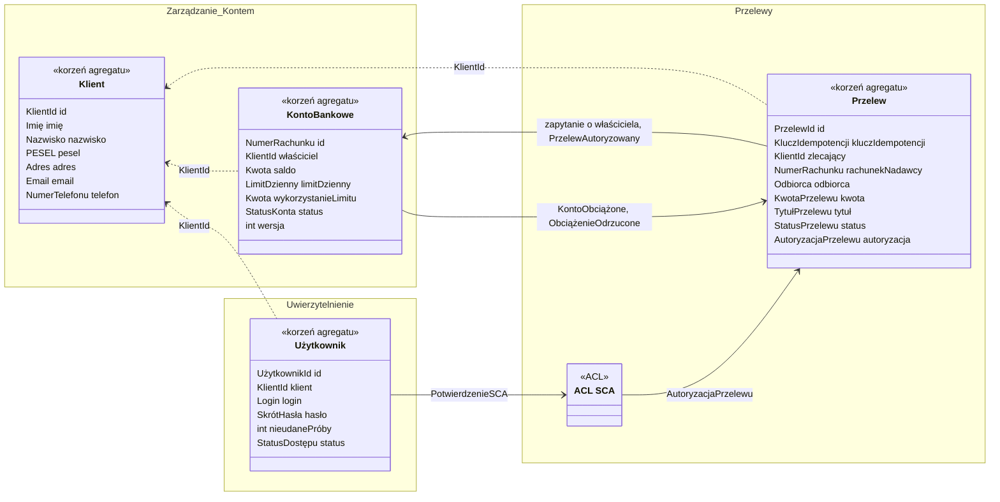

# Zadanie 1 – Domain Driven Design

## Opis zadania

Model obejmuje fragment bankowości internetowej: zlecenie i realizację przelewu krajowego w PLN. Wyodrębniono trzy konteksty (Bounded Context): Zarządzanie Kontem, Przelewy i Uwierzytelnienie, z czterema agregatami, a dane wejściowe są reprezentowane przez niezmienne, samowalidujące się obiekty wartości. Reguły istotne dla bezpieczeństwa (brak debetu, limity, jednorazowa autoryzacja SCA, dozwolone przejścia statusów, idempotencja) są niezmiennikami agregatów, a konteksty komunikują się wyłącznie przez identyfikatory i komunikaty, walidowane na granicy.

## Model

Linia przerywana – referencja wyłącznie po identyfikatorze; linia ciągła – zdarzenie lub komunikat między kontekstami; typy atrybutów (poza `int`) to obiekty wartości.

## Bounded Context

| Bounded Context | Odpowiedzialność |
|---|---|
| Zarządzanie Kontem | zmiana danych klienta, prowadzenie rachunku i salda, limity, obciążanie rachunku |
| Przelewy | zlecenie przelewu, jego autoryzacja, anulowanie i śledzenie statusu |
| Uwierzytelnienie | logowanie, blokada dostępu, potwierdzanie przelewów (SCA) |

## Encje i niezmienniki

Każda encja jest korzeniem własnego agregatu i ma identyfikator nadawany przy utworzeniu, który nigdy się nie zmienia: `KontoBankowe` identyfikuje `NumerRachunku`, pozostałe encje – UUID.

| Encja | Atrybuty | Niezmienniki |
|---|---|---|
| `Klient` | `KlientId`, `Imię`, `Nazwisko`, `PESEL`, `Adres`, `Email`, `NumerTelefonu` | PESEL unikalny w banku. |
| `Użytkownik` | `UżytkownikId`, `KlientId`, `Login`, `SkrótHasła`, licznik prób, `StatusDostępu` | 5 nieudanych logowań → `ZABLOKOWANY`; SCA tylko dla `AKTYWNY`. |
| `KontoBankowe` | `NumerRachunku`, `KlientId` właściciela, saldo (`Kwota`), `LimitDzienny`, wykorzystanie limitu, `StatusKonta`, wersja | saldo ≥ 0 (brak debetu); obciążyć rachunek może tylko jego właściciel, na koncie `AKTYWNE`, w granicach limitu dziennego; jedno obciążenie na `PrzelewId`; saldo zmienia się tylko przez `obciąż()`; zapis z kontrolą wersji (optymistyczne blokowanie), więc równoległe obciążenia nie przekroczą salda ani limitu. |
| `Przelew` | `PrzelewId`, `KluczIdempotencji`, `KlientId` zlecającego, rachunek nadawcy, `Odbiorca`, `KwotaPrzelewu`, `TytułPrzelewu`, `StatusPrzelewu`, `AutoryzacjaPrzelewu` | zlecający pochodzi z sesji, nie z treści żądania; przelew powstaje tylko, gdy Zarządzanie Kontem potwierdzi, że zlecający jest właścicielem rachunku nadawcy; rachunek nadawcy ≠ odbiorcy; dane niezmienne po utworzeniu; powtórzony `KluczIdempotencji` zwraca istniejący przelew. |

## Obiekty wartości – akceptowane formaty

Obiekty wartości są niezmienne i walidują się w konstruktorze (rozmiar → dozwolone znaki → składnia → semantyka). Niepoprawna wartość kończy się wyjątkiem domenowym.

| Obiekt wartości | Format |
|---|---|
| `KlientId`, `UżytkownikId`, `PrzelewId`, `KluczIdempotencji` | UUID v4 |
| `Imię`, `Nazwisko` | 1–50 znaków: litery, spacja, `-`, `'` |
| `PESEL` | 11 cyfr, poprawna cyfra kontrolna i data urodzenia |
| `Adres` | ulica 1–100 znaków, numer budynku (np. `12A`), kod pocztowy `NN-NNN`, miejscowość 1–60 znaków, kraj `PL` |
| `Email` | ≤ 254 znaki, zapisywany małymi literami, format `lokalna@domena.tld` |
| `NumerTelefonu` | `+48` + 9 cyfr |
| `Login` | 6–32 znaki `[a-z0-9._-]` |
| `SkrótHasła` | skrót Argon2id; samo hasło nie jest przechowywane |
| `NumerRachunku` | `PL` + 26 cyfr (spacje usuwane), suma kontrolna IBAN mod 97 = 1 |
| `Kwota` | `BigDecimal` (nie `double`), 2 miejsca po przecinku – więcej jest odrzucane, nie zaokrąglane; waluta `PLN` |
| `KwotaPrzelewu` | 0,01–100 000,00 PLN |
| `LimitDzienny` | 0,00–200 000,00 PLN |
| `TytułPrzelewu`, `NazwaOdbiorcy` | 1–140 znaków; litery, cyfry, spacja i `/ - ? : ( ) . , ' +` – znaki `< > " & ;` są odrzucane |
| `Odbiorca` | `NazwaOdbiorcy` + `NumerRachunku` |
| `AutoryzacjaPrzelewu` | tworzona tylko przez ACL SCA (warstwę antykorupcyjną na granicy z Uwierzytelnieniem): `PrzelewId`, kwota, rachunek odbiorcy, ważność ≤ 5 min, jednorazowa |
| Statusy | `StatusPrzelewu`: `UTWORZONY`, `AUTORYZOWANY`, `ZREALIZOWANY`, `ODRZUCONY`, `ANULOWANY`; `StatusKonta`: `AKTYWNE`, `ZABLOKOWANE`, `ZAMKNIĘTE`; `StatusDostępu`: `AKTYWNY`, `ZABLOKOWANY` |

## Cykl życia przelewu

- `UTWORZONY` → `AUTORYZOWANY`: ważna, nieużyta autoryzacja SCA dla tego przelewu, kwoty i odbiorcy.
- `AUTORYZOWANY` → `ZREALIZOWANY`: rachunek nadawcy obciążony.
- `AUTORYZOWANY` → `ODRZUCONY`: obciążenie odrzucone (brak środków, limit, konto nieaktywne).
- `UTWORZONY` → `ANULOWANY`: anulowanie przed autoryzacją.

Każde inne przejście kończy się wyjątkiem domenowym, niezależnie od tego, co pokazuje UI.

## Integracja między kontekstami

| Komunikat | Kierunek | Walidacja na granicy |
|---|---|---|
| zapytanie o właściciela rachunku | Przelewy → Zarządzanie Kontem | odpowiedź tak/nie przy tworzeniu przelewu; ostateczną kontrolę robi `obciąż()` |
| `PotwierdzenieSCA` | Uwierzytelnienie → Przelewy (przez ACL SCA) | podpis, ważność, jednorazowość, zgodność z przelewem → `AutoryzacjaPrzelewu` |
| `PrzelewAutoryzowany` | Przelewy → Zarządzanie Kontem | `obciąż()`; powtórzone zdarzenie nie obciąży rachunku drugi raz |
| `KontoObciążone` / `ObciążenieOdrzucone` | Zarządzanie Kontem → Przelewy | przelew musi być `AUTORYZOWANY`, inaczej zdarzenie jest ignorowane |

Każdy agregat zmieniany jest w osobnej transakcji; między kontekstami obowiązuje spójność ostateczna. Uznanie rachunku odbiorcy jest poza zakresem modelu.
