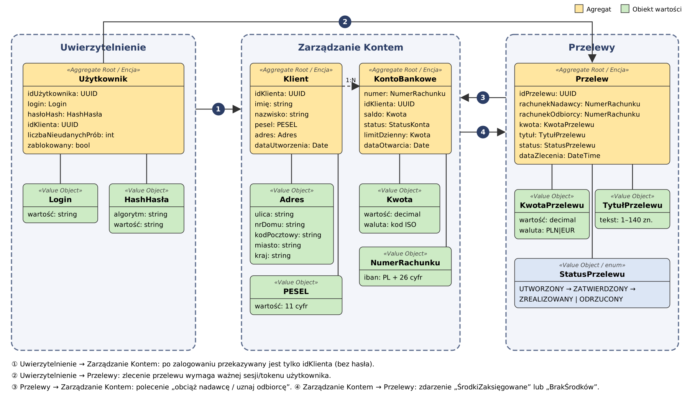

# Zadanie 1 – Domain Driven Design

## Opis zadania

Celem zadania było zamodelowanie fragmentu bezpiecznej aplikacji bankowej zgodnie z zasadami Domain Driven Design. Model obejmuje trzy konteksty ograniczone (Bounded Context): **Customers** (Klienci), **Accounts** (Rachunki) oraz **Transfers** (Przelewy), które komunikują się ze sobą wyłącznie przez identyfikatory i zdarzenia domenowe.
Każdy kontekst zawiera dokładnie jeden agregat (`Customer`, `BankAccount`, `Transfer`); agregat `BankAccount` zawiera dodatkowo encję wewnętrzną `AccountOperation`. Agregaty posiadają własne obiekty wartości (np. `Address`, `Balance`, `TransferAmount`), które walidują swoje dane już w momencie tworzenia. Dla każdego elementu określono atrybuty, akceptowane formaty danych oraz reguły biznesowe i bezpieczeństwa, których model musi przestrzegać.

## Model

Źródło diagramu (Mermaid): [model.mmd](model.mmd)

- Linia ciągła z rombem – encja wewnętrzna lub obiekt wartości jest częścią agregatu.
- Linia przerywana – referencja do agregatu z innego kontekstu **wyłącznie przez identyfikator**.

## Bounded Contexts

| Kontekst | Odpowiedzialność | Agregat (Aggregate Root) | Encje wewnętrzne | Obiekty wartości |
|---|---|---|---|---|
| **Customers** | Dane osobowe i adresowe klienta. | `Customer` | – | `Address` |
| **Accounts** | Prowadzenie rachunków, saldo, historia operacji, blokowanie kont. | `BankAccount` | `AccountOperation` | `Balance` |
| **Transfers** | Zlecanie, autoryzacja i realizacja przelewów. | `Transfer` | – | `TransferAmount` |

Model zawiera **4 encje** (3 Aggregate Rooty + 1 encja wewnętrzna) oraz **3 obiekty wartości**.

Każdy kontekst ma własne obiekty wartości – nie ma współdzielonych typów. `Balance` i `TransferAmount` mają podobną budowę (kwota + waluta), ale różne reguły: saldo może wynosić 0, kwota przelewu musi być dodatnia i ma górny limit.

## Przyjęte założenia

### Encje i agregaty

| Encja | Atrybut | Format / ograniczenia |
|---|---|---|
| `Customer` | `id` | UUID v4, generowany przez system, niezmienny |
| | `firstName`, `lastName` | 2–50 znaków, tylko litery (w tym polskie), spacja, myślnik |
| | `pesel` | dokładnie 11 cyfr, poprawna suma kontrolna |
| | `address` | VO `Address` |
| `BankAccount` | `id` | UUID v4 |
| | `number` | IBAN; dla PL: `PL` + 26 cyfr, poprawna suma kontrolna mod 97, bez spacji; unikalny w systemie |
| | `ownerId` | UUID istniejącego `Customer` |
| | `balance` | VO `Balance` |
| | `status` | `ACTIVE` \| `BLOCKED` \| `CLOSED` |
| `AccountOperation` (encja wewnętrzna `BankAccount`) | `id` | UUID v4 |
| | `type` | `DEBIT` \| `CREDIT` |
| | `amount` | `Decimal`, 2 miejsca po przecinku, > 0, w walucie rachunku |
| | `transferId` | UUID `Transfer`, który spowodował operację (referencja przez ID) |
| | `createdAt` | data i czas ISO 8601 (UTC), nadawane przez system |
| `Transfer` | `id` | UUID v4 |
| | `sourceAccountId` | UUID istniejącego `BankAccount` |
| | `targetAccount` | IBAN (format jak `BankAccount.number`); może być rachunkiem w innym banku |
| | `amount` | VO `TransferAmount` |
| | `status` | `CREATED` \| `AUTHORIZED` \| `EXECUTED` \| `REJECTED` |

### Obiekty wartości

Wszystkie obiekty wartości są **niemutowalne**, porównywane po wartości i **walidują dane w konstruktorze** – nie da się utworzyć obiektu w niepoprawnym stanie.

| Obiekt wartości | Kontekst | Atrybuty | Akceptowany format / reguły |
|---|---|---|---|
| `Address` | Customers | `street`, `city`, `postalCode`, `country` | ulica 1–100 znaków; miasto 1–50 liter; kod pocztowy dla PL `NN-NNN`; kraj ISO 3166-1 alpha-2 (np. `PL`) |
| `Balance` | Accounts | `amount`, `currency` | `Decimal` (nigdy `float`), 2 miejsca po przecinku, ≥ 0; waluta ISO 4217 (`PLN`, `EUR`, `USD`) |
| `TransferAmount` | Transfers | `amount`, `currency` | `Decimal`, 2 miejsca po przecinku, > 0 i ≤ 1 000 000,00; waluta ISO 4217 |

### Reguły biznesowe i bezpieczeństwa (niezmienniki)

1. Przelew może zostać zrealizowany tylko z konta o statusie `ACTIVE`, gdy saldo ≥ kwota przelewu.
2. Waluta przelewu musi być zgodna z walutą rachunku źródłowego.
3. Rachunek docelowy musi być różny od rachunku źródłowego.
4. Przelew może zlecić wyłącznie właściciel rachunku źródłowego (`BankAccount.ownerId`) i każdy przelew wymaga autoryzacji kodem MFA (`authorize(mfaCode)`).
5. Dozwolone przejścia statusu przelewu: `CREATED → AUTHORIZED → EXECUTED` oraz `CREATED/AUTHORIZED → REJECTED`. Statusy `EXECUTED` i `REJECTED` są końcowe.
6. Konto z niezerowym saldem nie może zostać zamknięte.
7. Każde wywołanie `debit`/`credit` tworzy nową `AccountOperation`; operacje są niezmienne i nie można ich usuwać (pełna historia zmian salda).
8. Agregaty odwołują się do siebie wyłącznie przez identyfikatory; jedna transakcja modyfikuje tylko jeden agregat.
9. Dane wrażliwe (PESEL, numer konta) są maskowane w logach (np. `PL** **** … 1234`).

### Integracja pomiędzy kontekstami

| Operacja | Źródło → Cel | Mechanizm | Opis |
|---|---|---|---|
| Sprawdzenie właściciela i środków | Transfers → Accounts | zapytanie synchroniczne | Przed utworzeniem przelewu sprawdzane jest, czy zlecający jest właścicielem konta, czy konto jest `ACTIVE` i czy saldo wystarcza. |
| `TransferAuthorized` | Transfers → Accounts | zdarzenie domenowe | Konto źródłowe wykonuje `debit(amount)`; konto docelowe (jeśli w tym banku) `credit(amount)`. |
| `DebitRejected` | Accounts → Transfers | zdarzenie domenowe | Brak środków lub konto zablokowane → przelew przechodzi w `REJECTED`. |
| `AccountBlocked` | Accounts → Transfers | zdarzenie domenowe | Oczekujące przelewy z zablokowanego konta są odrzucane. |
| `CustomerCreated` | Customers → Accounts | zdarzenie domenowe | Umożliwia otwarcie `BankAccount` z `ownerId` nowego klienta. |
