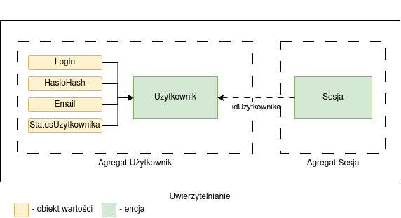

# Zadanie 1 – Domain Driven Design

## Opis zadania

Celem zadania jest zamodelowanie fragmentu bezpiecznej aplikacji bankowej zgodnie z zasadami Domain Driven Design.
W systemie bankowym wyróżniono konteksty ograniczone **Uwierzytelnianie**, **Zarządzanie Kontem** i **Przelewy**, a szczegółowo zamodelowano **Uwierzytelnianie**.
Dla agregatów `Uzytkownik` i `Sesja` oraz ich obiektów wartości określono atrybuty, akceptowane formaty danych oraz niezmienniki, które są sprawdzane już przy tworzeniu obiektu, tak aby obiekt w niepoprawnym stanie nie mógł powstać.

## Model

## Bounded Contexts

| Kontekst | Odpowiedzialność |
|---|---|
| Uwierzytelnianie | rejestracja poświadczeń, logowanie, blokowanie konta, sesje |
| Zarządzanie Kontem | klienci, rachunki, saldo |
| Przelewy | zlecanie i realizacja przelewów |

## Agregaty (kontekst Uwierzytelnianie)

| Agregat | Korzeń (encja) | Elementy wewnątrz |
|---|---|---|
| Uzytkownik | `Uzytkownik` | `Login`, `HasloHash`, `Email`, `StatusUzytkownika` |
| Sesja | `Sesja` | – (do `Uzytkownik` odwołuje się tylko przez `idUzytkownika`) |

## Encje i obiekty wartości

| Element | Rodzaj | Opis |
|---|---|---|
| `Uzytkownik` | Encja (korzeń agregatu) | poświadczenia użytkownika, pilnuje blokady po nieudanych logowaniach |
| `Sesja` | Encja (korzeń agregatu) | zalogowana sesja użytkownika |
| `Login` | Obiekt wartości | identyfikator logowania |
| `HasloHash` | Obiekt wartości | skrót hasła |
| `Email` | Obiekt wartości | adres do powiadomień i resetu hasła |
| `StatusUzytkownika` | Obiekt wartości (enum) | `AKTYWNY`, `ZABLOKOWANY` |

## Założenia

### `Uzytkownik`

| Atrybut | Typ | Format / ograniczenia |
|---|---|---|
| `idUzytkownika` | UUID | UUID v4 generowany przez system, niezmienny |
| `idKlienta` | UUID | referencja do klienta w kontekście Zarządzanie Kontem, wymagana, niezmienna |
| `login` | `Login` | unikalny w systemie |
| `hasloHash` | `HasloHash` | wymagany, hasło nigdy nie jest przechowywane jawnie |
| `email` | `Email` | wymagany |
| `status` | `StatusUzytkownika` | przy utworzeniu `AKTYWNY` |
| `nieudaneLogowania` | int | 0–5; po 5. nieudanej próbie status zmienia się na `ZABLOKOWANY`, po udanym logowaniu licznik jest zerowany |

### `Sesja`

| Atrybut | Typ | Format / ograniczenia |
|---|---|---|
| `idSesji` | String | losowy token, nadawany przez system |
| `idUzytkownika` | UUID | referencja do `Uzytkownik` |
| `utworzona` | Instant (UTC) | nadawana przez system |
| `wygasa` | Instant (UTC) | `utworzona + 15 min`, przedłużana przy aktywności, maks. 8 h od utworzenia |
| `aktywna` | boolean | `false` po wylogowaniu lub wygaśnięciu, nie można jej ponownie aktywować |

### Obiekty wartości

Obiekty wartości są niemutowalne i walidują dane w konstruktorze – przy błędzie rzucany jest wyjątek. Napisy są przed walidacją przycinane.

| Obiekt wartości | Akceptowany format |
|---|---|
| `Login` | 5–30 znaków, tylko `a-z A-Z 0-9 . _ -`, porównywany bez rozróżniania wielkości liter |
| `HasloHash` | tworzony tylko z hasła spełniającego politykę: 12–128 znaków, co najmniej 1 mała i 1 wielka litera, 1 cyfra, 1 znak specjalny, hasło różne od loginu; skrót z losową solą |
| `Email` | maks. 254 znaki, `^[A-Za-z0-9._%+-]+@[A-Za-z0-9.-]+\.[A-Za-z]{2,}$`, zapisywany małymi literami |
| `StatusUzytkownika` | `AKTYWNY`, `ZABLOKOWANY` |

### Operacje i integracja z innymi kontekstami

| Operacja | Warunek | Skutek |
|---|---|---|
| `zaloguj(login, haslo)` | status `AKTYWNY`, hasło zgodne ze skrótem | zerowanie licznika, utworzenie `Sesja`, zdarzenie `UzytkownikZalogowany` |
| `zaloguj(...)` – błędne hasło | status `AKTYWNY` | licznik +1; przy 5 → `ZABLOKOWANY` i zdarzenie `UzytkownikZablokowany`. Komunikat błędu jest taki sam dla złego loginu i złego hasła |
| `zmienHaslo(stare, nowe)` | aktywna sesja, stare hasło poprawne, nowe zgodne z polityką | nowy `HasloHash`, unieważnienie pozostałych sesji użytkownika |
| `odblokuj()` | status `ZABLOKOWANY`, wykonywane przez konsultanta lub reset hasła przez e-mail | status `AKTYWNY`, licznik = 0 |
| `wyloguj()` | sesja aktywna | `aktywna = false` |
