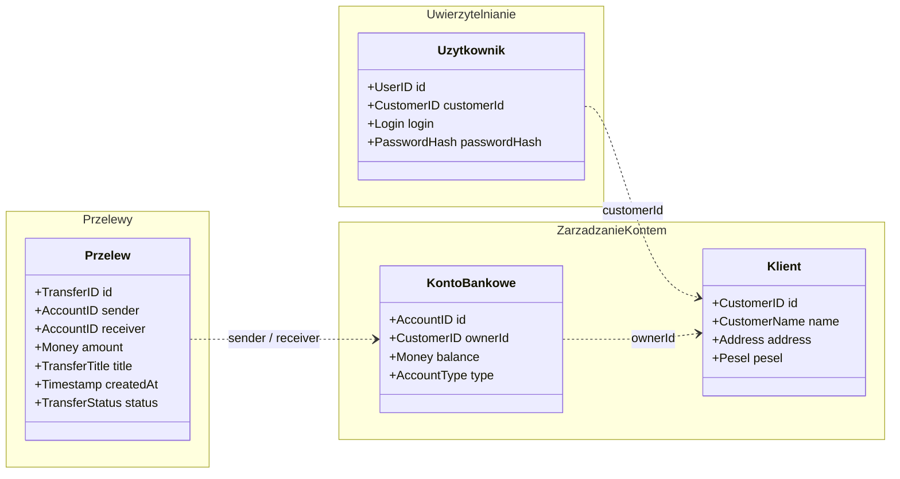

# Domain Driven Design - aplikacja bankowa

Celem zadania jest zaprojektowanie fragmentu bezpiecznej aplikacji bankowej zgodnie z zasadami Domain Driven Design.
Przedstawiony poniżej model zawiera trzy główne obszary (Bounded Context), skupiające się na uwierzytelnianiu, zarządzaniu kontem oraz przelewach.
Każdy z tych obszarów posiada zdefiniowane agregaty, encje, obiekty wartości oraz ograniczenia związane z formatem danych bądź interakcją między poszczególnymi obszarami.
Poniżej znajduje się rysunek przedstawiający uproszczoną strukturę takiej aplikacji:

Agregaty odwołują się do siebie wyłącznie przez identyfikatory (linie przerywane).

## Bounded Context

| Bounded Context | Opis |
| --- | --- |
| Uwierzytelnianie | Logowanie do aplikacji bankowej oraz autoryzacja operacji (np. potwierdzanie przelewów) |
| Zarządzanie kontem | Dane osobowe klienta, rachunki bankowe oraz ich saldo |
| Przelewy | Zlecanie i realizacja przelewów między rachunkami |

## Agregaty

| Agregat | Bounded Context | Opis |
| --- | --- | --- |
| Użytkownik | Uwierzytelnianie | Dane logowania do aplikacji; powiązany z klientem |
| Klient | Zarządzanie kontem | Właściciel rachunków bankowych; zawiera dane osobowe klienta |
| Konto bankowe | Zarządzanie kontem | Pojedynczy rachunek (produkt) posiadany przez klienta w banku |
| Przelew | Przelewy | Przekazanie środków z rachunku nadawcy na rachunek odbiorcy |

## Encje

### Użytkownik

| Atrybut | Typ | Opis |
| --- | --- | --- |
| id | UserID | Unikalny identyfikator użytkownika |
| customerId | CustomerID | Klient, do którego należy użytkownik |
| login | Login | Numer klienta nadawany przez bank, używany do logowania |
| passwordHash | PasswordHash | Hash hasła użytkownika |

### Klient

| Atrybut | Typ | Opis |
| --- | --- | --- |
| id | CustomerID | Unikalny identyfikator klienta |
| name | CustomerName | Imię i nazwisko klienta |
| address | Address | Adres zamieszkania klienta |
| pesel | Pesel | Numer PESEL |

### Konto bankowe

| Atrybut | Typ | Opis |
| --- | --- | --- |
| id | AccountID | Numer rachunku (IBAN) |
| ownerId | CustomerID | Klient będący właścicielem rachunku |
| balance | Money | Saldo rachunku w walucie rachunku |
| type | AccountType | Rodzaj rachunku (osobisty, oszczędnościowy) |

### Przelew

| Atrybut | Typ | Opis |
| --- | --- | --- |
| id | TransferID | Unikalny identyfikator przelewu |
| sender | AccountID | Numer rachunku nadawcy |
| receiver | AccountID | Numer rachunku odbiorcy |
| amount | Money | Kwota przelewu wraz z walutą |
| title | TransferTitle | Tytuł przelewu |
| createdAt | Timestamp | Data i godzina zlecenia przelewu |
| status | TransferStatus | Status przelewu (zlecony, zaksięgowany, odrzucony) |

## Obiekty Wartości

| Obiekt wartości | Typ obiektu | Format | Przykład |
| --- | --- | --- | --- |
| UserID, CustomerID, TransferID | UUID v4 | Generowany przez system | `83027cec-2335-49a3-a532-0e1e4cc60401` |
| Login | String | 8 cyfr nadawanych przez bank | `48302917` |
| PasswordHash | String | Hash bcrypt; hasło nie jest przechowywane w postaci jawnej | `$2a$12$Jrw1BWLPQEWclXe5ugtsYOe70oUqNXdFYF2PxwO0u8FAufATKLSoG` |
| CustomerName | Object(String, String) | Imię i nazwisko, każde do 50 znaków; tylko litery, spacja i `-` | `CustomerName(name: 'Jan', surname: 'Kowalski')` |
| Address | Object | Ulica, numer budynku, opcjonalny numer lokalu, kod pocztowy w formacie `XX-XXX`, miasto | `Address(street: 'Przykładowa', streetNumber: '1', flatNumber: '2', postcode: '00-950', city: 'Warszawa')` |
| Pesel | String | 11 cyfr z poprawną cyfrą kontrolną | `76111501233` |
| AccountID | String | Numer IBAN: `PL` + 26 cyfr | `PL63005000123498763456789123` |
| Money | Object(BigDecimal, String) | Kwota z dokładnością do 2 miejsc po przecinku oraz waluta (`PLN`, `EUR`, `USD`) | `Money(amount: 12345.67, currency: 'PLN')` |
| AccountType | Enum | `PERSONAL`, `SAVING` | `AccountType.SAVING` |
| TransferTitle | String | 1–64 znaki; litery, cyfry, spacja i podstawowa interpunkcja | `Zwrot za obiad` |
| Timestamp | DateTime | Data i godzina w UTC | `2026-11-07T17:55:00Z` |
| TransferStatus | Enum | `ORDERED`, `BOOKED`, `REJECTED` | `TransferStatus.ORDERED` |

## Integracje między kontekstami

| Konteksty | Interakcja |
| --- | --- |
| Uwierzytelnianie → Zarządzanie kontem | Użytkownik jest powiązany z Klientem przez `customerId`; po zalogowaniu ma dostęp tylko do rachunków tego klienta. |
| Uwierzytelnianie → Przelewy | Zlecenie przelewu wymaga potwierdzenia przez zalogowanego użytkownika. |
| Przelewy → Zarządzanie kontem | Przelew odwołuje się do rachunków przez `AccountID` i zleca obciążenie rachunku nadawcy oraz uznanie rachunku odbiorcy. Przy braku środków przelew zostaje odrzucony (`REJECTED`), w przeciwnym razie zaksięgowany (`BOOKED`). |

## Przyjęte założenia

| Obszar | Założenie / ograniczenie |
| --- | --- |
| Ogólne | Model obejmuje wyłącznie osoby fizyczne i przelewy wewnątrz banku; nie obsługuje przewalutowań ani debetu. |
| Obiekty wartości | Dane są weryfikowane przy tworzeniu obiektu; obiekt z niepoprawnymi danymi nie może powstać. |
| Użytkownik | Login jest unikalny; jednemu klientowi odpowiada jeden użytkownik. |
| Klient | PESEL jest unikalny w systemie. |
| Konto bankowe | Rachunek należy do jednego klienta; klient może mieć wiele rachunków. Saldo nie może być ujemne. |
| Przelew | Kwota musi być większa od zera, a jej waluta zgodna z walutą obu rachunków. Nie można wykonać przelewu na ten sam rachunek. |