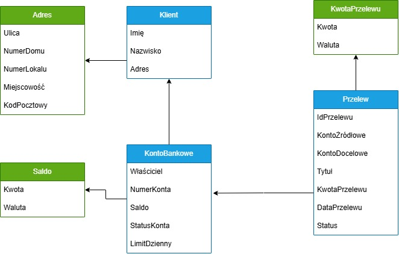

# Zadanie 1 - Domain Driven Design: bezpieczna aplikacja bankowa

## Opis zadania

Poniższy model jest fragmentem systemu bankowego zaprojektowanym przy użyciu podejścia Domain Driven Design (DDD). Wyodrębniono dwa konteksty ograniczone - zarządzanie kontem oraz przelewy. Model uwzględnia współpracę klienta i jego konta oraz logikę tworzenia i weryfikacji samej transakcji przelewu, pomijając przy tym warstwę uwierzytelniania i autoryzacji użytkownika. Reguły walidacji opisane poniżej powinny być egzekwowane już przy tworzeniu obiektów w backendzie, tak aby obiekt o niepoprawnych danych w ogóle nie mógł powstać.

## Model

**Klient** 
| Atrybut | Typ | Opis i Ograniczenia |
| :--- | :--- | :--- |
| Imię | string | Imię klienta. Wymagane, 1-60 znaków, dozwolone litery, spacja, myślnik i apostrof, cyfry zabronione. |
| Nazwisko | string | Nazwisko klienta. Wymagane, 1-60 znaków, dozwolone litery, spacja, myślnik i apostrof, cyfry zabronione. |
| Adres | ValueObject: Adres | Adres zamieszkania klienta. Wymagany, musi być poprawnym obiektem `Adres` |

Przyjęto, że konta mogą zakładać wyłącznie obywatele Polski, więc adres zamieszkania musi znajdować się w Polsce. Żadna z informacji o kliencie nie może być pusta ani składać się wyłącznie ze spacji.

**Adres** 
| Atrybut | Typ | Opis i Ograniczenia |
| :--- | :--- | :--- |
| Ulica | string | Nazwa ulicy. Opcjonalna, 1-100 znaków, litery, cyfry, spacja, `.` i `-` |
| NumerDomu | string | Numer domu. Wymagany, 1-10 znaków, format: cyfry, opcjonalnie litera |
| NumerLokalu | string | Numer lokalu. Opcjonalny, 1-10 znaków, format: cyfry, opcjonalnie litera |
| Miejscowość | string | Nazwa miejscowości. Wymagana, 1-100 znaków, litery, spacja, `.` i `-`. |
| KodPocztowy | string | Kod pocztowy miejscowości. Wymagany, format NN-NNN. |

Adres jest obiektem wartości, zatem musi istnieć w całości, a wszystkie pola (oprócz ulicy i numeru lokalu) muszą być kompletne i poprawne. Dwa adresy o identycznych wartościach pól są sobie równe. Należy sprawdzić poprawność kodu pocztowego.

**KontoBankowe**
| Atrybut | Typ | Opis i Ograniczenia |
| :--- | :--- | :--- |
| Właściciel | Klient | Klient będący właścicielem konta. Wymagany, konto ma dokładnie jednego właściciela, a klient może mieć wiele kont. Właściciel musi istnieć. |
| NumerKonta | string | Unikalny numer rachunku. Format polskiego IBAN: PL + 26 cyfr (28 znaków, bez spacji), poprawna suma kontrolna (mod 97). Niezmienny po utworzeniu. |
| Saldo | ValueObject: Saldo | Aktualny stan środków na koncie. Wymagane, zawsze obecne (nowe konto ma saldo 0). |
| StatusKonta | enum | 	Dozwolone wartości: `aktywne`, `zablokowane`, `zamknięte`. |
| LimitDzienny | ValueObject: LimitDzienny | Maksymalna suma wydatków (przelewów wychodzących) z konta w ciągu doby. Wymagany. |

Konto bankowe musi mieć przypisanego właściciela oraz unikalny numer konta, którego format jest sprawdzany. Saldo nie może być ujemne (brak debetu). Status konta określa dozwolone operacje: 
- `aktywne` - konto przyjmuje i wysyła przelewy, 
- `zablokowane` - z konta nie można wysyłać przelewów, przywrócenie do `aktywne` jest możliwe, 
- `zamknięte` - konto zamknięte, stan możliwy tylko przy saldzie równym 0,00, konto nie uczestniczy w żadnych operacjach. 

Limit dzienny ogranicza przelewy: suma kwot przelewów wychodzących z danego konta w ciągu doby (od 00:00 do 23:59) nie może go przekroczyć. Przelew przekraczający pozostały limit jest odrzucany.

**Saldo**
| Atrybut | Typ | Opis i Ograniczenia |
| :--- | :--- | :--- |
|  Kwota | decimal | Stan środków. Wartość nieujemna. |
| Waluta | string | Kod waluty wg ISO 4217 |

Kwota nieujemna i waluta zgodna z walutą konta. Operacje na saldzie zwracają nowy obiekt, a odjęcie kwoty większej niż saldo jest niedozwolone.

**LimitDzienny**
| Atrybut | Typ | Opis i Ograniczenia |
| :--- | :--- | :--- |
|  Kwota | 	decimal | Wysokość limitu. Wartość nieujemna. Wartość 0 oznacza brak możliwości wysyłania przelewów. |
| Waluta | string | Kod waluty wg ISO 4217 |

Kwota nieujemna i waluta taka sama jak waluta konta.

**Przelew**
| Atrybut | Typ | Opis i Ograniczenia |
| :--- | :--- | :--- |
| IdPrzelewu | int | Unikalny identyfikator przelewu, nadawany przez system, niezmienny. |
| KontoŹródłowe | string | 	Numer konta nadawcy. Wymagane, poprawny polski IBAN. Musi to być istniejące konto w statusie `aktywne`. |
| KontoDocelowe | string | Numer konta odbiorcy. Wymagane, poprawny polski IBAN. Może być kontem w innym banku. Musi być różne od konta źródłowego. |
| Tytuł | string | 	Tytuł przelewu. Wymagany, 1-140 znaków, dozwolone litery, cyfry, spacja oraz znaki `.` `,` `-` `/` `:` `(` `)`, zabronione `<` `>` `"` `'` `;` `&` i znaki sterujące. |
| KwotaPrzelewu | ValueObject: KwotaPrzelewu | Kwota przelewu. Wymagana. |
| DataPrzelewu | ValueObject: DataPrzelewu | Moment utworzenia przelewu. Ustawiany przez system, niezmienny. |
| Status | enum | Dozwolone wartości: `utworzony`, `zrealizowany`, `odrzucony`. |

Wszystkie pola są wymagane. Przelew można utworzyć tylko wtedy, gdy konto źródłowe jest aktywne, a jego saldo i pozostały limit dzienny pokrywają kwotę przelewu. Cykl życia statusu: `utworzony` -> `zrealizowany` (środki pobrane z konta źródłowego) lub `utworzony` -> `odrzucony` (np. brak środków, przekroczony limit, konto zablokowane). Po osiągnięciu statusu `zrealizowany` lub `odrzucony` przelew jest niezmienny, a inne przejścia są zabronione.

**KwotaPrzelewu**
| Atrybut | Typ | Opis i Ograniczenia |
| :--- | :--- | :--- |
|  Kwota | decimal | Wartość dodatnia. Nie może przekraczać salda konta źródłowego ani pozostałego limitu dziennego. |
| Waluta | string | Kod waluty wg ISO 4217. |

Kwota przelewu musi być dodatnia, a waluta zgodna z walutą konta.

**DataPrzelewu**
| Atrybut | Typ | Opis i Ograniczenia |
| :--- | :--- | :--- |
|  Data | date | Data utworzenia przelewu w formacie RRRR-MM-DD. Ustawiana przez system. |
| Godzina | time | 	Godzina utworzenia przelewu w formacie GG:MM:SS, strefa czasowa UTC. Ustawiana przez system. |

Data i godzina są nadawane przez serwer w momencie utworzenia przelewu (klient nie może ich podać ani zmienić), a po utworzeniu są niezmienne. Data nie może wskazywać przyszłości.
