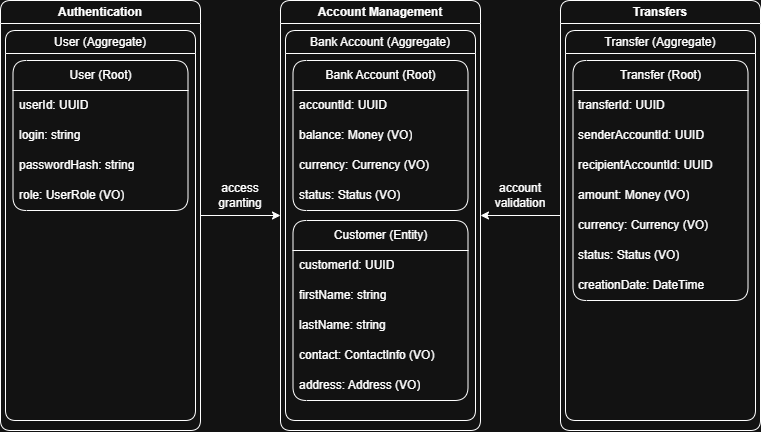

# Domain Driven Design

## Opis modelu

W domenie aplikacji bankowej zostały zdefiniowane trzy konteksty:
- Uwierzytelnienie (Authentication) – uwierzytelnianie użytkownika i nadawanie mu dostępu do jego kont bankowych;
- Zarządzanie kontem (Account Management) – zarządzanie kontem bankowym oraz dostęp do jego danych;
- Przelewy (Transfers) – walidacja i śledzenie przelewów bankowych pomiędzy kontami.

W tych kontekstach zostały zdefiniowane odpowiednie agregaty:
- Użytkownik (User),
- Konto bankowe (Bank Account),
- Przelew (Transfer).

Przy czym agregat Bank Account zawiera encję Klient (Customer).

## Diagram modelu

## Założenia modelu

### Agregaty i encje

| Agregat lub encja | Reguła |
| --- | --- |
| User | Posiada unikalny identyfikator i login. Wszystkie wartości string nie mogą zawierać znaków specjalnych. |
| Bank Account | Posiada unikalny identyfikator, saldo nie może być ujemne. |
| Customer | Posiada unikalny identyfikator, jego dane kontaktowe i adres powinny być wypełnione w całości. Wszystkie wartości string nie mogą zawierać znaków specjalnych. |
| Transfer | Posiada unikalny identyfikator, kwota przelewu musi być większa od zera, oba konta powinny być aktywne. W przypadku różnicy walut przelewu i konta odbiorcy powinna nastąpić konwersja. |

### Obiekty wartości

| Obiekt | Reguła |
| --- | --- |
| User Role | Użytkownik może mieć rolę Klienta (Customer) albo Administratora (Admin). |
| Money (Account Management) | Kwota nieujemna, obsługiwane są dwie cyfry po przecinku. |
| Currency (Account Management + Transfers) | Możliwe waluty: PLN, EUR, USD itd. |
| Status (Account Management) | Możliwe statusy: Active, Inactive, Blocked. |
| ContactInfo | Zawiera adres e-mail (z symbolem „@” i istniejącą domeną) oraz numer telefonu (wraz z kodem kraju). |
| Address | Zawiera ulicę, numer budynku, numer mieszkania (opcjonalnie), kod pocztowy (NN-NNN), miasto i kraj. |
| Money (Transfers) | Kwota większa od zera, obsługiwane są dwie cyfry po przecinku. |
| Status (Transfers) | Możliwe statusy: Pending, Completed, Rejected, Cancelled. |