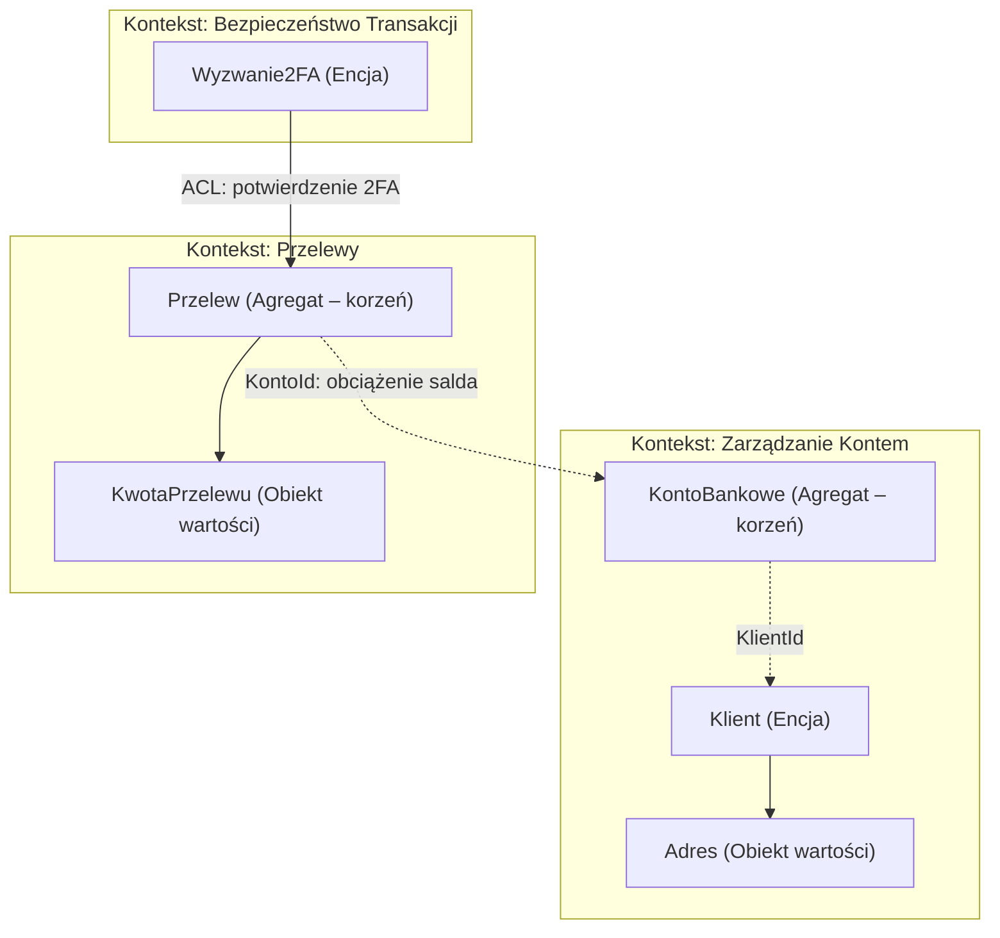

# Zadanie 1 – Zlecenie i autoryzacja przelewu

## 1. Opis zadania
Celem zadania jest zamodelowanie procesu zlecania i autoryzacji przelewu bankowego zgodnie z DDD. Wydzielono trzy konteksty ograniczone: **Zarządzanie Kontem**, **Przelewy** oraz **Bezpieczeństwo Transakcji**, które komunikują się przez identyfikatory. Model składa się z agregatów (`KontoBankowe`, `Przelew`), encji (`Klient`, `Wyzwanie2FA`) oraz samowalidujących obiektów wartości (`Adres`, `KwotaPrzelewu`).

---

## 2. Model domeny

---

## 3. Przyjęte założenia i ograniczenia modelu

| Obiekt (Typ DDD) | Kontekst | Atrybut | Typ i akceptowany format danych |
| :--- | :--- | :--- | :--- |
| **`KontoBankowe`** (Agregat) | Zarządzanie Kontem | `id` | `UUID` |
| | | `klientId` | `UUID` (referencja do właściciela wyłącznie przez ID) |
| | | `numerIBAN` | `String`, zaczyna się przedrostkiem kraju, w zależności od wybranego kraju, sprawdzana jest liczba cyfr |
| | | `saldo` | `BigDecimal`, wartość `>= 0.00`, maks. 2 miejsca po przecinku |
| | | `status` | `Enum`: `AKTYWNE`, `ZABLOKOWANE` |
| **`Klient`** (Encja) | Zarządzanie Kontem | `id` | `UUID` |
| | | `imieNazwisko` | `String`, 2–80 znaków, sprawdzany regexem |
| | | `adres` | Obiekt wartości `Adres` |
| **`Adres`** (Obiekt wartości) | Zarządzanie Kontem | `ulica` | `String`, 2–80 znaków, tylko litery, cyfry, spacje, kropki i `/` |
| | | `kodPocztowy` | `String`, dokładnie 6 znaków, tylko liczby i znaki `-` |
| | | `miasto` | `String`, 2–64 znaków, tylko litery, spacje i myślniki |
| **`Przelew`** (Agregat) | Przelewy | `id` | `UUID` |
| | | `kontoNadawcyId` | `UUID` (referencja do `KontoBankowe`) |
| | | `ibanOdbiorcy` | `String`, sprawdzany tak jak `numerIBAN`, różny od rachunku nadawcy |
| | | `kwota` | Obiekt wartości `KwotaPrzelewu` |
| | | `tytul` | `String`, 1–140 znaków, sprawdzany regexem |
| | | `status` | `Enum`: `NOWY` -> `ZAUTORYZOWANY`, `ZREALIZOWANY`, `ODRZUCONY` |
| **`KwotaPrzelewu`** (Obiekt wartości) | Współdzielony | `wartosc` | `BigDecimal`, zakres `0.01 – 1 000 000.00` (musi być > 0) |
| | | `waluta` | `Enum` skrótu waluty |
| **`Wyzwanie2FA`** (Encja) | Bezpieczeństwo Transakcji | `przelewId` | `UUID` |
| | | `kod2FA` | `String`, dokładnie 6 cyfr |
| | | `liczbaProb` | `Int`, zakres `0 – 3`, maksymalnie 3 próby|

---

## 4. Reguły biznesowe i integracja między kontekstami

1. **Walidacja przy tworzeniu obiektów**: Obiekty wartości (`KwotaPrzelewu`, `Adres`) oraz pola tekstowe (`tytul`, `numerIBAN`) są niemutowalne i walidowane w konstruktorze (sprawdzenie długości przed regexem) — niepoprawny obiekt nie może powstać.
2. **Autoryzacja przelewu (Kontekst `Bezpieczeństwo Transakcji` -> `Przelewy`)**: Przelew nie może zmienić stanu na `ZREALIZOWANY` z pominięciem stanu `ZAUTORYZOWANY`. Potwierdzenie kodu 2FA przechodzi przez Warstwę ACL, która weryfikuje zgodność `przelewId` oraz `kwoty`.
3. **Księgowanie (Kontekst `Przelewy` -> `Zarządzanie Kontem`)**: Po autoryzacji `KontoBankowe` weryfikuje niezmienniki, czy `status == AKTYWNE` oraz `saldo >= kwota` i obciąża rachunek nadawcy za pomocą metody `obciazKonto(kwota)`.
