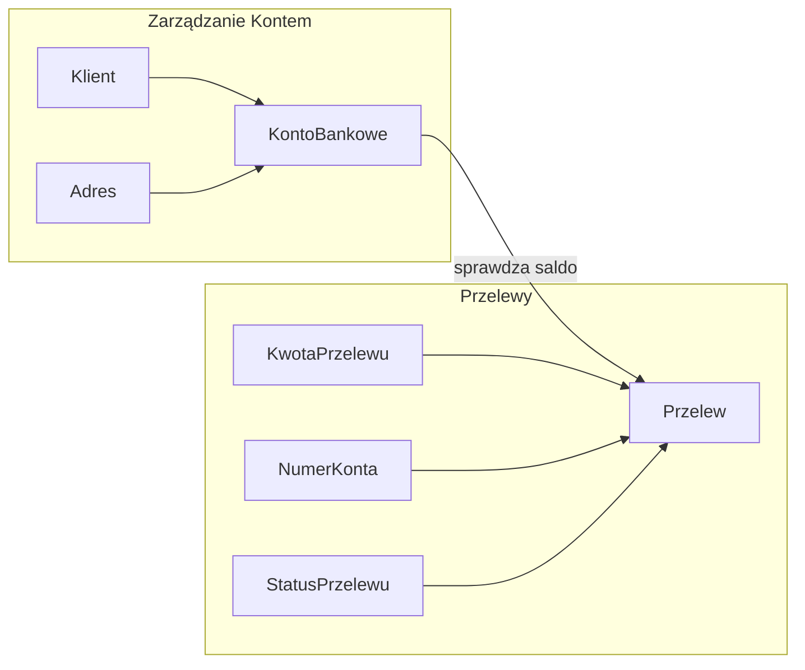

# Zadanie 1 - Domain Driven Design

Celem zadania jest przedstawienie prostego modelu bankowego w podejściu DDD. Model został ograniczony do najważniejszych agregatów i obiektów wartości, aby pokazać zasadę podziału systemu na bounded contexts oraz relacje pomiędzy nimi.

## 1. Bounded Contexts

### 1.1 Zarządzanie Kontem

Obszar odpowiedzialny za tworzenie i prowadzenie kont klienta, kontrolę salda oraz podstawowe dane właściciela. W tym kontekście kluczowe są operacje związane z aktywacją konta, aktualizacją stanu środków i sprawdzaniem poprawności danych klienta.

### 1.2 Przelewy

Obszar odpowiedzialny za realizację transferów między kontami. W tym kontekście sprawdzana jest dostępność środków, walidacja danych odbiorcy oraz status przelewu. Integracja z kontekstem Zarządzania Kontem odbywa się poprzez odczyt stanu konta i aktualizację salda po wykonaniu przelewu.

## 2. Model domeny

## 3. Agregaty, encje i obiekty wartości

### Agregat: KontoBankowe

Encja: `KontoBankowe`

| Nazwa atrybutu | Typ danych | Przykładowa wartość            |
| -------------- | ---------- | ------------------------------ |
| `idKonta`      | `String`   | `K-1001`                       |
| `numerKonta`   | `String`   | `PL12345678901234567890123456` |
| `saldo`        | `Decimal`  | `2500.75`                      |
| `waluta`       | `String`   | `PLN`                          |
| `statusKonta`  | `String`   | `AKTYWNE`                      |
| `wlasciciel`   | `Klient`   | `Jan Kowalski`                 |

Odpowiedzialność:

- sprawdzanie dostępności środków,
- aktualizacja salda po wpłacie/wyciągnięciu,
- walidacja numeru konta i statusu.

### Encja: Klient

| Nazwa atrybutu | Typ danych | Przykładowa wartość                |
| -------------- | ---------- | ---------------------------------- |
| `idKlienta`    | `String`   | `KL-001`                           |
| `imie`         | `String`   | `Jan`                              |
| `nazwisko`     | `String`   | `Kowalski`                         |
| `pesel`        | `String`   | `95010112345`                      |
| `adres`        | `Adres`    | `ul. Kwiatowa 12, 00-001 Warszawa` |

Odpowiedzialność:

- identyfikacja właściciela konta,
- przechowywanie podstawowych danych personalnych.

### Obiekt wartości: Adres

| Nazwa atrybutu | Typ danych | Przykładowa wartość |
| -------------- | ---------- | ------------------- |
| `ulica`        | `String`   | `Kwiatowa`          |
| `numerDomu`    | `String`   | `12`                |
| `kodPocztowy`  | `String`   | `00-001`            |
| `miasto`       | `String`   | `Warszawa`          |

Założenie:

- adres jest niezmienny jako całość,
- nie ma tożsamości niezależnej od klienta.

### Agregat: Przelew

Encja: `Przelew`

| Nazwa atrybutu   | Typ danych      | Przykładowa wartość            |
| ---------------- | --------------- | ------------------------------ |
| `idPrzelewu`     | `String`        | `TR-2026-0001`                 |
| `nadawca`        | `KontoBankowe`  | `PL12345678901234567890123456` |
| `odbiorca`       | `KontoBankowe`  | `PL98765432109876543210987654` |
| `kwota`          | `KwotaPrzelewu` | `1500.00 PLN`                  |
| `dataUtworzenia` | `LocalDateTime` | `2026-11-10T14:30:00`          |
| `status`         | `String`        | `WYKONANY`                     |

Odpowiedzialność:

- tworzenie i zapisywanie przelewu,
- weryfikacja poprawności danych,
- powiązanie z danymi konta nadawcy i odbiorcy.

### Obiekt wartości: KwotaPrzelewu

| Nazwa atrybutu | Typ danych | Przykładowa wartość |
| -------------- | ---------- | ------------------- |
| `wartosc`      | `Decimal`  | `1500.00`           |
| `waluta`       | `String`   | `PLN`               |

Założenie:

- wartość musi być większa od zera,
- liczba ma dwa miejsca po przecinku,
- waluta musi być zgodna z kontem nadawcy i odbiorcy.

### Obiekt wartości: NumerKonta

| Nazwa atrybutu | Typ danych | Przykładowa wartość            |
| -------------- | ---------- | ------------------------------ |
| `numer`        | `String`   | `PL12345678901234567890123456` |

Założenie:

- format składa się z kodu kraju i numeru konta,

## 4. Założenia przyjęte do modelu

| Element         | Typ                    | Założenie                                                                             | Ograniczenie / zasada biznesowa                                                                                    |
| --------------- | ---------------------- | ------------------------------------------------------------------------------------- | ------------------------------------------------------------------------------------------------------------------ |
| Klient          | Encja                  | Klient jest właścicielem konta i głównym podmiotem w kontekście zarządzania kontem    | W systemie może istnieć wiele kont przypisanych do jednego klienta, ale konto musi mieć jednego właściciela        |
| Adres           | Obiekt wartości        | Adres jest częścią danych klienta i nie ma własnej tożsamości                         | Adres nie może być modyfikowany niezależnie od klienta; zmiana danych adresowych oznacza utworzenie nowej wartości |
| KontoBankowe    | Agregat                | Konto jest jednostką biznesową odpowiedzialną za stan środków i status konta          | Konto nie może mieć ujemnego salda, jeśli nie została dopuszczona forma debetu                                     |
| Przelew         | Agregat                | Przelew reprezentuje pojedynczą operację finansową pomiędzy kontami                   | Przelew jest niezmienny po zatwierdzeniu; jedynie można dodać status lub historię wykonania                        |
| KwotaPrzelewu   | Obiekt wartości        | Kwota jest wartością domenową i nie może występować jako samodzielny bytem bez waluty | Przelew może być zrealizowany tylko wtedy, gdy kwota jest większa od zera i środki są dostępne                     |
| Status przelewu | Obiekt wartości / stan | Status odzwierciedla etap realizacji operacji                                         | Statusy są ograniczone do: `NOWY`, `W_TRAKCJI`, `WYKONANY`, `ODRZUCONY`                                            |

## 5. Integracja pomiędzy kontekstami

- Kontekst Zarządzania Kontem dostarcza informacje o stanie konta, numerze konta i właścicielu.
- Kontekst Przelewów pobiera te dane i sprawdza, czy nadawca ma wystarczające środki.
- Po zaakceptowaniu przelewu następuje aktualizacja salda konta nadawcy oraz odbiorcy.
- Jeśli warunki nie są spełnione, przelew zostaje odrzucony i zapisany w statusie `ODRZUCONY`.
