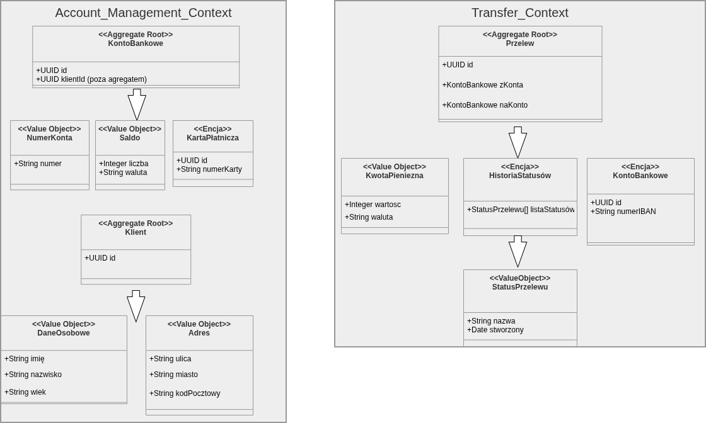

# Zadanie 1 (DDD)
Celem zadania jest zamodelowanie kluczowego fragmentu aplikacji bankowej, 
obejmującego zarządzanie rachunkiem oraz realizację przelewów, 
w oparciu o zasady Domain Driven Design (DDD). 
Architektura została podzielona na dwa autonomiczne obszary: 
`Account_Management_Context` odpowiedzialny za stan środków i dane klienta, oraz 
`Transfer_Context` procesujący cykl życia transakcji. 
Główne agregaty komunikują się ze sobą w sposób luźno powiązany, 
wykorzystując referencje po identyfikatorach 
(np. klientId zdefiniowane jako identyfikator poza agregatem), 
co chroni niezależność obu kontekstów.

## Założenia i ograniczenia domenowe
`Account Management Context`: 
- KontoBankowe (Aggregate Root): Reprezentuje rachunek i zarządza jego stanem. 
 Odwołuje się do właściciela wyłącznie przez klientId (UUID), 
 co zapobiega wczytywaniu całego obiektu klienta.   
- KartaPlatnicza (Encja): Funkcjonuje wewnątrz agregatu konta, 
 posiada własne id (UUID) oraz numerKarty (String). 
 Jej cykl życia (np. blokowanie, wydawanie nowej) jest zarządzany przez główne konto.   
- Klient (Aggregate Root): Niezależny agregat identyfikowany przez UUID.  
 Zbiera dane opisujące osobę za pomocą niemutowalnych Obiektów Wartości (Value Objects): 
- DaneOsobowe (imię, nazwisko, wiek) 
- Adres (ulica, miasto, kod pocztowy). W przypadku zmiany adresu, wymieniany jest cały obiekt.   
- Saldo i NumerKonta (Value Objects): Reprezentują konkretne wartości. 
 Dla salda przyjęto format Integer dla liczby oraz String dla waluty. 
 Założono, że typ całkowity przechowuje wartości w najmniejszych jednostkach (np. groszach), 
 co zapobiega błędom precyzji w obliczeniach finansowych. 

`Transfer Context`:  
- Przelew (Aggregate Root): Główny zarządca transakcji. 
 Przechowuje informacje o koncie nadawcy i odbiorcy w polach zKonta i naKonto.   
- HistoriaStatusow (Encja): Podrzędna encja zarządzająca chronologią statusów, 
 zawierająca tablicę listaStatusow. Elementy tej tablicy to Obiekty Wartości StatusPrzelewu (posiadające nazwę i datę stworzenia).   
- KontoBankowe (Encja w kontekście przelewu): Zredukowana forma konta, 
 ograniczona wyłącznie do id oraz numerIBAN. W tym kontekście służy jedynie jako definicja punktu końcowego 
 (źródła lub celu) dla transferu środków.   
- KwotaPieniezna (Value Object): Identycznie jak w przypadku salda, opiera się na typie Integer, 
 wymuszając operowanie na ułamkowych jednostkach bazowych (np. centy, grosze).

## Separacja danych 
Kontekst przelewu nie ma bezpośredniego dostępu do Salda. 
Reprezentacje obiektów, takie jak KontoBankowe, różnią się atrybutami w zależności od tego, 
w którym kontekście się znajdują.   
Operacja autoryzacji: Aby zainicjować Przelew, Transfer_Context musi komunikować się z Account_Management_Context 
za pomocą odpowiednich identyfikatorów, aby sprawdzić wystarczalność środków (Saldo) przed zmianą stanu w HistoriaStatusow.

