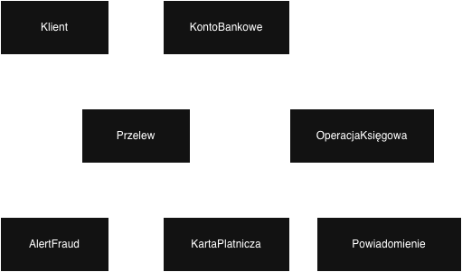

## Opis zadania

Celem zadania jest zamodelowanie fragmentu aplikacji bankowej zgodnie z zasadami Domain Driven Design. W ramach projektu wyodrębniono ograniczony kontekst związany z zarządzaniem kontami i wykonywaniem przelewów. Model obejmuje jedynie najważniejsze koncepty domenowe, aby skoncentrować się na ich poprawnej separacji oraz zależnościach. Diagram oraz opis poniżej przedstawiają przyjęte elementy i założenia projektowe.

## Bounded Context – podział systemu

| Bounded Context                                                                       | Opis                                       | Przykłady agregatów / elementów |
| ------------------------------------------------------------------------------ | ------------------------------------------------------ | ------------------------------- |
| **Zarządzanie Kontem**                                    | Prowadzenie i obsługa kont klientów                    | KontoBankowe, Klient            |
| **Przelewy**                                                       | Tworzenie i realizacja przelewów lokalnych             | Przelew                         |
| **Rozliczenia i Księgowanie**                                     | Finalizacja transakcji, aktualizacja sald, audyt       | OperacjaKsięgowa                |
| **Bezpieczeństwo i Anti-Fraud**                   | Monitorowanie podejrzanych operacji, reguły blokowania | RegułaFraud, AlertFraud         |
| **Powiadomienia**                                              | Informowanie klientów o wykonanych akcjach             | Powiadomienie                   |
| **Zarządzanie Kartami** | Obsługa kart płatniczych przypisanych do konta         | KartaPlatnicza                  |

## Model domenowy – Agregaty, Encje i Value Objects

### Agregaty

| Agregat          | Root             | Opis                                           |
| ---------------- | ---------------- | ---------------------------------------------- |
| KontoBankowe     | KontoBankowe     | Przechowuje saldo i autoryzuje obciążenia      |
| Klient           | Klient           | Dane właściciela konta, bez wiedzy o saldach   |
| Przelew          | Przelew          | Zarządza procesem płatności i walidacją danych |
| OperacjaKsięgowa | OperacjaKsięgowa | Rejestruje finalne zmiany sald i audyt         |
| AlertFraud       | AlertFraud       | Generowany, gdy wykryto podejrzaną akcję       |
| Powiadomienie    | Powiadomienie    | Komunikuje wynik operacji do klienta           |

### Encje

| Encja                | Atrybuty                                                         | Uwagi                                                      |
| -------------------- | ---------------------------------------------------------------- | ---------------------------------------------------------- |
| **KontoBankowe**     | `numerKonta`, `saldo`, `waluta`                                  | Numer konta unikalny, saldo ≥ 0 (chyba że konto kredytowe) |
| **Przelew**          | `id`, `data`, `status`, `nadawcaKonto`, `odbiorcaKonto`, `kwota` | Status: NOWY, W TOKU, ODRZUCONY, ZREALIZOWANY              |
| **Klient**           | `id`, `imie`, `nazwisko`, `adres`, `telefon`, `email`            | Dane kontaktowe wymagane do powiadomień                    |
| **OperacjaKsięgowa** | `id`, `typ`, `data`, `kwota`, `konto`, `referencjaPrzelewu`      | Niezmienna po zapisaniu — wymagana do audytu               |
| **AlertFraud**       | `id`, `data`, `powód`, `poziomRyzyka`, `idPrzelewu`              | Główny element wykrycia oszustwa, może blokować transakcję |
| **Powiadomienie**    | `id`, `typ`, `tresc`, `data`, `klientId`, `status`               | Status: OCZEKUJĄCE, WYSŁANE, BŁĄD                          |
| **KartaPlatnicza**   | `numerKarty`, `dataWaznosci`, `status`, `kontoPowiazane`         | Status: AKTYWNA, ZABLOKOWANA, WYGASNIECIE                  |

### Value Objects

| Value Object   | Atrybuty                 | Reguły                                |
| -------------- | ------------------------ | ------------------------------------- |
| Kwota          | `wartosc`, `waluta`      | Wartość > 0; waluta zgodna z kontem   |
| Adres          | `ulica`, `miasto`, `kod` | Dane muszą być kompletne              |
| NumerKonta     | `IBAN`                   | W pełni zwalidowany format IBAN       |
| StatusPrzelewu | `enum`                   | NOWY, W TOKU, ODRZUCONY, ZREALIZOWANY |

## Dodatkowe założenia i ograniczenia

- Konto nie może mieć salda ujemnego, chyba że ma status konta kredytowego

- Każdy przelew przechodzi obowiązkowy proces anty-fraud

- Historia operacji musi być nieusuwalna

- Przelewy między różnymi walutami wymagają konwersji (poza zakresem zadania)

- Klient nie posiada bezpośredniego dostępu do księgowania — jedynie zleca operację

## Najważniejsze procesy i interakcje między kontekstami

| Proces                   | Opis                                | Komunikacja między kontekstami         |
| ------------------------ | ----------------------------------- | -------------------------------------- |
| Utworzenie przelewu      | Klient inicjuje transakcję          | Transfers → Security → Settlement      |
| Weryfikacja antyfraudowa | Automaty sprawdzają ryzyko i limity | Security → Transfers                   |
| Księgowanie              | Aktualizacja sald obu kont          | Settlement → Account Management        |
| Powiadomienie            | Informowanie klienta o statusie     | Settlement / Transfers → Notifications |

## Model

