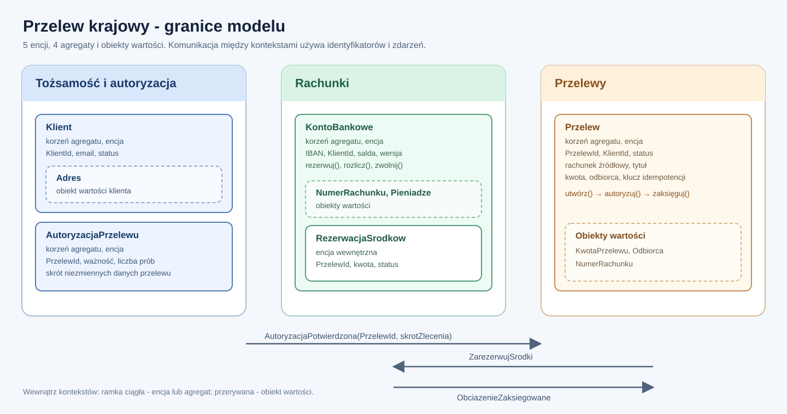

# Model DDD - przelew krajowy

Model obejmuje zlecenie przelewu krajowego w PLN przez uwierzytelnionego klienta. Zakres ogranicza się do utworzenia przelewu, jego autoryzacji, rezerwacji środków i zaksięgowania obciążenia. Każdy bounded context przechowuje własny model i przekazuje pozostałym tylko identyfikatory, komendy oraz zdarzenia. Nieudana autoryzacja lub rezerwacja kończy zlecenie bez obciążenia rachunku.

## Bounded contexts

| Kontekst | Odpowiedzialność | Granica danych |
| --- | --- | --- |
| Tożsamość i autoryzacja | Dane klienta, aktywna sesja i potwierdzenie przelewu kodem jednorazowym. | Udostępnia wynik autoryzacji przypisany do `PrzelewId`, `KlientId` i skrótu danych zlecenia, bez ujawniania kodu. |
| Rachunki | Własność rachunku, saldo księgowe i dostępne, rezerwacja środków oraz zaksięgowanie obciążenia. | Przyjmuje żądanie dla `NumerRachunku`, `KlientId`, `PrzelewId` i `KwotaPrzelewu`. Nie zna danych odbiorcy ani kodu jednorazowego. |
| Przelewy | Cykl życia zlecenia, odbiorca, kwota i idempotencja operacji. | Przechowuje identyfikatory klienta i rachunku, a nie kopie encji z innych kontekstów. |

## Agregaty, encje i obiekty wartości

W modelu są **5 encji**. Granice agregatów wyznaczają `Klient`, `AutoryzacjaPrzelewu`, `KontoBankowe` i `Przelew`; `RezerwacjaSrodkow` jest encją wewnątrz agregatu `KontoBankowe`.

| Element | Atrybuty i akceptowany format | Reguły |
| --- | --- | --- |
| `Klient` - encja, korzeń agregatu | `KlientId`: UUID; `imieINazwisko`: 1-120 znaków; `email`: poprawny adres e-mail do 254 znaków; `adres`: obiekt `Adres`; `status`: `AKTYWNY` albo `ZABLOKOWANY`. | Tylko aktywny klient może zlecić przelew. Dane osobowe pozostają w kontekście tożsamości. |
| `AutoryzacjaPrzelewu` - encja, korzeń agregatu | `AutoryzacjaId`: UUID; `PrzelewId`, `KlientId`: UUID; `skrotZlecenia`: skrót identyfikatora, rachunku źródłowego, kwoty i odbiorcy; `status`: `OCZEKUJE`, `POTWIERDZONA`, `ODRZUCONA`, `WYGASLA`; `waznaDo`: czas UTC; `liczbaProb`: 0-3. | Kod jednorazowy ma 6 cyfr i jest ważny 5 minut. Przechowywany jest wyłącznie jego skrót, a trzecia błędna próba blokuje autoryzację. Potwierdzenie dotyczy wyłącznie danych zapisanych w `skrotZlecenia`. |
| `KontoBankowe` - encja, korzeń agregatu | `NumerRachunku`: polski IBAN; `KlientId`: UUID; `saldoKsiegowe`, `saldoDostepne`: `Pieniadze`; `status`: `AKTYWNE` albo `ZABLOKOWANE`; `wersja`: liczba całkowita. | Rezerwacja wymaga zgodności właściciela, aktywnego konta i wystarczającego salda dostępnego. W tym fragmencie `saldoDostepne` równa się `saldoKsiegowe` pomniejszonemu o aktywne rezerwacje. Kontrola wersji zapobiega podwójnemu wydaniu środków. |
| `RezerwacjaSrodkow` - encja wewnętrzna | `RezerwacjaId`, `PrzelewId`: UUID; `kwota`: `Pieniadze`; `status`: `AKTYWNA`, `ROZLICZONA`, `ZWOLNIONA`; `waznaDo`: czas UTC. | Dla jednego `PrzelewId` powstaje najwyżej jedna rezerwacja. Tylko agregat konta może ją rozliczyć lub zwolnić. |
| `Przelew` - encja, korzeń agregatu | `PrzelewId`: UUID; `KlientId`: UUID; `rachunekZrodlowy`: `NumerRachunku`; `odbiorca`: `Odbiorca`; `kwota`: `KwotaPrzelewu`; `tytul`: 1-140 znaków; `kluczIdempotencji`: UUID; `status`: `UTWORZONY`, `OCZEKUJE_NA_AUTORYZACJE`, `AUTORYZOWANY`, `ZAKSIEGOWANY`, `ODRZUCONY`. | Rachunek źródłowy, kwota i odbiorca są niezmienne od utworzenia zlecenia. Ponowne żądanie z tym samym kluczem i danymi zwraca ten sam przelew, a z innymi danymi jest odrzucane. Stan `ZAKSIEGOWANY` jest końcowy. |
| `Adres` - obiekt wartości | `ulica`: 1-100 znaków; `numer`: 1-10 znaków; `kodPocztowy`: `NN-NNN`; `miasto`: 1-100 znaków; `kraj`: kod ISO 3166-1 alpha-2. | Niezmienny, porównywany po wartościach pól. |
| `NumerRachunku` - obiekt wartości | `PL` i 26 cyfr, łącznie 28 znaków; suma kontrolna IBAN mod 97. | Normalizowane są jedynie spacje podczas wprowadzania. Niepoprawny numer jest odrzucany przed utworzeniem przelewu. |
| `Pieniadze` i `KwotaPrzelewu` - obiekty wartości | `Decimal` z dokładnością do 0,01 PLN; kwota przelewu od 0,01 do 100 000,00 PLN. | Obliczenia nie używają liczb zmiennoprzecinkowych; saldo nie może spaść poniżej zera. |
| `Odbiorca` - obiekt wartości | `nazwa`: 1-140 znaków; `rachunek`: `NumerRachunku`. | Zawartość jest niezmienna od utworzenia zlecenia. |

`NumerRachunku` występuje w kontekstach rachunków i przelewów jako lokalny obiekt wartości, bez współdzielenia instancji między kontekstami.

## Przebieg i granice spójności

1. Kontekst przelewów przyjmuje `ZlecPrzelew`, weryfikuje format danych i klucz idempotencji oraz zapisuje niezmienne dane zlecenia. Rachunki sprawdzają, czy `KlientId` jest właścicielem aktywnego rachunku.
2. Kontekst tożsamości potwierdza kod dla `PrzelewId` i skrótu danych zlecenia. Zdarzenie `AutoryzacjaPotwierdzona` zawiera oba pola. Przelewy porównują skrót z własnymi danymi i dopiero wtedy przechodzą do stanu `AUTORYZOWANY`.
3. Przelewy wysyłają `ZarezerwujSrodki`. Konto atomowo tworzy `RezerwacjaSrodkow` i pomniejsza saldo dostępne. Rozliczenie rezerwacji pomniejsza saldo księgowe tylko raz; saldo dostępne nie jest wtedy pomniejszane ponownie.
4. Po `ObciazenieZaksiegowane` przelew otrzymuje stan `ZAKSIEGOWANY`. Jeśli rezerwacja zostanie odrzucona lub wygaśnie przed rozliczeniem, konto ją zwalnia, przywraca saldo dostępne, a przelew przechodzi do stanu `ODRZUCONY`.

Między agregatami stosowane są identyfikatory i zdarzenia, więc nie ma transakcji obejmującej trzy konteksty. Każdy odbiorca zdarzenia zapamiętuje jego identyfikator i ignoruje ponowne dostarczenie. W dzienniku audytowym znajdują się identyfikatory operacji, czas i wynik, bez kodów jednorazowych i pełnych danych osobowych.

Autor: Mateusz Orzełowski
