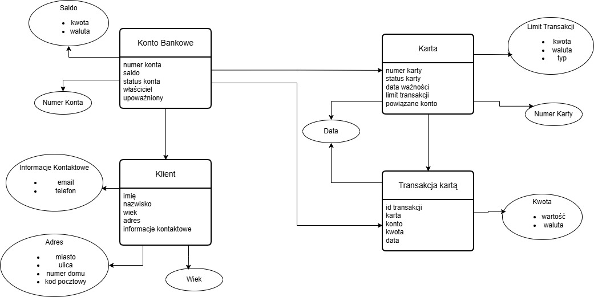

# Model Domenowy
Marta Sobol 318723

## Opis
Stworzony model domenowy systemy bankowego ma dwa konteksty: zarządzanie kontem i zarządzanie kartami płatniczymi. Model pozwala tworzyć klientów i ich konta bankowe. Klient może być właścicielem konta albo być upoważnionym do danego konta. Model obsługuje również tworzenie kart płatniczych i wykonywanie płatności.

## Diagram

## Encje i Value Object

### Konto Bankowe

| Atrybut                | Typ                             | Opis                                   |
|------------------------|----------------------------------|-----------------------------------------|
| numer konta             | ValueObject: numer konta          | Unikalny numer konta |
| saldo                  | ValueObject: saldo               | Aktualne saldo konta |
| status konta            | enum (aktywne, zamrożone, zamknięte)    | Aktualny status konta|
| właściciel           | Klient                     | Właściciel konta |
| upoważnieni | List[Klient]                    | Osoby upoważnione do konta|

### Klient

| Atrybut      | Typ                   | Opis                                                     |
|--------------|------------------------|-----------------------------------------------------------|
| imię         | string                | Imię klienta|
| nazwisko     | string                | Nazwisko klienta |
| adres        | ValueObject: Adres    | Adres zamieszkania: |
| wiek        | ValueObject: Wiek    | Wiek klienta|
| inforamcje kontaktowe        | ValueObject: Inforamcje kontaktowe    | Informacje kontaktowe|

### Karta Płatnicza

| Atrybut              | Typ                          | Opis                                        |
|----------------------|-------------------------------|----------------------------------------------|
| numer karty           | ValueObject: Numer karty      | Unikalny numer karty |
| status karty          | enum (Aktywna, Zablokowana, Nieważna) | Aktualny status karty |
| data ważności         | ValueObject: Data | Data ważności |
| limit transakcji    | ValueObject: Limit transakcji | Limit płatności kartą |
| powiązane konto       | Konto bankowe                 | Konto, z którego środki są pobierane         |

### Transakcja Kartą
| Atrybut        | Typ                                   | Opis                                                |
|----------------|----------------------------------------|------------------------------------------------------|
| id transakcji            | int     | Identyfikator transakcji  |
| karta        | Karta Płatnicza  | Referencja do karty, która inicjowała transakcję     |
| konto        | Konto Bankowe           | Referencja do konta powiązanego z kartą  |
| kwota          | ValueObject: Kwota    | Kwota transakcji |
| data | ValueObject: Data  | Data i czas wykonania transakcji  |

## Założenia

- **Numer konta jest unikalny** (Konto bankowe)  
  - Każde konto posiada niepowtarzalny numer.  
  - Tworzenie nowego konta wymaga weryfikacji unikalności numeru.  

- **Status konta** (Konto bankowe)  
  - Statusy: aktywne, zamrożone, zamknięte.  
  - Jeżeli bank wykryje podejrzane operacje zmienia status na zamrożone - klient nie może wykonywać transakcji aż do wyjaśnienia sprawy 

- **Właściciel konta jest wymagany** (Konto bankowe)  
  - Każde konto musi mieć przypisanego klienta.  
  - Jest jeden właściciel konta i nie można go zmienić  

- **Upoważnienia klientów** (Konto bankowe)  
  - Lista osób upoważnionych do konta - nie mogą oni wykonywać transakcji z tego konta, ale mają dostęp do wyświetlenia salda i histori transakcji.  
  - Możliwość dodawania i usuwania upoważnionych użytkowników.  

- **Numer karty jest unikalny** (Karta płatnicza)  
  - Każda karta identyfikowana jest unikalnym numerem.  
  - Tworzenie karty wymaga weryfikacji unikalności numeru.
  - Karta powiązana jest z kontem.  

- **Wykonanie transkacji** (Transakcja kartą)  
  - Przed wykonaniem transakcji sprawdzenie czy nie przekroczono limitu karty.
  - Przed wykonaniem transakcji sprawdzenie czy są wystarczające środki na koncie.

- **Data ważności karty** (Karta płatnicza)  
  - Karta nie może być użyta po upływie daty ważności.  
  - Transakcje po tej dacie są odrzucane.  

- **Saldo konta ≥ 0** (Konto bankowe)  
  - Brak debetu, nie może być na minusie.  
  - Operacje obciążające konto weryfikują saldo przed wykonaniem transakcji.  

