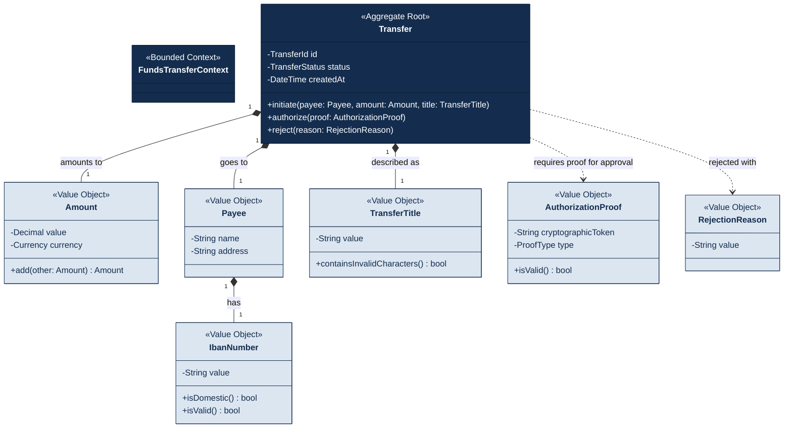

# DDD.md

# Opis zadania

Celem zadania jest zamodelowanie fragmentu aplikacji bankowej z wykorzystaniem zasad Domain Driven Design (DDD). Wybranym obszarem systemu jest realizacja przelewów bankowych, obejmująca ich inicjowanie, autoryzację oraz odrzucanie. Głównym elementem modelu jest agregat ``Transfer``, który odpowiada za przechowywanie danych przelewu i kontrolowanie jego stanu. Model uwzględnia również obiekty wartości opisujące kwotę, odbiorcę, numer rachunku, tytuł oraz dane wymagane do autoryzacji.

# Diagram DDD

# Opis elementów diagramu

| Element modelu | Typ | Atrybuty | Ograniczenia i reguły biznesowe | Integracja i język domeny |
| --- | --- | --- | --- | --- |
| **FundsTransferContext** | `Bounded Context` | — | Odpowiada za inicjowanie, autoryzację i odrzucanie przelewów. Skupia logikę biznesową związaną z realizacją przelewów. | Współpracuje z innymi kontekstami, np. `AccountManagementContext` oraz `AuthenticationContext`. |
| **Transfer** | `Aggregate Root` | `id`, `status`, `createdAt` | Wymusza zachowanie spójności agregatu. Zmiana stanu następuje wyłącznie poprzez metody domenowe, np. `initiate()`, `authorize()` i `reject()`. Przelew musi zostać poprawnie autoryzowany przed realizacją. | Główny obiekt domenowy. Odpowiada za kontrolowanie cyklu życia przelewu i jego statusu. |
| **Payee** | `Value Object` | `name`, `address` | Zawiera dane odbiorcy przelewu. Obiekt jest niezmienny (immutable). Musi posiadać poprawne dane identyfikujące odbiorcę. | Hermetyzuje dane odbiorcy. Zawiera numer rachunku reprezentowany przez `IbanNumber`. |
| **Amount** | `Value Object` | `value` (Decimal), `currency` (Currency) | Kwota musi być dodatnia. Obiekt jest niemutowalny. Operacja dodawania jest dozwolona wyłącznie dla kwot wyrażonych w tej samej walucie. | Reprezentuje wartość pieniężną. Wykorzystywany do określenia kwoty przelewu. |
| **IbanNumber** | `Value Object` | `value` (String) | Numer rachunku musi spełniać wymagania formatu IBAN, w tym poprawną długość i sumę kontrolną. Niepoprawna wartość nie może zostać utworzona. | Reprezentuje unikalny identyfikator rachunku bankowego. Może służyć do określenia, czy rachunek jest krajowy (`isDomestic()`). |
| **TransferTitle** | `Value Object` | `value` (String) | Tytuł przelewu nie może przekraczać 140 znaków. Dopuszczalne są znaki alfanumeryczne, spacje i podstawowe znaki interpunkcyjne. | Przechowuje opis przelewu. Przekazywany wraz z danymi przelewu do dalszej realizacji. |
| **AuthorizationProof** | `Value Object` | `cryptographicToken`, `type` (ProofType) | Zawiera dane wymagane do autoryzacji przelewu. Token musi zostać zweryfikowany przed zatwierdzeniem operacji. Nie powinien być przechowywany w postaci jawnej. | Wykorzystywany podczas autoryzacji. Może pochodzić z kontekstu `AuthenticationContext`. |
| **RejectionReason** | `Value Object` | `value` (String) | Przyczyna odrzucenia nie może być pusta. Powinna zawierać informację pozwalającą określić powód odrzucenia przelewu. | Przekazywana do metody `reject()` agregatu `Transfer` i powiązana z odrzuceniem przelewu. |