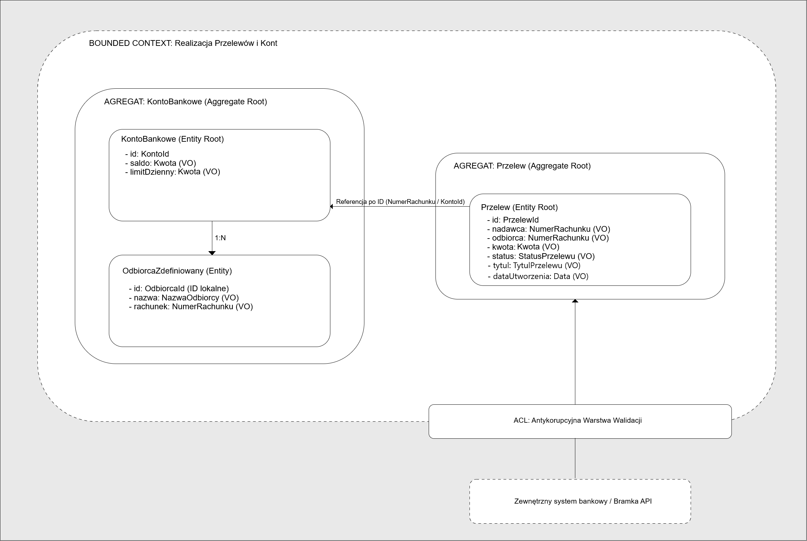

## Opis Zadania

Zadanie 1 obejmowało realizację projekt wybranych elementów domeny systemu bankowego z wykorzystaniem podejścia Domain-Driven Design (DDD) w kontekście koncepcji Security by Design. Głównym celem było zademonstrowanie, jak prawidłowo skonstruowane agregaty, obiekty wartości (Domain Primitives) oraz warstwa antykorupcyjna (ACL) zapobiegają błędom logiki biznesowej. Model skupia się na najważniejszym aspekcie dziedziny bankowej: inicjacji oraz realizacji przelewu pieniężnego między rachunkami, przy jednoczesnym zachowaniu pełnej spójności i samowalidacji obiektów.

W systemie bankowym wyodrębniono trzy podstawowe konteksty ograniczone (Bounded Contexts):
Kontekst Tożsamości i Uwierzytelniania (Identity & Auth Context)
Kontekst Zarządzania Kontami (Account Management Context)
Kontekst Realizacji Przelewów (Transfer Execution Context) – główny kontekst analizy

## Diagram modelu

## Przyjęte Założenia

### A. Walidacja Kwoty Transakcji (*Negative Amount Injection*)
* **Reguła biznesowa:** Kwota musi być ściśle dodatnia ($Kwota > 0$), wyrażona w walucie ze standardu ISO 4217 (np. PLN) oraz posiadać precyzję maksymalnie dwóch miejsc po przecinku.
* **Miejsce egzekwowania:** Obiekt wartości `Kwota (VO)` / `KwotaPrzelewu (VO)` (*Domain Primitive*).
* **Kaskada walidacji:**
  1. Sprawdzenie braku wartości puste/null (`Objects.requireNonNull`).
  2. Format leksykalny i precyzja (wyrażenie regularne `^\d+(\.\d{1,2})?$`).
  3. Semantyka wartości ($val > 0.00$).
* **Efekt dla bezpieczeństwa:** Całkowite wyeliminowanie podatności na ujemne kwoty, wyłudzenie środków lub uszkodzenie arytmetyki finansowej.

### B. Walidacja Numeru Rachunku (*Błędny lub Sfałszowany IBAN*)
* **Reguła biznesowa:** Numer konta musi spełniać standard IBAN dla Polski (28 znaków: kod kraju `PL` + 26 cyfr) oraz posiadać poprawną sumę kontrolną w algorytmie MOD-97.
* **Miejsce egzekwowania:** Obiekt wartości `NumerRachunku (VO)` (*Domain Primitive*).
* **Kaskada walidacji:**
  1. Walidacja długości tekstu (dokładnie 28 znaków z przedrostkiem `PL`).
  2. Walidacja znaki/cyfry (brak znaków specjalnych).
  3. Obliczenie algorytmu matematycznego MOD-97.
* **Efekt dla bezpieczeństwa:** Wyeliminowanie błędnych transakcji, atrybucji środków do nieistniejących subkont oraz ataku na wprowadzanie szumu w bazach danych.

### C. Kontrola Salda i Limitów (*Niedozwolony Debet*)
* **Reguła biznesowa:** Saldo konta po zarezerwowaniu kwoty nie może być mniejsze niż zero ($Saldo - Kwota \ge 0$), a łączna suma operacji w danym dniu nie może przekraczać `limitDzienny`.
* **Miejsce egzekwowania:** Korzeń Agregatu `KontoBankowe`.
* **Sposób weryfikacji:** Metoda domenowa `zablokujSrodki(Kwota kwota)` przed zmianą wewnętrznego stanu.
* **Efekt dla bezpieczeństwa:** Ochrona przed nieautoryzowanym saldem ujemnym oraz próbami przekroczenia przyznanych limitów transakcyjnych.

### D. Sanitizacja Tytułu i Danych Odbiorcy (*Injection / XSS*)
* **Reguła biznesowa:** Tytuł przelewu nie może przekraczać 140 znaków, a nazwa odbiorcy musi zostać skasowana z potencjalnie groźnych kodów sterujących lub znaczników HTML/Script.
* **Miejsce egzekwowania:** Obiekty wartości `TytulPrzelewu (VO)` oraz `NazwaOdbiorcy (VO)`.
* **Kaskada walidacji:**
  1. Tani test długości tekstu (rozmiar ciągu).
  2. Stripowanie białych znaków i odrzucenie kodowania innego niż bezpieczny zestaw znaków (UTF-8 / alphanumeric).
* **Efekt dla bezpieczeństwa:** Zapobieganie aktywnym podatnościom typu XSS lub SQL Injection w modułach historii transakcji i wyciągów.

### E. Cykl Życia Przelewu (*Replay Attack / Pominięcie Kroku*)
* **Reguła biznesowa:** Przelew może przejść w stan `ZREALIZOWANY` wyłącznie ze stanu `ZABLOKOWANY`. Wymaga zweryfikowanego tokena potwierdzającego oraz utrwalonego stempla `dataUtworzenia`.
* **Miejsce egzekwowania:** Maszyna stanów w Korzeniu Agregatu `Przelew`.
* **Sposób weryfikacji:** Metoda domenowa `zrealizuj(ConfirmationToken token)` wewnątrz agregatu.
* **Efekt dla bezpieczeństwa:** Uniemożliwienie wielokrotnego przetworzenia tej samej dyspozycji (*Replay Attack*) oraz uniemożliwienie wysyłki pieniędzy bez wcześniejszego zablokowania środków.

### F. Filtrowanie Zewnętrznych Zgłoszeń (*Warstwa Antykorupcyjna / ACL*)
* **Reguła biznesowa:** Wszystkie przychodzące dane z zewnętrznych systemów lub z bramki API są traktowane jako niezaufane i wymagają walidacji oraz przetłumaczenia.
* **Miejsce egzekwowania:** Warstwa Antykorupcyjna (`PaymentGatewayACL`).
* **Sposób weryfikacji:**
  1. Weryfikacja podpisu kryptograficznego nagłówka/callbacku.
  2. Sprawdzenie zgodności kwoty w zgłoszeniu z wartością zapisaną w domenie.
  3. Konwersja surowego payloadu JSON na bezpieczny typ domenowy `PaymentConfirmation`.
* **Efekt dla bezpieczeństwa:** Izolacja wnętrza domeny przed wstrzykiwaniem sfałszowanych statusów transakcji przez osoby trzecie.

## 6. Integracja pomiędzy obiektami i kontekstami

* **Luźna komunikacja między agregatami (Referencja po ID):**
  * Agregat `Przelew` nie przechowuje bezpośredniego wskaźnika do obiektu `KontoBankowe`.
  * Powiązanie realizowane jest wyłącznie poprzez unikalny identyfikator `NumerRachunku` / `KontoId`.
  * Zapobiega to powstawaniu jednego gigantycznego agregatu i blokadom transakcyjnym w bazie danych.

* **Spójność Ostateczna (Eventual Consistency):**
  * Wykonanie przelewu nie modyfikuje obu agregatów w jednej fizycznej transakcji bazodanowej.
  * Utworzenie obiektu `Przelew` generuje Zdarzenie Domenowe (np. `PrzelewZlecony`), które asynchronicznie wywołuje reakcję w agregacie `KontoBankowe`.