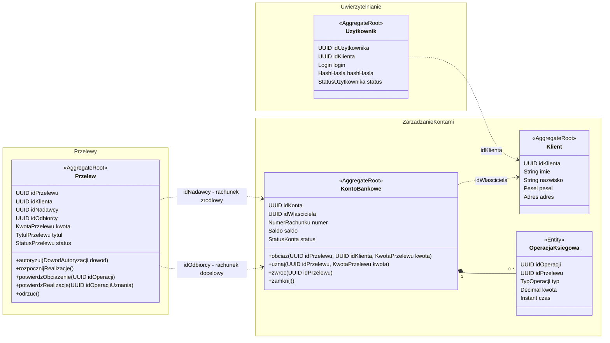

# Zadanie 1: Domain Driven Design

## Opis zadania

Model przedstawia fragment aplikacji bankowej służący do przelewów między rachunkami w PLN.
Podzieliłem go na trzy konteksty: Uwierzytelnianie, Zarządzanie kontami i Przelewy.
Konteksty rozdzielają logowanie, obsługę rachunków i realizację przelewów.
Dla uproszczenia pomijam opłaty, kredyty i przelewy w innych walutach.

## Model

Operacje księgowe należą do agregatu KontoBankowe.

## Konteksty i agregaty

| Kontekst            | Agregaty                 | Za co odpowiada                                         |
|---------------------|--------------------------|---------------------------------------------------------|
| Uwierzytelnianie    | `Uzytkownik`             | Logowanie i potwierdzanie przelewu kodem MFA.           |
| Zarządzanie kontami | `Klient`, `KontoBankowe` | Dane klienta, jego rachunki, saldo i historia operacji. |
| Przelewy            | `Przelew`                | Przyjęcie zlecenia i obsługa jego realizacji.           |

| Encja              | Rola i podstawowe zasady                                                                                                                                                           |
|--------------------|------------------------------------------------------------------------------------------------------------------------------------------------------------------------------------|
| `Uzytkownik`       | Przechowuje dane logowania i ID klienta. Status aktywny lub zablokowany; zablokowany użytkownik nie może potwierdzać przelewów.                                                    |
| `Klient`           | Ma imię, nazwisko, PESEL i adres. Jeden klient może posiadać kilka rachunków.                                                                                                      |
| `KontoBankowe`     | Ma jednego właściciela. Pozwala obciążyć lub uznać rachunek i zapisuje operacje księgowe. Saldo nie może spaść poniżej zera. Rachunek może być aktywny, zablokowany lub zamknięty. |
| `Przelew`          | Zawiera ID klienta, rachunku nadawcy i odbiorcy, kwotę, tytuł oraz status. Rachunki muszą być różne, a dane zlecenia po potwierdzeniu nie zmieniają się.                           |
| `OperacjaKsiegowa` | Wpis w historii rachunku: ID operacji i przelewu, kwota, czas oraz typ (obciążenie, uznanie, zwrot). Wpisów nie edytujemy.                                                         |

Korzeń agregatu sprawdza reguły przy każdej zmianie.

## Przyjęte założenia

Obiekty wartości są niezmienne i nie mają ID. Przy tworzeniu odrzucają niepoprawne dane, np. błędny PESEL lub ujemną kwotę.

| Dane / obiekt wartości | Format i ograniczenia                                                                                                         |
|------------------------|-------------------------------------------------------------------------------------------------------------------------------|
| Identyfikatory i daty  | UUID generowane przez system; czas operacji w UTC.                                                                            |
| Imię i nazwisko        | Każde 1–50 znaków: litery, spacja, myślnik lub apostrof.                                                                      |
| `Login`                | Dokładnie 8 cyfr.                                                                                                             |
| `HashHasla`            | Hash z solą, np. Argon2id. Hasła nie zapisujemy jawnym tekstem.                                                               |
| `Pesel`                | 11 cyfr, poprawna data urodzenia i suma kontrolna.                                                                            |
| `Adres`                | Ulica, numer domu, opcjonalnie lokalu, miasto i kod pocztowy. Adres w Polsce, kod w formacie `XX-XXX`, gdzie X oznacza cyfrę. |
| `NumerRachunku`        | IBAN: `PL` i 26 cyfr, poprawna suma kontrolna. Spacje są usuwane przed sprawdzeniem.                                          |
| `Saldo`                | Kwota nieujemna w PLN, typ Decimal, najwyżej 2 miejsca po przecinku.                                                          |
| `KwotaPrzelewu`        | Od 0,01 do 100 000,00 PLN, typ Decimal, najwyżej 2 miejsca po przecinku.                                                      |
| `TytulPrzelewu`        | 1–140 znaków: litery, cyfry, spacje i znaki `. , - / : ( )`.                                                                  |
| `DowodAutoryzacji`     | ID użytkownika i przelewu, skrót potwierdzonych danych oraz termin ważności. Powstaje po sprawdzeniu MFA.                     |

Unikalność loginu, PESEL-u i numeru rachunku zapewniają repozytoria i ograniczenia w bazie. Zwykłe obciążenie lub uznanie wymaga aktywnego rachunku. Zamknięcie
wymaga salda zero i zakończenia przelewów wychodzących; zwrot środków jest możliwy także na rachunek zablokowany.

## Jak przebiega przelew

1. Użytkownik zleca przelew ze swojego rachunku. Zlecenie `NOWY` po potwierdzeniu danych przez MFA przechodzi do `AUTORYZOWANY`.
2. Przelew otrzymuje status `W_REALIZACJI`. Rachunek nadawcy sprawdza własność, status i środki, po czym zapisuje obciążenie razem z operacją księgową.
3. Potwierdzenie obciążenia uruchamia uznanie rachunku odbiorcy. Dopiero potwierdzone uznanie pozwala oznaczyć przelew jako `ZREALIZOWANY`.
4. Brak środków powoduje odrzucenie. Jeżeli nadawca został już obciążony, a odbiorca odmówił przyjęcia przelewu, wykonywany jest zwrot. Dopiero po zwrocie
   przelew otrzymuje status `ODRZUCONY`.

Każdy agregat jest zmieniany w osobnej transakcji. Konteksty komunikują się przez zdarzenia domenowe i sprawdzają otrzymane dane. Oznacza to spójność
ostateczną: przez chwilę środki mogą być w drodze między rachunkami.

Ponowione zlecenie z tym samym kluczem i danymi zwraca istniejący przelew; zmienione dane są odrzucane. Zapisane wyniki operacji zapobiegają podwójnemu
księgowaniu. Błąd techniczny powoduje ponowienie kroku; sam brak odpowiedzi nie oznacza odmowy i nie uruchamia zwrotu.
