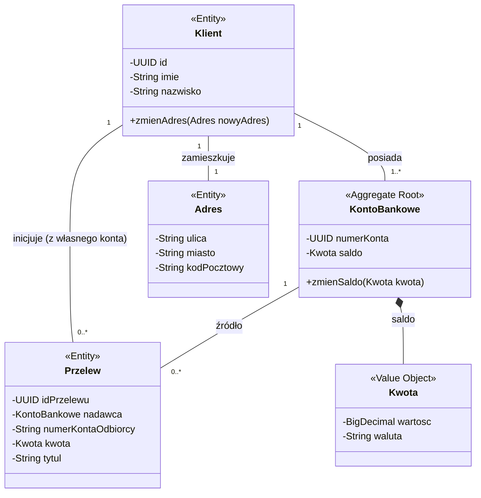

# DDD - Modelowanie Systemu Bankowego

## Opis zadania
Niniejszy dokument przedstawia uproszczony model domenowy dla systemu bankowego, skupiający się na zarządzaniu kontami klientów oraz realizacją przelewów. Celem projektu jest zapewnienie spójności danych oraz separacji odpowiedzialności pomiędzy kluczowymi obszarami biznesowymi. Model stanowi punkt wyjścia do budowy bezpiecznej aplikacji, zgodnie z założeniami Domain Driven Design.

## Model systemu (Diagram)
Poniższy diagram przedstawia relacje pomiędzy głównymi encjami i obiektami wartości:

## Przyjęte założenia

| Encja / Obiekt | Typ | Atrybuty | Opis / Ograniczenia |
| :--- | :--- | :--- | :--- |
| **Klient** | Encja | ID, imię, nazwisko | Główny identyfikator użytkownika. Posiada możliwość zmiany adresu. |
| **Adres** | Encja | Ulica, miasto, kod | Encja reprezentująca miejsce zamieszkania (podatna na zmiany). |
| **KontoBankowe** | Agregat | Numer konta, saldo, waluta | Agregat stanu finansowego. Konto nie może mieć ujemnego salda. |
| **Przelew** | Encja | Nadawca, Odbiorca, Kwota | Operacja finansowa inicjowana przez klienta z jego własnego rachunku. |
| **Kwota** | Obiekt Wartości | Wartość, waluta | Wartość pieniężna. |

### Dodatkowe reguły biznesowe:
1. **Konteksty (Bounded Contexts):**
   - **Uwierzytelnienie:** Odpowiedzialny za logowanie i sesję użytkownika.
   - **Zarządzanie Kontem:** Odpowiedzialny za dane klienta i stan rachunków.
   - **Przelewy:** Odpowiedzialny za logikę biznesową związaną z transferem środków.
2. **Integracja:** Przelew może być zainicjowany wyłącznie przez Klienta, który jest właścicielem konta źródłowego. Weryfikacja właściciela następuje wewnątrz agregatu Przelew/Konto.
3. **Formaty:** Wszystkie kwoty operują na standardzie `BigDecimal` dla uniknięcia błędów zaokrągleń walutowych.