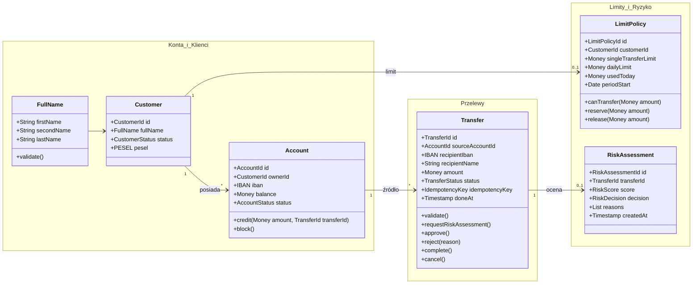

# Model DDD – fragment bezpiecznej aplikacji bankowej

## Krótki opis zadania

Wybrano trzy bounded contexty: **Konta i Klienci**, **Przelewy** oraz **Limity i Ryzyko**. Model obejmuje pięć głównych agregatów/encjí: `Customer`, `Account`, `Transfer`, `LimitPolicy` i `RiskAssessment`.

## Model DDD

## Bounded Contexty

| Bounded Context | Odpowiedzialność                                                         | Główne agregaty                 |
| --------------- | ------------------------------------------------------------------------ | ------------------------------- |
| Konta i Klienci | Tożsamość klienta, status klienta, rachunki, salda, blokady, księgowanie | `Customer`, `Account`           |
| Przelewy        | Cykl życia przelewu, walidacja danych, orkiestracja procesu              | `Transfer`                      |
| Limity i Ryzyko | Limity przelewowe oraz ocena ryzyka/bezpieczeństwa przelewu              | `LimitPolicy`, `RiskAssessment` |

## Agregaty, encje i obiekty wartości

### Agregaty i encje

| Agregat / encja główna | Opis                                                                              |
| ---------------------- | --------------------------------------------------------------------------------- |
| `Customer`             | Klient banku; identyfikuje właściciela rachunku i limitów.                        |
| `Account`              | Rachunek bankowy; agregat odpowiedzialny za saldo, dostępne środki i księgowania. |
| `Transfer`             | Przelew; agregat z maszyną stanów i idempotencją.                                 |
| `LimitPolicy`          | Polityka limitów klienta; rezerwuje i zwalnia limit dzienny.                      |
| `RiskAssessment`       | Niezmienny zapis oceny ryzyka dla przelewu.                                       |

### Obiekty wartości

| Obiekt wartości                                                              | Format                                                                                                            |
| ---------------------------------------------------------------------------- | ----------------------------------------------------------------------------------------------------------------- |
| `CustomerId`, `AccountId`, `TransferId`, `LimitPolicyId`, `RiskAssessmentId` | UUID                                                                                                              |
| `IBAN`                                                                       | `PL` + 26 cyfr, łącznie 28 znaków; normalizacja do wielkich liter bez spacji; walidacja modulo 97                 |
| `Money`                                                                      | `amount` jako `BigDecimal(19,2)` + `currency`; bez typów zmiennoprzecinkowych; operacje tylko w tej samej walucie |
| `Currency`                                                                   | np. `PLN`, `EUR`, `USD`                                                                                           |
| `AccountStatus`                                                              | `ACTIVE`, `BLOCKED`, `CLOSED`                                                                                     |
| `CustomerStatus`                                                             | `ACTIVE`, `BLOCKED`, `CLOSED`                                                                                     |
| `TransferStatus`                                                             | `DRAFT`, `VALIDATED`, `RISK_PENDING`, `APPROVED`, `REJECTED`, `PENDING`, `COMPLETED`, `CANCELLED`, `FAILED`       |
| `RiskDecision`                                                               | `ALLOW`, `REVIEW`, `REJECT`                                                                                       |
| `RiskScore`                                                                  | liczba całkowita `[0, 100]`                                                                                       |
| `IdempotencyKey`                                                             | UUID; unikalny dla komendy utworzenia/wykonania przelewu                                                          |
| `TransferTitle`                                                              | 1–140 znaków                                                                                                      |
| `Timestamp`                                                                  | UTC                                                                                                               |
| `PESEL`                                                                      | 11-cyfrowy identyfikator numeryczny używany do jednoznacznego ustalenia tożsamości osoby fizycznej                |

## Przyjęte założenia i ograniczenia

| Obszar           | Założenie / ograniczenie                                                                                                                                                                     |
| ---------------- | -------------------------------------------------------------------------------------------------------------------------------------------------------------------------------------------- |
| `FullName`       | `firstName` & `secondName` długosc ∈ `[2, 20]` brak znaków specjalnych; `lastName` długość ∈ `[3, 50]` dostępne znaki specjalne jak: `'`,`-`                                                 |
| `Customer`       | `status` wymagany; klient `BLOCKED`/`CLOSED` nie może inicjować przelewów.                                                                                                                   |
| `Account`        | `balance >= 0`; waluta rachunku zgodna z walutą przelewu.                                                                                                                                    |
| `Transfer`       | `amount > 0`; `sourceAccountId != recipientIban` jako rachunek źródłowy; `recipientIban` walidowany; `idempotencyKey` wymagany; dozwolone przejścia statusów tylko zgodnie z maszyną stanów. |
| `LimitPolicy`    | `singleTransferLimit >= 0`; `dailyLimit >= 0`; `usedToday >= 0`; `usedToday <= dailyLimit`; rezerwacja limitu musi być idempotentna względem `transferId`.                                   |
| `RiskAssessment` | Po utworzeniu ocena jest niezmienna; `score` w zakresie `[0,100]`; `decision` wymagane; `reasons` opcjonalne, maks. 10 pozycji.                                                              |
| `Bezpieczeństwo` | Autoryzacja: klient może operować tylko na własnych rachunkach; komunikacja TLS; dane wrażliwe szyfrowane;                                                                                   |
| `Uproszczenie`   | Model nie obsługuje przewalutowania; przelew tylko w walucie rachunku źródłowego.                                                                                                            |
