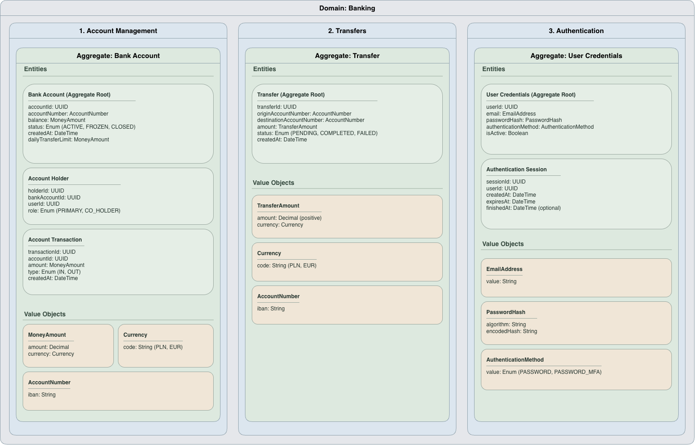

# **Opis zadania 1.1**
Celem pierwszego zadania było zaprojektowanie systemu bankowego z wykorzystaniem podejścia Domain-Driven Design (DDD). To podejście do tworzenia oprogramowania, które skupia się na definiowaniu i modelowaniu domeny biznesowej (business domain) i określaniu bounded contextów. W ramach kazdego bounded contextu odpowiadające encje (reprezentujące obiekty z zycia rzeczywistego) oraz value objects (nieposiadające własnej tozsamości) są zgrupowane w agregaty, co zapewnia spójność poprzez stosowanie reguł biznesowych.

Przykład systemu bankowego zdefiniowanego przy użyciu DDD:
## **Domain:** 
Banking

### **Bounded contexts:** 
Account management, Transfers, Authentication

### 1. Account Management
Opisuje rachunki bankowe i ich właścicieli.

**Aggregate:** Bank Account

#### Entities

##### Bank Account (Aggregate Root)

| Attribute | Data Type | Description |
|---|---|---|
| accountId | UUID | Unique account ID |
| accountNumber | AccountNumber | Unique bank account number |
| balance | MoneyAmount | Current balance (money, cannot be negative) |
| status | Enum | ACTIVE, FROZEN, CLOSED |
| createdAt | DateTime | Account creation date |
| dailyTransferLimit | MoneyAmount | Maximum total amount of outgoing transfers per day |

##### Account Holder

| Attribute | Data Type | Description |
|---|---|---|
| holderId | UUID | Unique holder ID |
| bankAccountId | UUID | Reference to Bank Account |
| userId | UUID | Reference to the user |
| role | Enum | PRIMARY, CO_HOLDER |

##### Account Transaction

| Attribute | Data Type | Description |
|---|---|---|
| transactionId | UUID | Unique transaction record identifier |
| accountId | UUID | Reference to the Bank Account |
| amount | MoneyAmount | Transaction amount |
| type | Enum | IN, OUT |
| createdAt | DateTime | Date and time of transaction |

#### Value Objects

##### MoneyAmount

| Attribute | Data Type | Description |
|---|---|---|
| amount | Decimal | Monetary amount |
| currency | Currency | Account currency |

##### Currency

| Attribute | Data Type | Description |
|---|---|---|
| code | String | PLN or EUR |

##### Account Number

| Attribute | Data Type | Description |
|---|---|---|
| iban | String | Valid IBAN |

### 2. Transfers
Opisuje przelewy między rachunkami.

**Aggregate:** Transfer

#### Entities

##### Transfer (Aggregate Root)

| Attribute | Data Type | Description |
|---|---|---|
| transferId | UUID | Unique transfer ID |
| originAccountNumber | AccountNumber | Sender's account number |
| destinationAccountNumber | AccountNumber | Recipient's account number |
| amount | TransferAmount | Amount to be transferred |
| status | Enum | PENDING, COMPLETED, FAILED |
| createdAt | DateTime | Transfer creation date |

#### Value Objects

##### Transfer Amount

| Attribute | Data Type | Description |
|---|---|---|
| amount | Decimal | Must be positive |
| currency | Currency | Transfer currency |

##### Currency

| Attribute | Data Type | Description |
|---|---|---|
| code | String | PLN or EUR |

##### Account Number

| Attribute | Data Type | Description |
|---|---|---|
| iban | String | Valid IBAN |

### 3. Authentication
Opisuje, w jaki sposób użytkownicy logują się do systemu bankowego i jak zarządzane są ich sesje uwierzytelniające.

**Aggregate:** User Credentials

#### Entities

##### User Credentials (Aggregate Root)

| Attribute | Data Type | Description |
|---|---|---|
| userId | UUID | Unique user ID |
| email | EmailAddress | Login email (user's email address) |
| passwordHash | PasswordHash | Securely stored password hash |
| authenticationMethod | AuthenticationMethod | Supported login method |
| isActive | Boolean | Whether the user can log in or not |

##### Authentication Session

| Attribute | Data Type | Description |
|---|---|---|
| sessionId | UUID | Unique session ID |
| userId | UUID | Reference to User Credentials |
| createdAt | DateTime | Login date and time |
| expiresAt | DateTime | Session expiration date and time |
| finishedAt | DateTime (optional) | Logout date and time |

#### Value Objects

##### Email Address

| Attribute | Data Type | Description |
|---|---|---|
| value | String | Valid email format |

##### Password Hash

| Attribute | Data Type | Description |
|---|---|---|
| algorithm | String | Secure hashing algorithm, e.g. Argon2id |
| encodedHash | String | Stored password hash |

##### Authentication Method

| Attribute | Data Type | Description |
|---|---|---|
| value | Enum | PASSWORD, PASSWORD_MFA |

## Banking System – DDD Diagram

Poniższy schemat przedstawia strukturę systemu bankowego opracowaną zgodnie z podejściem Domain-Driven Design, obejmującą konteksty ograniczone, agregaty, encje i obiekty wartościowe.

