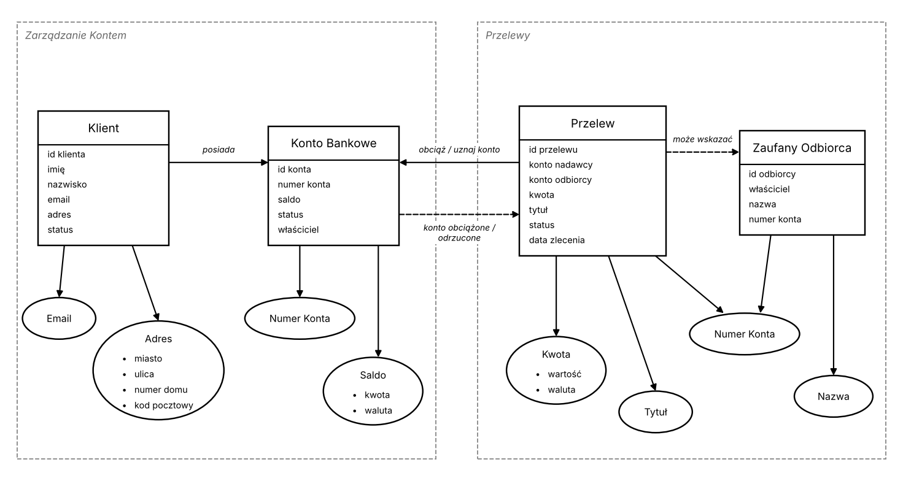

# Model Domenowy

## Opis
Model obejmuje dwa konteksty systemu bankowego: zarządzanie kontem i przelewy. Klient posiada konta bankowe, a w kontekście przelewów zleca przelewy z własnych kont i zapisuje zaufanych odbiorców. Przelew nie zmienia salda samodzielnie, tylko wysyła do konta polecenie obciążenia, a konto odpowiada zdarzeniem. Reguły walidacji są częścią modelu, więc niepoprawny obiekt nie może powstać.

## Diagram

## Encje i Value Object

### Klient

| Atrybut     | Typ                             | Opis                                |
|-------------|---------------------------------|-------------------------------------|
| id klienta  | UUID                            | Unikalny identyfikator              |
| imię        | string                          | Imię klienta                        |
| nazwisko    | string                          | Nazwisko klienta                    |
| email       | ValueObject: Email              | Adres email klienta                 |
| adres       | ValueObject: Adres              | Miasto, ulica, numer domu, kod pocztowy |
| status      | enum (aktywny, zablokowany)     | Aktualny status klienta             |

### Konto Bankowe

| Atrybut      | Typ                                    | Opis                              |
|--------------|----------------------------------------|-----------------------------------|
| id konta     | UUID                                   | Unikalny identyfikator            |
| numer konta  | ValueObject: NumerKonta                | Unikalny numer konta              |
| saldo        | ValueObject: Saldo                     | Aktualne saldo (kwota, waluta)    |
| status       | enum (aktywne, zamrożone, zamknięte)   | Aktualny status konta             |
| właściciel   | Klient (po id)                         | Właściciel konta                  |

### Przelew

| Atrybut         | Typ                                                      | Opis                          |
|-----------------|----------------------------------------------------------|-------------------------------|
| id przelewu     | UUID                                                     | Unikalny identyfikator        |
| konto nadawcy   | Konto Bankowe (po id)                                    | Konto, z którego idą środki   |
| konto odbiorcy  | ValueObject: NumerKonta                                  | Konto, na które idą środki    |
| kwota           | ValueObject: Kwota                                       | Kwota przelewu (wartość, waluta) |
| tytuł           | ValueObject: Tytuł                                       | Tytuł przelewu                |
| status          | enum (utworzony, zatwierdzony, zrealizowany, odrzucony)  | Etap realizacji przelewu      |
| data zlecenia   | ValueObject: Data                                        | Data i czas zlecenia          |

### Zaufany Odbiorca

| Atrybut      | Typ                         | Opis                                  |
|--------------|-----------------------------|---------------------------------------|
| id odbiorcy  | UUID                        | Unikalny identyfikator                |
| właściciel   | Klient (po id)              | Klient, który zapisał odbiorcę        |
| nazwa        | ValueObject: Nazwa          | Nazwa odbiorcy                        |
| numer konta  | ValueObject: NumerKonta     | Konto odbiorcy                        |

## Założenia

- **Numer konta jest unikalny** (Konto Bankowe)
  - Format `PL` + 26 cyfr z weryfikacją sumy kontrolnej.
  - Tworzenie konta wymaga weryfikacji unikalności numeru.

- **Właściciel konta jest wymagany** (Konto Bankowe)
  - Każde konto ma dokładnie jednego właściciela, którego nie można zmienić.
  - Konto można założyć tylko aktywnemu klientowi.

- **Status konta** (Konto Bankowe)
  - Statusy: aktywne, zamrożone, zamknięte.
  - Konto zamrożone lub zamknięte nie może być obciążane.

- **Saldo ≥ 0** (Konto Bankowe)
  - Brak debetu, saldo jest kwotą dziesiętną w PLN.
  - Saldo zmienia się wyłącznie przez konto, które samo sprawdza środki przed obciążeniem.

- **Dane klienta** (Klient)
  - Imię i nazwisko: 1–50 znaków, tylko litery, spacja i myślnik.
  - Email: poprawny format, maks. 254 znaki, unikalny.
  - Adres: kod pocztowy w formacie `NN-NNN`, miasto, ulica i numer domu wymagane.

- **Zlecenie przelewu** (Przelew)
  - Klient może zlecić przelew tylko z konta, którego jest właścicielem, i tylko gdy konto jest aktywne.
  - Konto nadawcy musi być inne niż konto odbiorcy.

- **Kwota przelewu** (Przelew)
  - Większa od 0, maks. 2 miejsca po przecinku, waluta PLN.
  - Limit jednorazowy np. 50 000 PLN i nie więcej niż saldo konta.

- **Tytuł i nazwa** (Przelew, Zaufany Odbiorca)
  - Tytuł: 1–140 znaków, nazwa: 1–70 znaków.
  - Dozwolone litery, cyfry i podstawowa interpunkcja. Znaki `< > " '` są odrzucane (ochrona przed XSS).

- **Niezmienność przelewu** (Przelew)
  - Po utworzeniu nie można zmieniać danych przelewu.
  - Statusy: utworzony → zatwierdzony → zrealizowany lub odrzucony. Zrealizowanego przelewu nie można cofnąć.

- **Realizacja przelewu** (integracja Przelewy ↔ Konto)
  - Przelew wysyła do konta polecenie „obciąż / uznaj”, a konto odpowiada zdarzeniem „obciążone” lub „odrzucone”.
  - Na tej podstawie przelew zmienia status na zrealizowany lub odrzucony.

- **Zaufany odbiorca** (Zaufany Odbiorca)
  - Należy do jednego klienta i jest widoczny tylko dla niego.
  - Przelew na konto spoza listy zaufanych wymaga dodatkowego potwierdzenia.