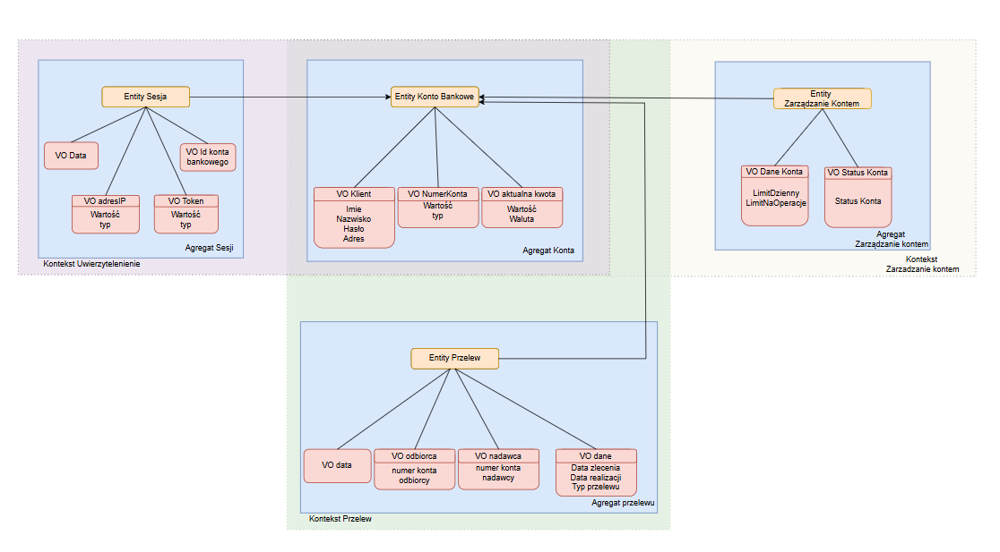

# Domain Driven Design - Model Aplikacji Bankowej

## cel zadania
Celem zadania było zamodelowanie przykładowych kontekstów, agregatów, encji oraz obiektów wartości w projekcie systemu bankowego. W tym celu zostały zaprojektowane trzy konteksty, uwierzytelnienia, przelewu i zarządzania kontem. Użytkownik ma możliwość wysyłania przelewów, edycji swojego konta, sesja użytkownika jest automatycznie kończona po określonym czasie nieaktywności.

## diagram

## Kontekst **Uwierzytelenienie**
Moduł odpowiedzialny za uwierzytelnienie użytkownika i zarządzanie sesją.
### encje
- Sesja
- Konto Bankowe
### funkcjonalności
- Logowanie
- Anulowanie sesji (w przypadku braku aktywności przez 10 min)

## Kontekst  **Przelew**
Model odpowiedzialny za zarządzanie przelewami między kontami

### encje
- Konto Bankowe
- Przelew

### funkcjonalności
- Dokonywanie przelewu
- Anulowanie przelewu

## Kontekst  **Zarządzanie Kontem**
Model odpowiedzialny za zarządzanie statusem konta
- Konto Bankowe
- Zarządzanie kontem

### encje
- Konto Bankowe
- Zarządzanie kontem

### funkcjonalności
- ustawianie limitu dziennego, operacyjnego
- blokowanie konta, w przypadku podejrzanej aktywności

## Opis Encji

### Przelew
 - Data, Data
 - Numer konta nadawcy, NumerKonta
 - Numer konta Odbiorcy, NumerKonta
 - Kwota, Kwota

### Konto Bankowe
- Aktualna kwota, Kwota
- Klient, Klient
- Numer Konta, NumerKonta

### Sesja
- Data, Data
- adres IP, AdresIP
- Token, Token
- Numer Konta bankowego, NumerKonta

### Zarządzanie Kontem
- Dane konta

## Opis Value Objects

ValueObject Klient
- Imie, 1-30 znaków, alfabet + znaki specjalne alfabetów
- Nazwisko, 1-30 znaków, alfabet + znaki specjalne alfabetów
- hasło 1-30 znaków, cyfry i alfabet
- Adres, 1-30 znaków, alfabet + znaki specjalne alfabetów
- Adres Korespondencyjny, 1-30 znaków, alfabet + znaki specjalne alfabetów

ValueObject Kwota
- Wartość, liczba 10 cyfrowa
- Waluta, enum (pln, eur)

ValueObject NumerKonta
 - Numer, 8 znaków cyfry
 - Kod banku, 10 znaków, cyfry

ValueObject Token
- Wartość, 1-30 znaków, cyfry i alfabet
- typ, enum

ValueObject AdresIP
- Wartość, 1-30 znaków, cyfry
- typ, enum (ip4, ip6)

ValueObject DaneKonta
- limit dzienny, liczba 1-10 cyfr
- limit na operacje, liczba 1-10 cyfr

ValueObject StatusKonta
- status konta - enum, (czynne, zablokowane)