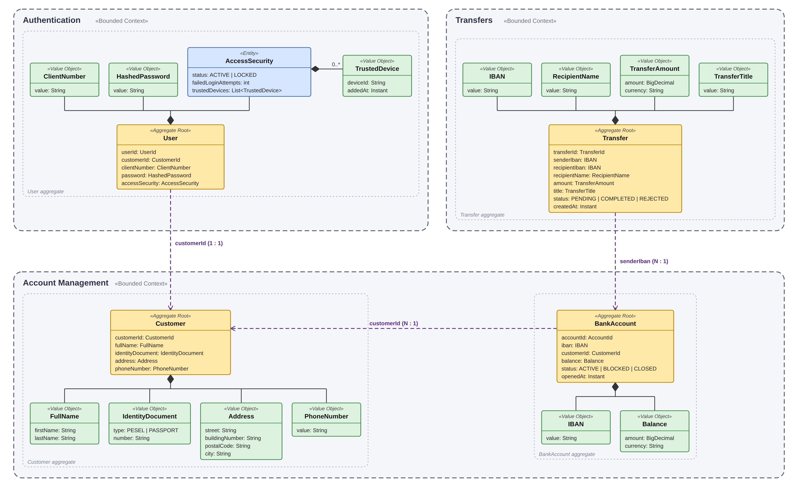

# Zadanie 1 – Domain Driven Design

## Opis zadania

W zadaniu został zamodelowany fragment bezpiecznej aplikacji bankowej zgodnie z zasadami Domain Driven Design. System został podzielony na trzy konteksty: **Authentication**, **Account Management** i **Transfers**. W każdym z nich wyróżniono agregaty, encje i obiekty wartości, a powiązania między agregatami opierają się wyłącznie na identyfikatorach. Obiekty wartości, zgodnie z zaleceniami, walidują dane już w konstruktorze, więc obiekt z niepoprawnymi danymi (np. błędnym IBAN-em czy ujemną kwotą) w ogóle nie powstanie.

## Model

*Rys. 1. Model domeny fragmentu systemu bankowego.*

## Przyjęte założenia

### Formaty i ograniczenia

| Element | Założenia |
|---|---|
| `userId`, `customerId`, `accountId`, `transferId` | wartości UUID; każdy identyfikator ma znaczącą nazwę (a nie samo `id`), żeby trudniej było je pomylić |
| `openedAt`, `createdAt`, `addedAt` | `Instant`, zawsze w UTC |
| `iban` | format IBAN: 2-literowy kod kraju, 2 cyfry kontrolne i numer rachunku (dla Polski łącznie 28 znaków), poprawna suma kontrolna |
| `balance` | `amount` ≥ 0, `BigDecimal` z 2 miejscami po przecinku, `currency` w ISO 4217 |
| `amount` (przelewu) | `amount` > 0, `BigDecimal` z 2 miejscami po przecinku, `currency` w ISO 4217 |
| `title` | 1–140 znaków |
| `recipientName` | 1–70 znaków |
| `clientNumber` | dokładnie 8 cyfr (identyfikator do logowania, podobnie jak Millekod w Banku Millennium) |
| `password` | przechowywany wyłącznie skrót hasła, nigdy hasło jawnym tekstem |
| `identityDocument` | dopuszczalny PESEL albo paszport; numer walidowany sumą kontrolną |
| `address` | kod pocztowy walidowany w formacie `XX-XXX` (dla uproszczenia przyjmujemy, że adres jest w Polsce) |
| `phoneNumber` | format E.164 (np. `+48123456789`) |
| `BankAccount` | status `ACTIVE`, `BLOCKED` albo `CLOSED`; operacje na saldzie tylko na koncie `ACTIVE`, saldo nie może spaść poniżej zera |
| `Transfer` | pilnuje, aby `senderIban` ≠ `recipientIban`; status `PENDING` → `COMPLETED` albo `REJECTED` |
| `AccessSecurity` | liczy nieudane próby logowania i po 3 z rzędu blokuje dostęp (`LOCKED`); pozwala uwierzytelnić się na zaufanym urządzeniu (`trustedDevices`), a z nowego urządzenia wymaga dodatkowej weryfikacji |

### Integracja między kontekstami

1. **Logowanie:** po poprawnym uwierzytelnieniu klient dostaje access token, którym posługuje się przy kolejnych żądaniach (wiem, że w bankowości to tak nie działa, ale nie chcę się dalej w to zagłębiać, więc stosuję duże uproszczenie).
2. **Zlecenie przelewu:** Transfers tworzy przelew w statusie `PENDING` tylko wtedy, gdy `senderIban` należy do konta zalogowanego klienta.
3. **Realizacja przelewu:** przelew zmienia kilka agregatów (konto nadawcy, konto odbiorcy i sam Transfer), więc nie da się go wykonać w jednej transakcji bazodanowej. Każdy agregat zmieniany jest w osobnej transakcji, a konteksty komunikują się przez zdarzenia domenowe. Wzorzec Outbox pilnuje, żeby każde zdarzenie faktycznie trafiło do kolejki komunikatów. Całość orkiestruje wzorzec Saga (bo realizacja przelewu jest wieloetapowym procesem), który ułatwia też wycofanie skutków wcześniejszych kroków, gdy któryś z nich się nie uda.
