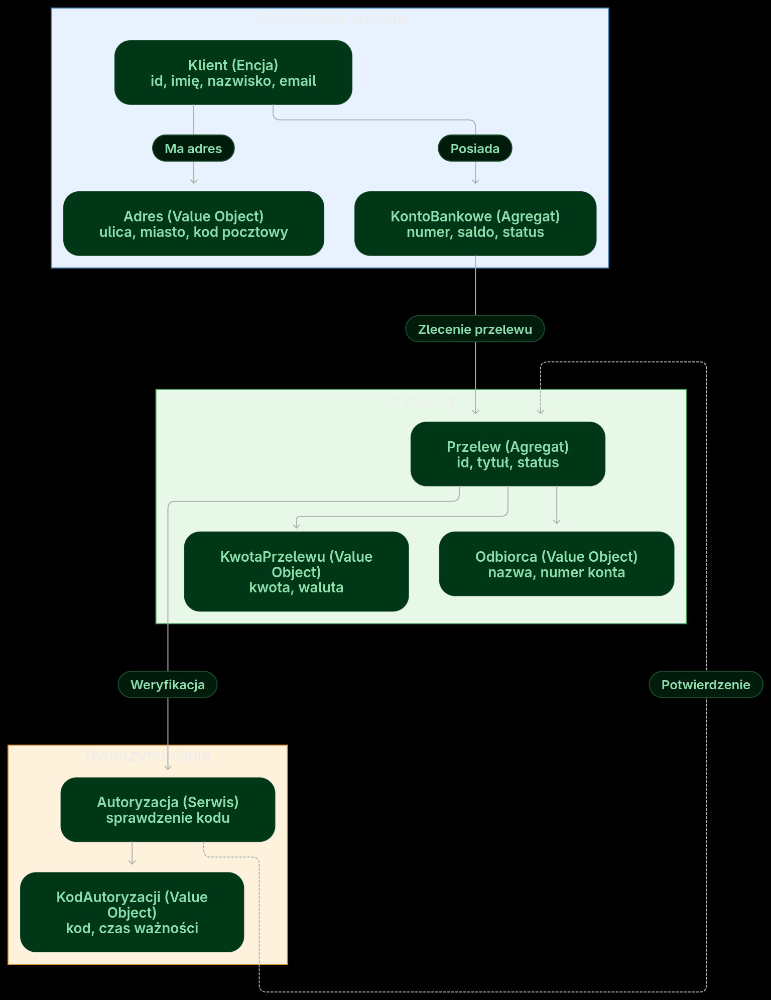

# DDD – prosty system bankowy

## Opis
Model przedstawia fragment bezpiecznej aplikacji bankowej umożliwiający wykonanie przelewu. System podzielono na trzy **Bounded Contexts**: Zarządzanie kontem, Przelewy i Uwierzytelnianie. KontoBankowe i Przelew są agregatami, a Klient jest encją. Przelew można wykonać dopiero po autoryzacji.

## Diagram

## Założenia
| Element | Typ | Atrybuty i ograniczenia |
|---|---|---|
| Klient | Encja | `id` (UUID), imię, nazwisko, e-mail |
| KontoBankowe | Agregat | numer (26 cyfr), saldo (PLN, ≥ 0), status (aktywne/zablokowane) |
| Adres | Value Object | ulica, miasto, kod pocztowy (`XX-XXX`) |
| Przelew | Agregat | `id` (UUID), tytuł (1–140 znaków), status (nowy/zatwierdzony/wykonany/odrzucony) |
| KwotaPrzelewu | Value Object | kwota (> 0, dwa miejsca po przecinku), waluta `PLN` |
| Odbiorca | Value Object | nazwa, numer konta (26 cyfr) |
| Autoryzacja | Serwis domenowy | sprawdza kod przed wykonaniem przelewu |
| KodAutoryzacji | Value Object | 6 cyfr, ważność 5 minut |

**Przepływ:** Klient zleca przelew z aktywnego konta → system sprawdza saldo → serwis autoryzuje przelew → konto jest obciążane i przelew otrzymuje status „wykonany”. Niepoprawna autoryzacja lub brak środków powodują odrzucenie operacji.
