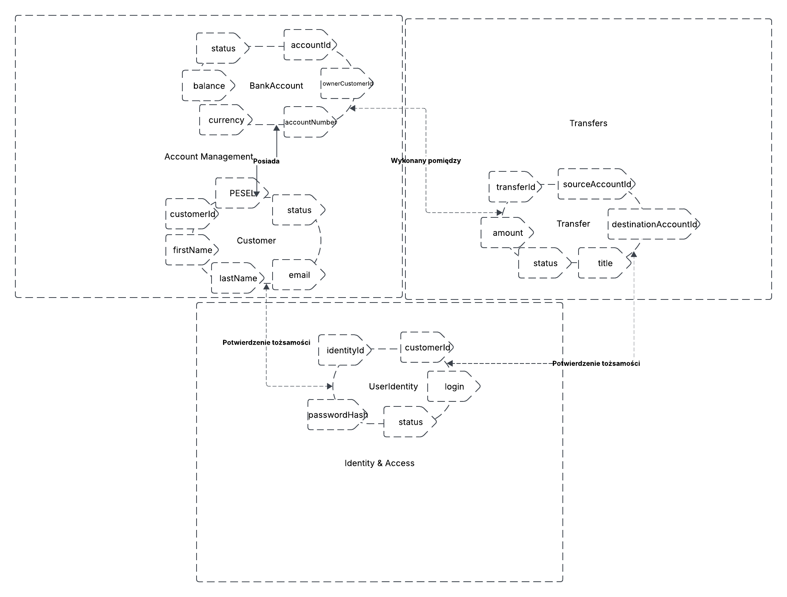

# DDD - fragment bezpiecznej aplikacji bankowej

## 1. Opis zadania

Celem projektu jest zamodelowanie fragmentu aplikacji bankowej z wykorzystaniem podejścia Domain-Driven Design. Zakres obejmuje zarządzanie rachunkiem klienta oraz realizację krajowego przelewu pomiędzy rachunkami. Model koncentruje się na najważniejszych regułach biznesowych, odpowiedzialnościach agregatów i granicach kontekstów, a nie na odwzorowaniu całego systemu bankowego.

## 2. Zakres i Bounded Contexts

W modelu wyróżniono trzy konteksty:

1. **Zarządzanie rachunkami (Account Management)** - odpowiada za dane klienta, rachunki, ich status oraz dostępne saldo. Jest właścicielem modelu `Customer` i agregatu `BankAccount`.
2. **Przelewy (Transfers)** - odpowiada za zlecanie i obsługę przelewów, kontrolę poprawności zlecenia oraz jego status. Jest właścicielem agregatu `Transfer`. Nie zmienia bezpośrednio stanu wewnętrznego rachunku - korzysta z jawnego kontraktu kontekstu rachunków.
3. **Uwierzytelnianie i autoryzacja (Identity & Access)** - odpowiada za logowanie, sesje i potwierdzanie uprawnień do wykonania operacji. To kontekst wspierający i nie przechowuje salda ani nie podejmuje decyzji biznesowych dotyczących przelewów.

### Relacje między kontekstami

- `Transfers` pobiera z `Account Management` informację, czy rachunek źródłowy i docelowy mogą uczestniczyć w przelewie, oraz zleca obciążenie i uznanie rachunków przez udostępniony interfejs aplikacyjny.
- `Identity & Access` dostarcza kontekstowi `Transfers` potwierdzenie tożsamości i uprawnienia do zlecenia operacji. Samo poprawne uwierzytelnienie nie oznacza jeszcze, że przelew jest dozwolony.
- Komunikacja między kontekstami powinna odbywać się przez jawne API/komendy lub zdarzenia integracyjne, a nie przez bezpośrednie modyfikowanie cudzych encji jako że praktykujemy tu `Zero Trust security`.

## 3. Model domenowy

**Encje (łącznie 4):**

| Encja | Kontekst / rola | Najważniejsze atrybuty |
|---|---|---|
| `Customer` | Zarządzanie rachunkami, klient banku | `customerId`, `firstName`, `lastName`, `PESEL`, `email`, `status` |
| `BankAccount` | Zarządzanie rachunkami, korzeń agregatu | `accountId`, `ownerCustomerId`, `accountNumber`, `currency`, `availableBalance`, `status` |
| `Transfer` | Przelewy, korzeń agregatu | `transferId`, `sourceAccountId`, `destinationAccountId`, `amount`, `title`, `status`|
| `UserIdentity` | Uwierzytelnianie i autoryzacja | `identityId`, `customerId`, `login`, `passwordHash`, `status` |

`Customer` i `UserIdentity` są powiązani przez identyfikator klienta, ale pozostają w osobnych kontekstach. Nie należy przechowywać hasła ani jego skrótu w encji `Customer`.

### Agregaty i granice spójności

- **Agregat `BankAccount`** - korzeniem jest encja `BankAccount`. Odpowiada za reguły dotyczące rachunku, np. czy jest aktywny i czy dostępne saldo wystarcza do obciążenia. Zmiany salda odbywają się wyłącznie przez komendy domenowe, np. `debit(amount)` i `credit(amount)`.
- **Agregat `Transfer`** - korzeniem jest encja `Transfer`. Pilnuje poprawnych przejść statusów, np. `Created → Authorized → Processing → Completed` albo `Rejected/Failed`. Przechowuje identyfikatory rachunków, a nie kopie całych encji rachunków.
- **`Customer` i `UserIdentity`** - w tym uproszczonym modelu są osobnymi encjami/korzeniami w swoich kontekstach. Nie są częścią agregatu `BankAccount` ani `Transfer`.

Przykładowa operacja przelewu: system uwierzytelnia klienta i sprawdza uprawnienia, tworzy zlecenie `Transfer`, weryfikuje rachunki i limity, a następnie realizuje obciążenie rachunku źródłowego i uznanie docelowego.

## 4. Obiekty wartości (Value Objects)

| Obiekt wartości | Pola / format | Reguły walidacji |
|---|---|---|
| `Money` | `amount: Decimal`, `currency: Currency` | Kwota dodatnia dla przelewu, maksymalnie 2 miejsca po przecinku, bez `float`/`double`|
| `Currency` | kod, tutaj `PLN` | Trzy wielkie litery, w tym zakresie obsługiwane jest wyłącznie PLN. |
| `AccountNumber` | 26 cyfr (NRB) | Po usunięciu spacji musi zawierać dokładnie 26 cyfr, walidacja sumy kontrolnej NRB |
| `EmailAddress` | adres e-mail | Walidacja składni i normalizacja, ograniczenie rozmiaru do np 100 symboli |
| `TransferTitle` | tekst | Od 1 do 140 znaków po przycięciu białych znaków, bez znaków sterujących, najlepiej ograniczone do samych liter oraz cyfr |
| `CustomerName` | imię i nazwisko | Niepuste, długość ograniczona, np. do 50 znaków na pole, zachować polskie znaki. |
| `TransferId`, `AccountId`, `CustomerId` | UUID | Identyfikatory generowane przez system, format UUID, np. UUIDv4. |

## 5. Przyjęte założenia i ograniczenia

1. Model obejmuje wyłącznie przelew krajowy w PLN pomiędzy dwoma rachunkami obsługiwanymi przez system.
2. Każdy rachunek ma jednego właściciela będącego klientem banku. 
3. Rachunek musi mieć status `Active`, aby można było go obciążyć lub uznać. Statusy przykładowe: `Active`, `Blocked`, `Closed`.
4. Kwota przelewu musi być większa od zera, wyrażona w PLN i mieścić się w dostępnych środkach oraz limitach transakcyjnych.
5. Rachunek źródłowy i docelowy muszą być różne. Numer rachunku jest walidowany przed rozpoczęciem realizacji.
6. Status przelewu zmienia się wyłącznie przez dozwolone przejścia domenowe. Przykładowe statusy: `Created`, `Authorized`, `Processing`, `Completed`, `Rejected`, `Failed`.
7. Operacje finansowe muszą być audytowalne: należy zapisać identyfikator operacji, czas, wynik i źródło żądania. Dziennik audytowy powinien być chroniony przed nieuprawnioną modyfikacją.
8. Hasła nie są przechowywane jawnie. `passwordHash` oznacza skrót wyliczony bezpiecznym, dedykowanym algorytmem haszowania haseł. Nie należy logować haseł, tokenów ani pełnych danych uwierzytelniających.
9. Wszystkie operacje wymagają uwierzytelnienia i sprawdzenia autoryzacji po stronie serwera. Identyfikator klienta przekazany przez klienta aplikacji nie jest sam w sobie dowodem uprawnień.
10. Kwoty przechowywane są jako typ dziesiętny o ustalonej precyzji, a czas jako znacznik z informacją o strefie lub UTC. Nie używa się typów zmiennoprzecinkowych do obliczeń pieniężnych (mogłoby to spowodować straty groszy przez błędy zaokrąglania).
11. Przy błędzie w trakcie realizacji przelewu proces musi zapewnić spójność (np. rezerwacja środków, ponawianie). Sytuacja, w której po rozpoczęciu przelewu środki są wyciągane poprzez klienta powinna być nie możliwa albo powinna blokować przelew.

