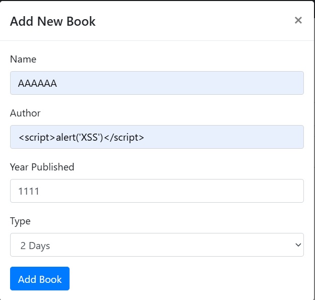
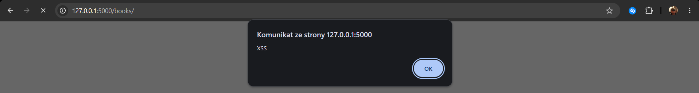
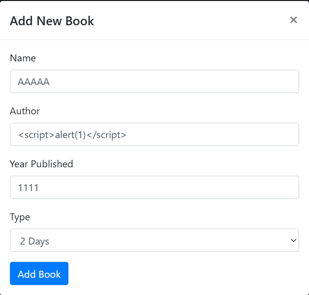
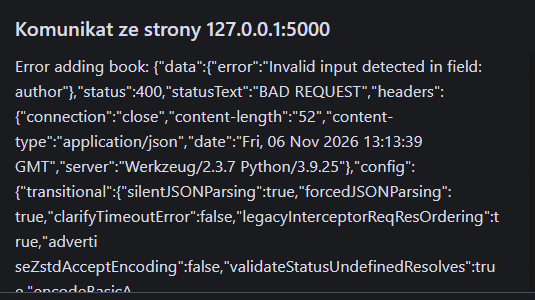
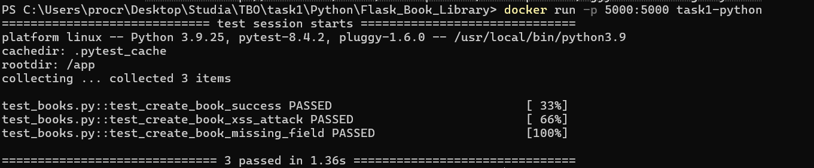

# Zadanie 2

## Podatność XSS
Podatność XSS można prosto znaleźć w panelu http://127.0.0.1:5000/books/, 
przykładowo przy dodawaniu nowej książki.

W polu autor widać atak XSS. Po dodaniu ksiązki, dane przechodzą 
a strona wykonuje atak:

Powodzenie ataku wynika z braku sanityzacji danych przy odczycie danych
w funkcji `create_book` jaką można znaleźć w projekt/books/views.py.

Po zaimplementowaniu walidacji danych taka sama procedura się nie powiedzie.

## Test jednostkowy
Dodatkowo, zaimplementowałem test jednostkowy dla tej podatności. 
Dodałem plik `test_books.py` i zmieniłem komendę `CMD ["flask", "run"]`
na `CMD ["pytest", "-v"]` w Dockerfile. Wynik testów jednostkowych:
