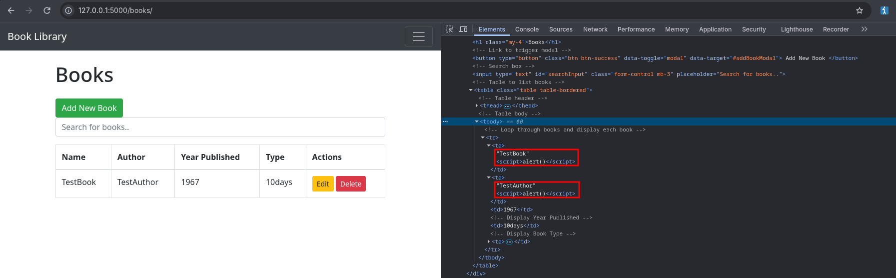
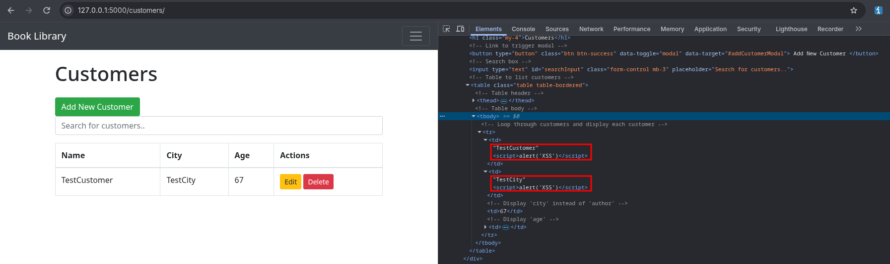
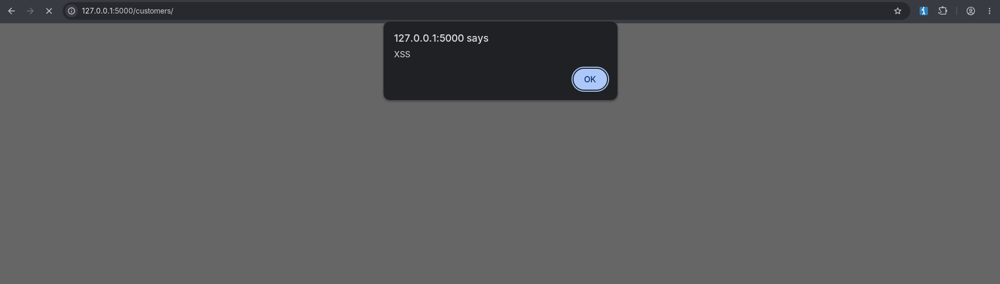
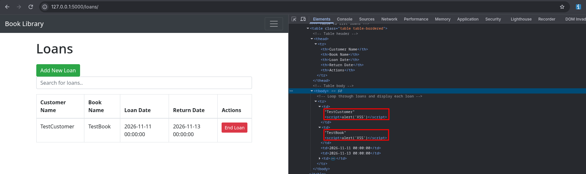
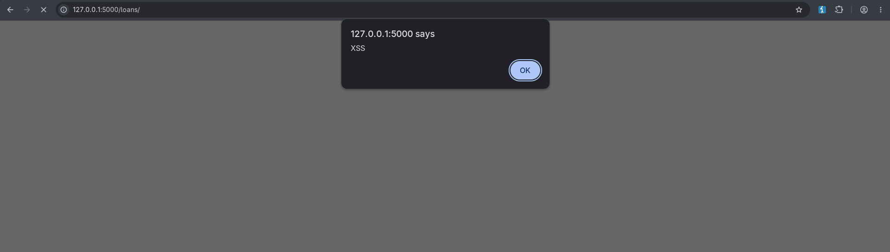

# Raport podatności Stored XSS

| | |
|---|---|
| **Aplikacja** | Flask Book Library |
| **Typ podatności** | Stored Cross-Site Scripting |
| **Dotknięte widoki** | `GET /books/`, `GET /customers/`, `GET /loans/` |
| **Status** | Poprawione (walidacja danych w backendzie) |

## Opis

Aplikacja zapisuje w bazie danych tekst podany przez użytkownika (nazwy książek, autorów, klientów, miast) bez żadnej walidacji, a następnie wyświetla go w tabelach na stronach list. W szablonach Jinja2 do tych pól dodano filtr `| safe`. Wyłącza on automatyczne escapowanie znaków HTML. Dlatego zapisany w bazie kod HTML/JavaScript trafia do strony w surowej postaci i przeglądarka wykonuje go u każdego użytkownika, który otworzy dany widok.

## Odtworzenie (PoC)

Przykładowy payload: `<script>alert('XSS')</script>`

1. Uruchomić aplikację i przejść na `http://127.0.0.1:5000/`.
2. **Books:** kliknąć „Add New Book” i w polu *Book Name* wpisać payload, zapisać.
3. **Customers:** kliknąć „Add New Customer” i w polu *Name* wpisać payload, zapisać.
4. **Loans:** utworzyć wypożyczenie, wybierając klienta/książkę z payloadem w nazwie.
5. Otworzyć widoki `/books/`, `/customers/`, `/loans/`. Przy każdym wejściu wyświetla się okno `alert` z napisem „XSS”.


### Dowody

**Endpoint 1 – `/books/`**

```
Request:

POST /books/1/edit HTTP/1.1
Host: 127.0.0.1:5000
[...]

{
  "name": "TestBook<script>alert('XSS')</script>",
  "author": "TestAuthor<script>alert('XSS')</script>",
  "year_published": "1967",
  "book_type": "10days"
}


Response:

HTTP/1.1 200 OK
Date: Tue, 10 Nov 2026 17:18:43 GMT
[...]

{"message":"Book updated successfully"}
```





**Endpoint 2 – `/customers/`**

```
Request:

POST /customers/1/edit HTTP/1.1
Host: 127.0.0.1:5000
[...]

name=TestCustomer%3Cscript%3Ealert('XSS')%3C%2Fscript%3E&city=TestCity%3Cscript%3Ealert('XSS')%3C%2Fscript%3E&age=67


Response:

HTTP/1.1 302 FOUND
Date: Tue, 10 Nov 2026 17:20:17 GMT

<html lang=en>
<title>Redirecting...</title>
<h1>Redirecting...</h1>
<p>You should be redirected automatically to the target URL: <a href="/customers/">/customers/</a>. If not, click the link.
```





**Endpoint 3 – `/loans/`**

```
Request:

POST /loans/create HTTP/1.1
Host: 127.0.0.1:5000
[...]

csrf_token=ImRhYTY5YWZiOWE2OTNkMDE5ZmY4OWEyMjZiMjViNmQ5NzFiMzY2MmYi.avNSoQ.cTRNOB2W6GQIVdz7Jqtd17T9oL0&customer_name=TestCustomer%3Cscript%3Ealert%28%27XSS%27%29%3C%2Fscript%3E&book_name=TestBook%3Cscript%3Ealert%28%27XSS%27%29%3C%2Fscript%3E&loan_date=2026-11-11&return_date=2026-11-13


Response:

HTTP/1.1 302 FOUND
Date: Tue, 10 Nov 2026 17:21:49 GMT
[...]

<!doctype html>
<html lang=en>
<title>Redirecting...</title>
<h1>Redirecting...</h1>
<p>You should be redirected automatically to the target URL: <a href="/loans/">/loans/</a>. If not, click the link.
```





## Poprawka

Weryfikację danych przeniesiono do backendu, na poziom **tworzenia i modyfikacji obiektów modeli**. Złośliwa wartość jest odrzucana, zanim trafi do bazy danych, więc nie ma czego wyświetlić.

**`project/validators.py`** (nowy plik) – funkcja `validate_text()`:

- przyjmuje tylko tekst (`str`) i usuwa skrajne białe znaki;
- odrzuca puste wartości (z wyjątkiem pól opcjonalnych) i wartości dłuższe niż 64 znaki, zgodnie z `db.String(64)`;
- stosuje **białą listę znaków**: litery (w tym polskie znaki), cyfry, spację oraz `. , ' - : ; ! ? ( ) &`. Znaki potrzebne do wstrzyknięcia HTML/JS (`< > " ` / \ = { }`) są odrzucane.

Funkcja `validate_book_type()` dopuszcza tylko wartości `2days`, `5days`, `10days`.

**Modele** – walidatory podpięto przez `sqlalchemy.orm.validates`. SQLAlchemy wywołuje je przy każdym przypisaniu atrybutu, czyli zarówno w konstruktorze, jak i przy edycji istniejącego obiektu:

| Model | Walidowane pola |
|---|---|
| `Book` | `name`, `author`, `book_type` |
| `Customer` | `name`, `city` |
| `Loan` | `customer_name`, `book_name`, `original_author`, `original_book_type` |

**Widoki** – błąd walidacji (`ValueError`) jest przechwytywany w `create`/`edit` dla książek i klientów oraz w `create` dla wypożyczeń. Endpoint robi `rollback` i zwraca **HTTP 400** z komunikatem, np.:

```
POST /books/create {"name": "<script>alert(\"XSS\")</script>", ...}
-> 400 {"error": "Invalid book data: name: pole zawiera niedozwolone znaki"}
```

Ponieważ walidacja jest w modelu, a nie w konkretnym widoku, chroni każdą ścieżkę zapisu, również przyszłe endpointy.

## Testy

Testy jednostkowe znajdują się w `tests/test_xss.py` (24 testy, `unittest`, z subtestami dla 7 różnych payloadów XSS). Sprawdzają trzy poziomy:

1. **Funkcja `validate_text()`** – odrzuca payloady XSS i pojedyncze znaki specjalne HTML, puste wartości, zbyt długie wartości oraz wartości niebędące tekstem. Akceptuje poprawne dane, np. „Łódź”, „O'Brien”, „Pride & Prejudice”.
2. **Modele** – utworzenie `Book`, `Customer` i `Loan` z payloadem w dowolnym polu tekstowym rzuca `ValueError`. Zmiana pola istniejącego obiektu również. Poprawne obiekty zapisują się normalnie.
3. **Endpointy** – `POST /books/create`, `/books/<id>/edit`, `/customers/create`, `/customers/<id>/edit` i `/loans/create` z payloadem zwracają **400**, a baza pozostaje bez zmian (np. książka nie zostaje „wypożyczona”). Poprawne dane dają 302. Widoki list nie zawierają `<script>`.

Uruchomienie testów, a po ich pomyślnym przejściu aplikacji (`entrypoint.sh`):

```bash
docker build -t flask-library .
docker run --rm -p 5000:5000 flask-library
```

Jeśli którykolwiek test się nie powiedzie, kontener kończy działanie z kodem 1, a aplikacja nie zostaje uruchomiona. Gdy wszystkie przejdą, aplikacja jest dostępna pod `http://127.0.0.1:5000/`.

Same testy (bez uruchamiania aplikacji):

```bash
docker build -f Dockerfile.test -t flask-library-tests .
docker run --rm flask-library-tests
```


Wyniki testów:

```
>>> Running unit tests...
test_create_with_xss_in_name_or_author_raises (tests.test_xss.BookModelTest) ... ok
test_invalid_book_type_raises (tests.test_xss.BookModelTest) ... ok
test_modify_existing_book_with_xss_raises (tests.test_xss.BookModelTest) ... ok
test_valid_book_is_saved (tests.test_xss.BookModelTest) ... ok
test_create_with_xss_in_name_or_city_raises (tests.test_xss.CustomerModelTest) ... ok
test_modify_existing_customer_with_xss_raises (tests.test_xss.CustomerModelTest) ... ok
test_valid_customer_is_saved (tests.test_xss.CustomerModelTest) ... ok
test_books_create_accepts_valid (tests.test_xss.EndpointsTest) ... ok
test_books_create_rejects_xss (tests.test_xss.EndpointsTest) ... ok
test_books_edit_rejects_xss (tests.test_xss.EndpointsTest) ... /app/project/books/views.py:59: LegacyAPIWarning: The Query.get() method is considered legacy as of the 1.x series of SQLAlchemy and becomes a legacy construct in 2.0. The method is now available as Session.get() (deprecated since: 2.0) (Background on SQLAlchemy 2.0 at: https://sqlalche.me/e/b8d9) book = Book.query.get(book_id) ok
test_customers_create_accepts_valid (tests.test_xss.EndpointsTest) ... ok
test_customers_create_rejects_xss (tests.test_xss.EndpointsTest) ... ok
test_customers_edit_rejects_xss (tests.test_xss.EndpointsTest) ... /app/project/customers/views.py:81: LegacyAPIWarning: The Query.get() method is considered legacy as of the 1.x series of SQLAlchemy and becomes a legacy construct in 2.0. The method is now available as Session.get() (deprecated since: 2.0) (Background on SQLAlchemy 2.0 at: https://sqlalche.me/e/b8d9) customer = Customer.query.get(customer_id) ok
test_loans_create_accepts_valid (tests.test_xss.EndpointsTest) ... ok
test_loans_create_rejects_xss (tests.test_xss.EndpointsTest) ... ok
test_create_with_xss_raises (tests.test_xss.LoanModelTest) ... ok
test_invalid_book_type_raises (tests.test_xss.LoanModelTest) ... ok
test_valid_loan_is_saved (tests.test_xss.LoanModelTest) ... ok
test_accepts_valid_values (tests.test_xss.ValidateTextTest) ... ok
test_optional_field_allows_empty (tests.test_xss.ValidateTextTest) ... ok
test_rejects_empty_too_long_and_non_string (tests.test_xss.ValidateTextTest) ... ok
test_rejects_html_special_chars (tests.test_xss.ValidateTextTest) ... ok
test_rejects_xss_payloads (tests.test_xss.ValidateTextTest) ... ok
test_strips_whitespace (tests.test_xss.ValidateTextTest) ... ok

----------------------------------------------------------------------
Ran 24 tests in 0.105s
```
