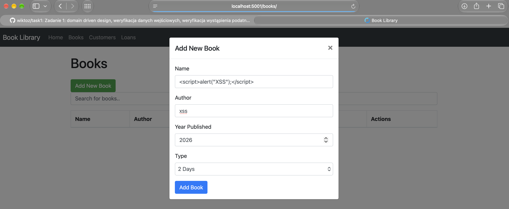
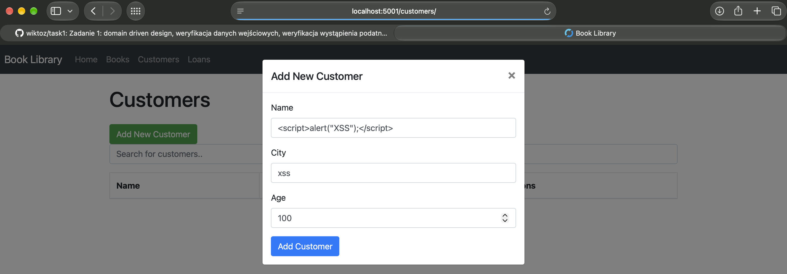
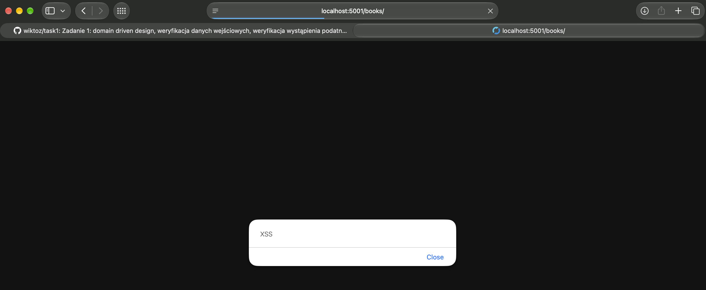

# Zadanie 2 - XSS

## 1. Opis zadania

Celem zadania jest znalezienie podatności typu XSS występującej w aplikacji Flask.

## 2. Odnalezione podatności

W formularzu dodania książki:

oraz w formularzu dodania klienta:

oraz w formularzu dodania wypożyczenia występuje podatność XSS, gdzie możemy wstrzyknąć kod JavaScript.

Kod nie jest poprawnie sanityzowany przed zapisem do bazy danych, a gdy inny użytkownik pobiera książkę lub klienta kod wykonuje się w jego przeglądarce:

Jest to prosty przykład wywołania alertu, jednak atakujący może wstrzyknąć dowolny kod, który umożliwi mu np. wykradnięcie cookies (jeśli nie są http only).

