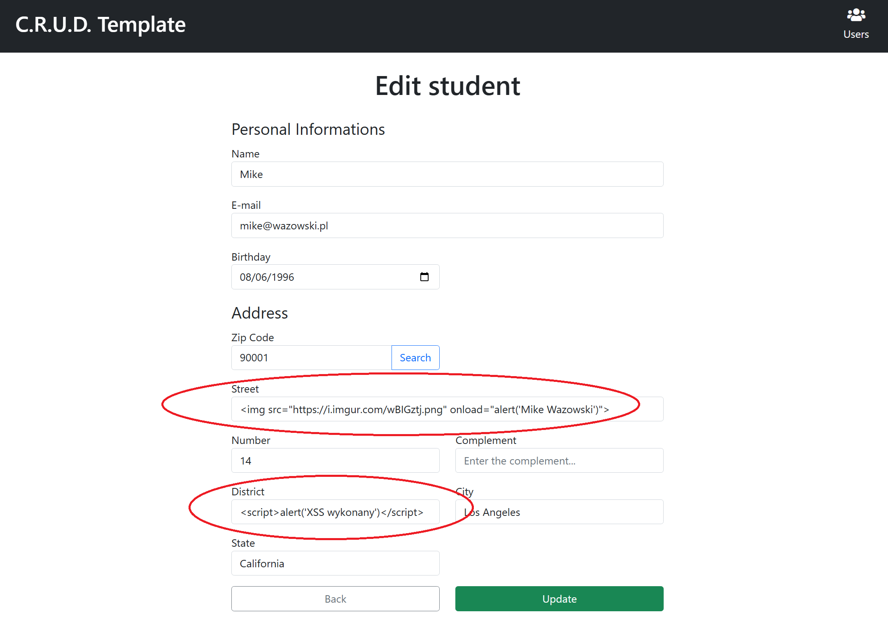
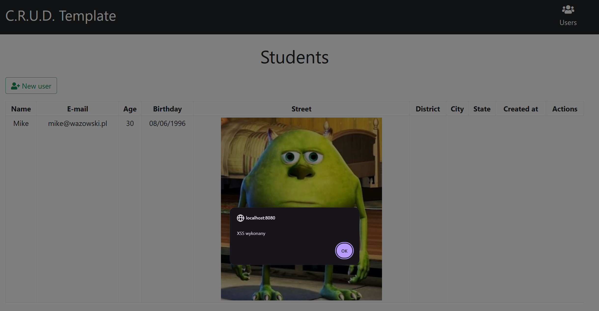
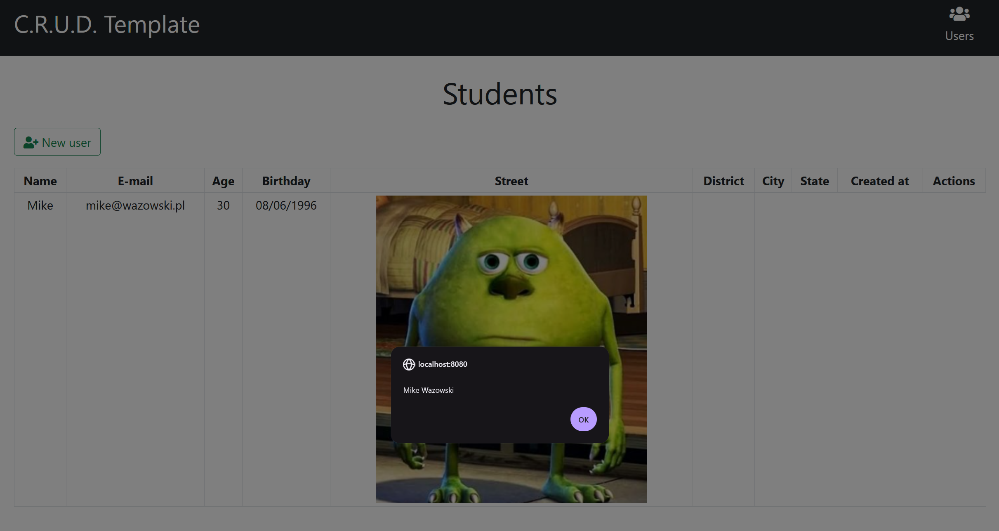

# Podatność XSS

Cross-Site Scripting (XSS) to podatność polegająca na wykonaniu kodu JavaScript w przeglądarce ofiary w miejscu, w którym nie powinno to być możliwe. W tej aplikacji mamy do czynienia z odmianą **Stored XSS** - złośliwy kod zapisuje się w bazie danych i wykonuje się w momencie wyświetlania listy studentów.

## Miejsce wystąpienia

Podatność znajduje się w szablonie `Java/spring-thymeleaf-crud-example/src/main/resources/templates/students.html` (linie 33-41):

```html
<tr class="text-center" th:each="student: ${students}">
    <td th:utext="${student.name}">Name</td>
    <td th:utext="${student.email}">Email</td>
    <td th:utext="${student.age}">Age</td>
    <td th:utext="${#temporals.format(student.birthday, 'dd/MM/yyyy')}">Birthday</td>
    <td th:utext="${student.street}">Street</td>
    <td th:utext="${student.district}">District</td>
    <td th:utext="${student.city}">City</td>
    <td th:utext="${student.state}">State</td>
    <td th:utext="${#temporals.format(student.createdAt, 'dd/MM/yyyy HH:mm:ss')}">CreatedAt</td>
    <td>
    ...
</tr>
```

Podatność wynika z wrzucania danych od użytkownika **prosto do szablonu HTML**. Wartości pól pochodzą bezpośrednio z danych wprowadzonych w formularzu dodawania/edycji studenta, zapisują się do bazy, a następnie są renderowane na stronie. Zamiast potraktować je jako zwykły tekst, przeglądarka interpretuje je jako kod HTML i wykonuje zawarty w nich kod JavaScript.

## Użyte payloady

Do wykonania kodu JavaScript użyto następujących payloadów:

```html

```

```html
<script>alert('XSS wykonany')</script>
```

Pierwszy payload ładuje obrazek i po jego wczytaniu wywołuje `alert` przez atrybut `onload`. Drugi to klasyczny znacznik `<script>` wykonujący kod bezpośrednio.

## Przykład odtworzenia

Podatność można odtworzyć dodając nowego studenta lub aktualizując wcześniej dodanego - wystarczy w jednym z pól formularza podać odpowiedni payload i zapisać. Po przejściu na listę studentów kod się wykona.



## Skutki

Wykonanie wstrzykniętego kodu JavaScript w kontekście strony:





## Jak podatność została naprawiona

TODO
