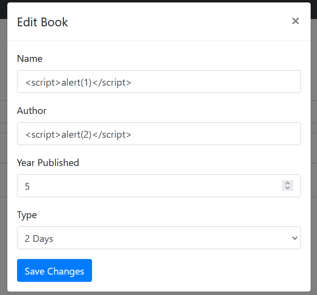
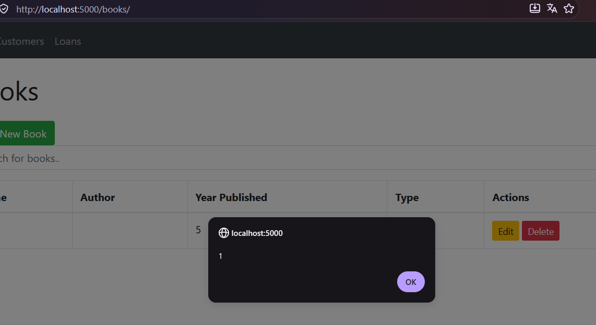
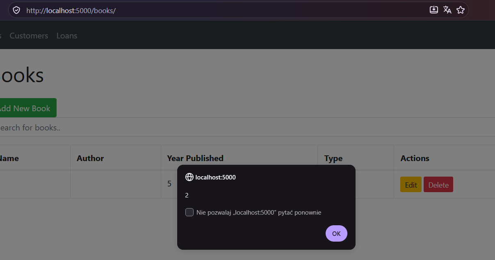
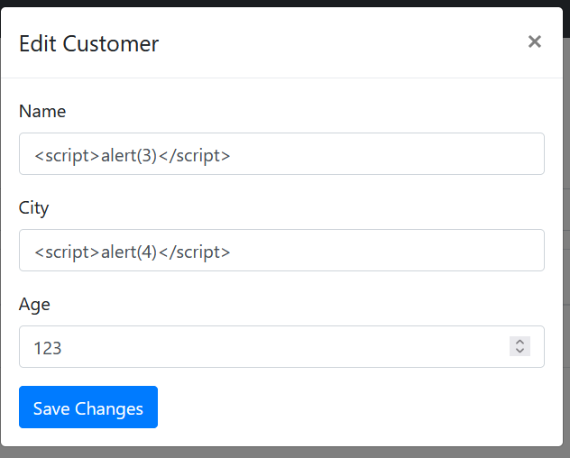
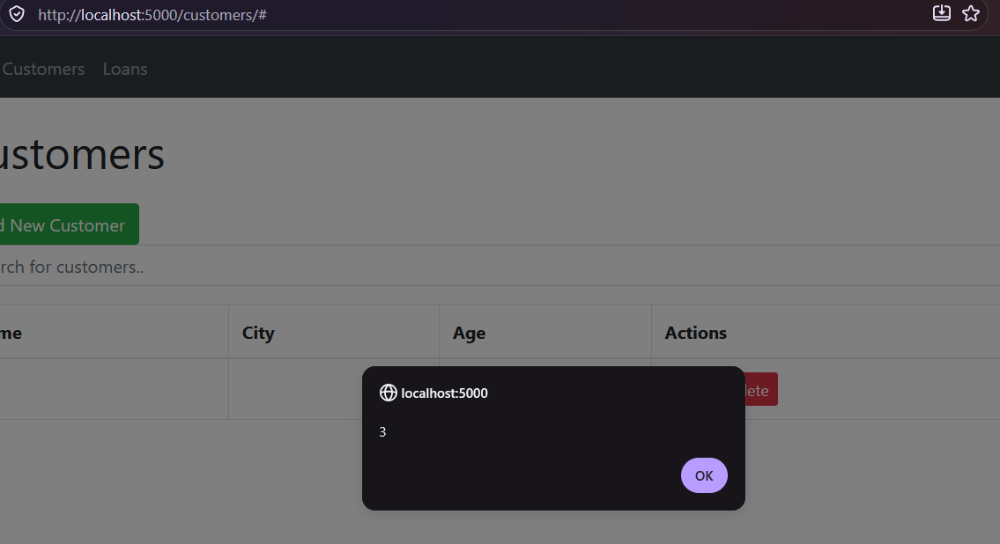
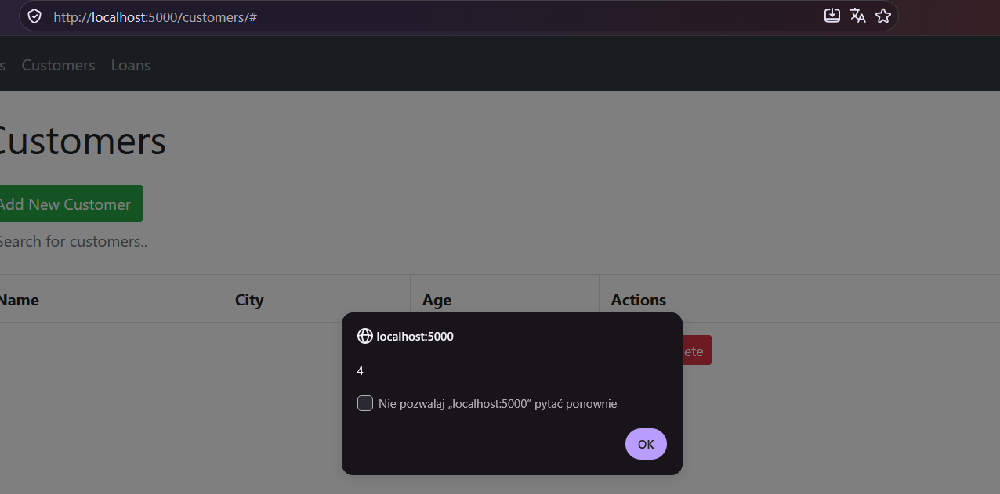
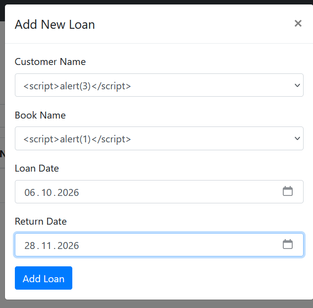
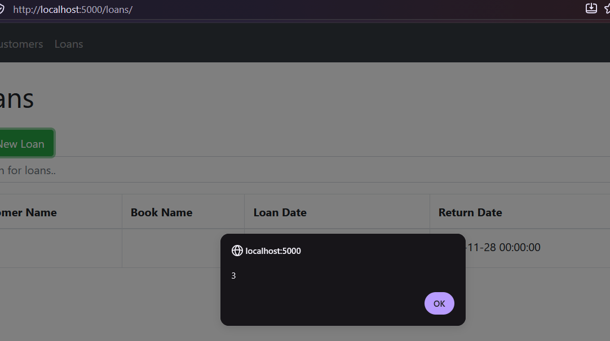
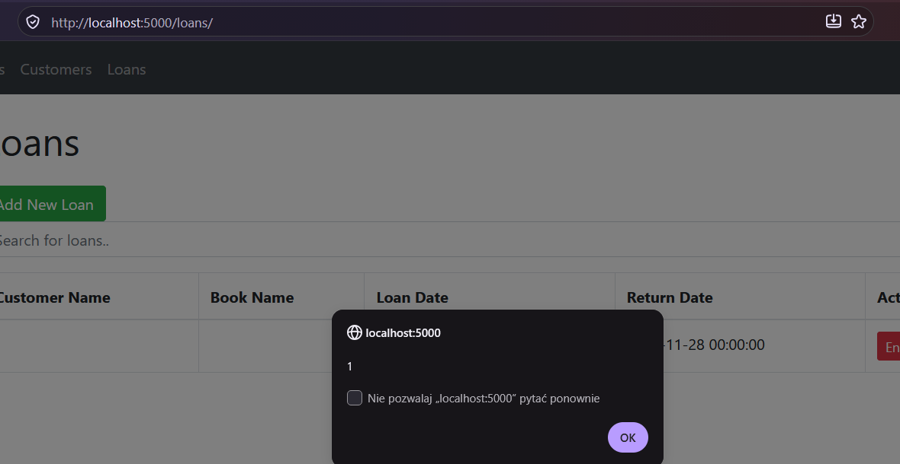

# Potwierdzenie podatności XSS

## Książki

Na stronie `http://localhost:5000/books/` można wprowadzić kod JavaScript w polach nazwy i autora książki:

Po zapisaniu danych i odświeżeniu strony pojawiają się okna z komunikatami `1` i `2`:

## Klienci

Na stronie `http://localhost:5000/customers/` można wprowadzić kod JavaScript w polach imienia i miasta:

Po zapisaniu danych i odświeżeniu strony pojawiają się okna z komunikatami `3` i `4`:

## Wypożyczenia

Na stronie `http://localhost:5000/loans/` można wybrać klienta i książkę, których nazwy zawierają wcześniej zapisany kod JavaScript:

Po zapisaniu wypożyczenia i odświeżeniu strony pojawiają się okna z komunikatami `3` i `1`:

Kod pozostaje zapisany w bazie i wykonuje się przy ponownym wyświetleniu danych. Jest to podatność persistent XSS. Powyższe screenshoty przedstawiają działanie aplikacji przed wprowadzeniem poprawki.
