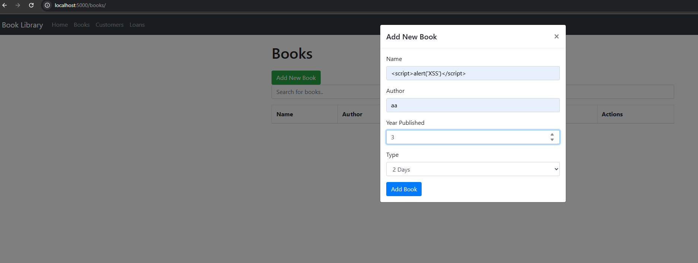
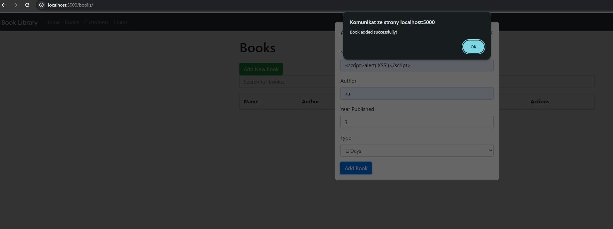
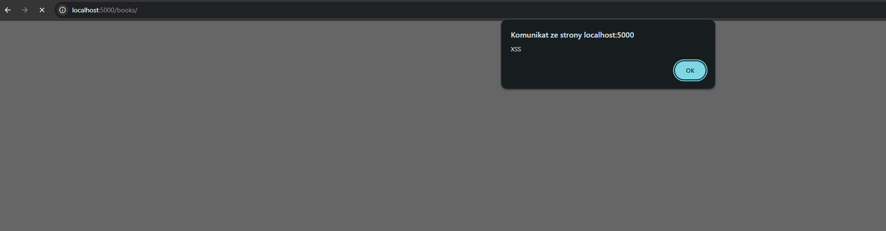
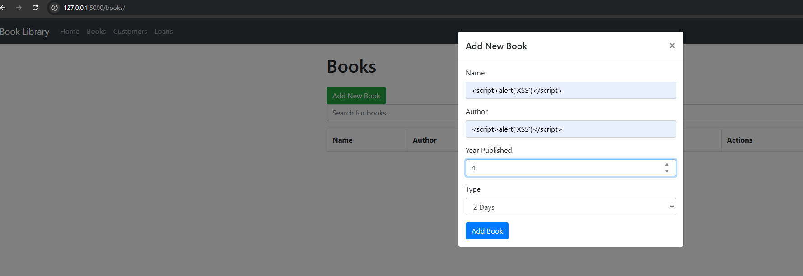
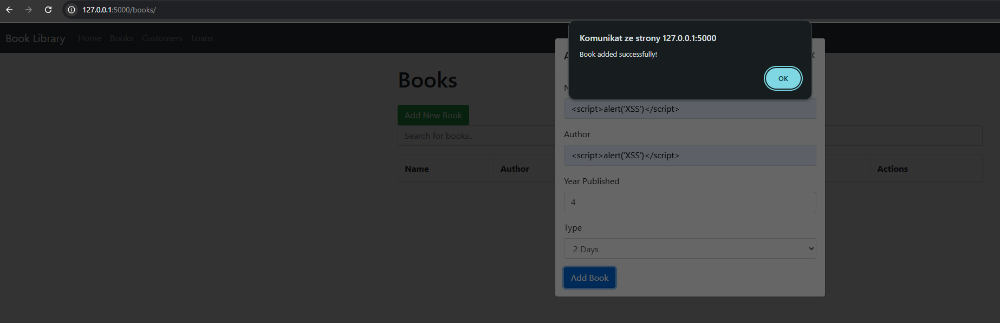
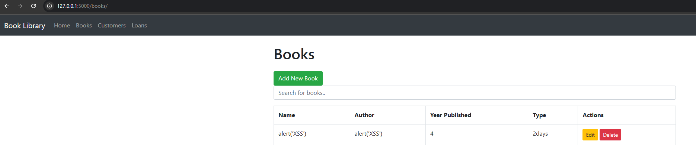

# xss.md

## Poszukiwanie podatności

Zdecydowałem się na analizę aplikacji Flask_Book_Library napisanej w pythonie. Po uruchomieniu aplikacji przystąpiłem do poszukiwania wskazanej podatności Cross-site Scripting (XSS). W pierwszym kroku spróbowałem wstrzyknięcia przykładowego, nienwazyjnego kodu JS w endpoincie /books/ w formularzu dodawanie nowej książki (pole name).

Wykorzystany kod JS:

 `<script>alert('XSS')</script>` 



Jak możemy zauważyć poniżej, obiekt został poprawnie dodany.



Po odświeżeniu strony, przy każdym wejściu do endpointu /books/ wywoływany jest kod JS, co świadczy o występowaniu podatności **Stored XSS**.  Analogiczna podatność występowała też w pozostałych polach formularza tworzenia nowej ksiązki oraz innych endpointach (praktycznie wszędzie).



## Weryfikacja w kodzie

Po potwierdzeniu występowania podatności przeszedłem do analizy kodu aplikacji. Kod odpowiedzialny za operacje wykonywane w endpoince /books/ znajduje się w pliku /books/views.py. 

W kodzie funkcji `create_book`, nowe książki definiowane były w następujący sposób (dane nie były w żaden sposób walidowane oraz sprawdzane pod kątem wstrzykiwania szkodliwego kodu). 

```python
@books.route('/create', methods=['POST', 'GET'])
def create_book():
    data = request.get_json()

    new_book = Book(name=data['name'], author=data['author'], year_published=data['year_published'],
                    book_type=data['book_type'])

    try:
        # Add the new book to the session and commit to save to the database
        db.session.add(new_book)
        db.session.commit()
        print('Book added successfully')
        return redirect(url_for('books.list_books'))
    except Exception as e:
        # Handle any exceptions, such as database errors
        db.session.rollback()
        print('Error creating book')
        return jsonify({'error': f'Error creating book: {str(e)}'}), 500
```

Analogiczny problem występował w kodzie funkcjii `edit_book`. Weryfikacja kodu potwierdziła również, że pozostałe pola formularza w enpdpoincie /books są podatne (brak walidacji danych wejściowych) oraz to, że inne endpointy również są podatne.

## Wprowadzone poprawki

W celu weryfikacji inputu na poziomie backendu zdecydowałem się na wykorzystanie biblioteki `bleach`.  Biblioteka `bleach` służy do oczyszczania danych wejściowych z elementów HTML, takich jak znaczniki `<script>`, `` czy `<iframe>`, które mogą zostać wykorzystane do przeprowadzenia ataków XSS. W zastosowanej konfiguracji `bleach.clean()` usuwa wszystkie znaczniki HTML, pozostawiając ich tekstową zawartość.

W funkcji `edit_book` podczas tworzenia nowej książki, na jej atrybutach wywołana została funkcja `bleach.clean()`. 

```python
  new_book = Book(
        name=bleach.clean(data['name'], tags=[], attributes={}, strip=True),
        author=bleach.clean(data['author'], tags=[], attributes={}, strip=True),
        year_published=data['year_published'],
        book_type=bleach.clean(data['book_type'], tags=[], attributes={}, strip=True)
    )
```

Analogiczna zmiana została wykonana w funkcji `edit_book` oraz w pozostałych endpointach.

## Weryfikacja skuteczności wprowadzonych poprawek

Po wprowadzeniu poprawek powtórzono test wykonany na początku ćwiczenia.







Jak możemy zauważyć, tym razem kod JS się nie wykonał - funkcja `bleach.clean()` usunęła tagi `<script>` oraz `<\script>` , a co za tym idzie uniemożliwiła wykonanie kodu.

## Uwaga

Poprawki zostały również wprowadzone w pozostałych endpointach (potwierdzona została mitygacja podatności). Ze względu na czytelność raportu oraz identyczny typ podatności (a co za tym idzie analogiczne poprawki w kodzie) w niniejszym raporcie umieszczono opis jedynie poprawek w endpoincie \books.