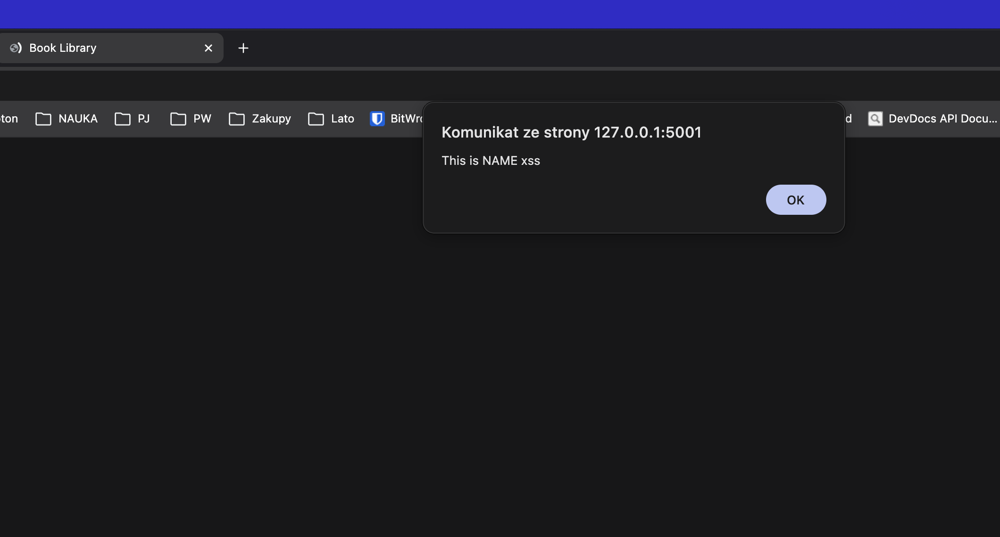
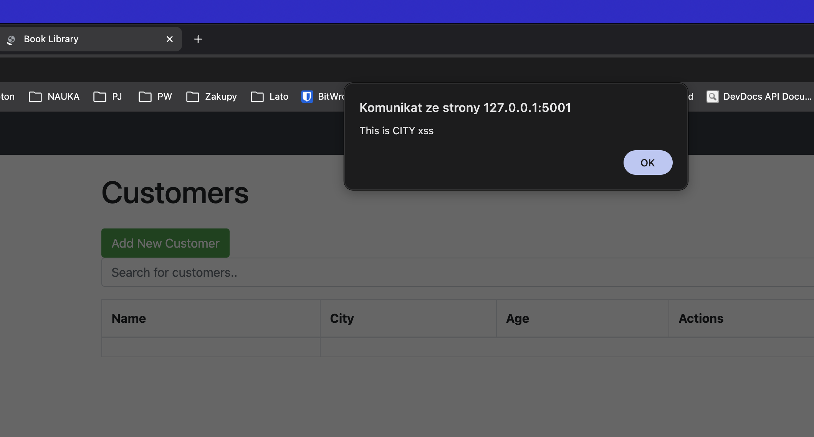
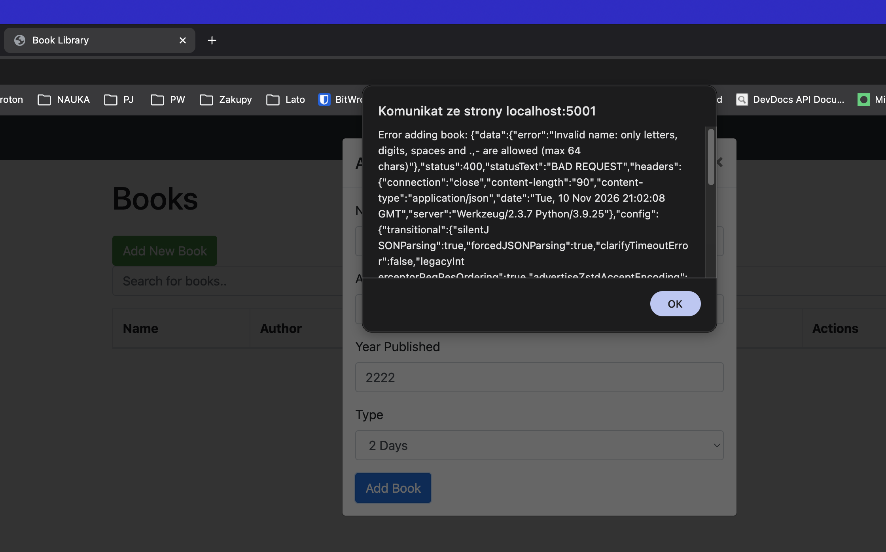

# Wystąpienie podatności w formularzach

Podatność XSS występuje w następujących plikach:

```
Python/Flask_Book_Library/project/templates/books.html
Python/Flask_Book_Library/project/templates/customers.html
Python/Flask_Book_Library/project/templates/loans.html
```

Ponizszy wycinek kodu odpowiada za podatność pola *name* w formularzu customers
``` <td>{{ customer.name | safe }}</td>```

Ponizsze screenshoty przedstawiają wykorzystanie podatności w tym samym formularzu przy uzyciu

``` <script>alert("This is .... xss")</script> ```




# Bug fix

1. Mozna usunąć keyword safe (ale to nie waliduje po stronie backendu)
2. Walidować input po stronie backendu np. poprzez regex podczas tworzenia obiektu.
3. Moznaby tez walidowac podczas edycji obiektu, ale z tego co rozumiem nie jest to clue tego zadania




# Test

```pytest tests/test_validators.py -v```